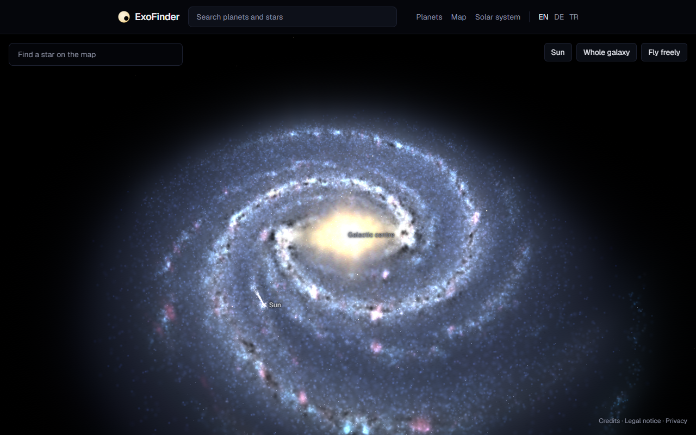
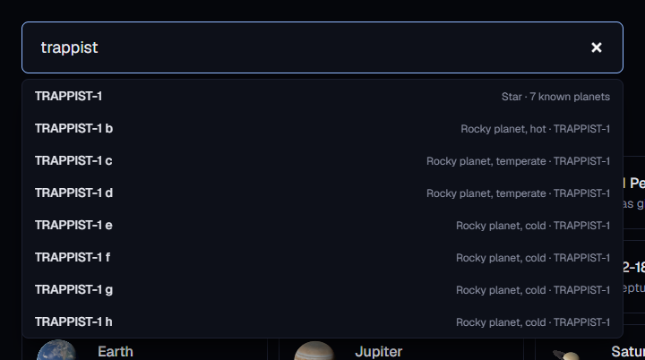
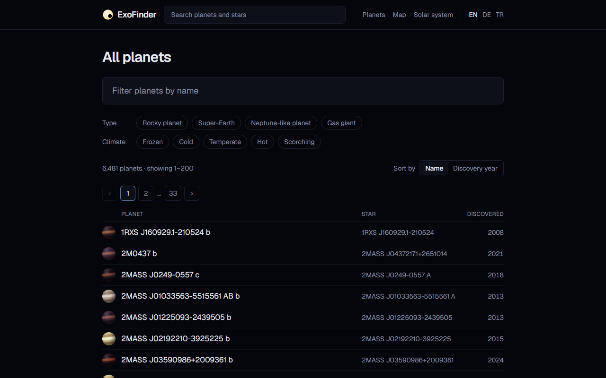
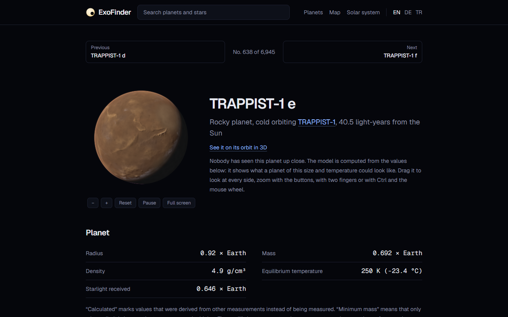
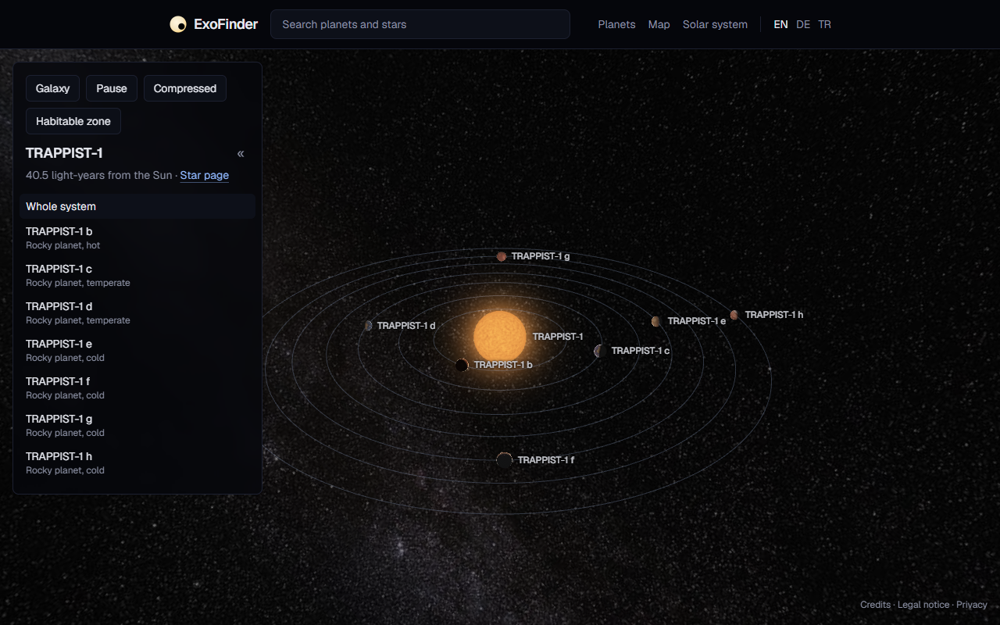
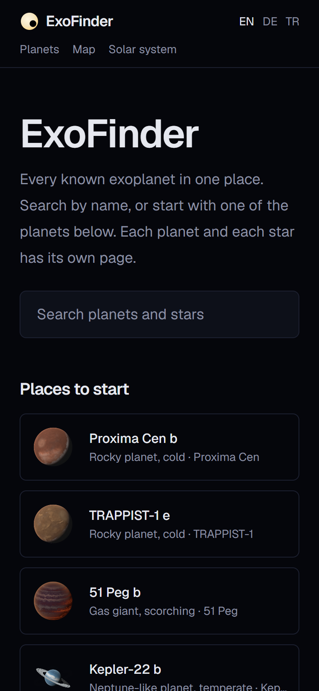
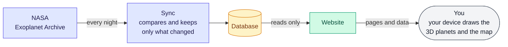
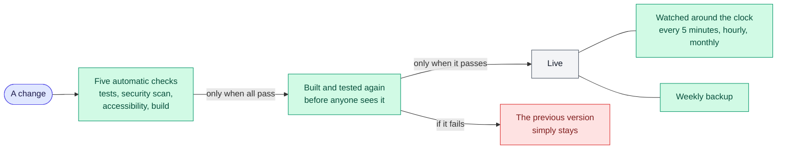

<p align="center">
  
</p>

<h1 align="center">ExoFinder</h1>

<p align="center">
  <strong>Every known exoplanet in one place.</strong><br>
  Search them, look at each one in 3D, and fly through the Milky Way to visit them.
</p>

<p align="center">
  <a href="https://www.exofinder.space"><strong>Open ExoFinder →</strong></a>
  &nbsp;·&nbsp;
  <a href="docs/wiki/Home.md">User guide</a>
  &nbsp;·&nbsp;
  <a href="docs/ARCHITECTURE.md">How it works</a>
</p>

<p align="center">
  <a href="https://www.exofinder.space"></a>
  <a href="https://github.com/tomdevtech/ExoFinder/actions/workflows/ci.yml"></a>
  <a href="https://github.com/tomdevtech/ExoFinder/actions/workflows/codeql.yml"></a>
  <a href="https://exoplanetarchive.ipac.caltech.edu/"></a>
  <a href="LICENSE"></a>
</p>

<p align="center">
  
</p>

| 🪐 about 6,500 planets | ⭐ about 4,900 stars | 🗺️ 4,835 systems on the map | 🔄 updated from NASA every night |
| :---: | :---: | :---: | :---: |

## What you can do

<table>
  <tr>
    <td width="50%" valign="top">
      <h3>🔍 Find any planet</h3>
      Type a name and suggestions appear at once. Spelling does not matter: <code>kepler 22b</code> finds <em>Kepler-22 b</em>, and typos still lead somewhere.
      <br><br>
      
    </td>
    <td width="50%" valign="top">
      <h3>📋 Browse all of them</h3>
      Every known planet in one long list, sorted by name or by the year it was found, with a field that narrows the list while you type.
      <br><br>
      
    </td>
  </tr>
  <tr>
    <td width="50%" valign="top">
      <h3>🌍 Look at each planet in 3D</h3>
      Every planet has its own page: size, mass, temperature, orbit, discovery and what has changed over time. A 3D model shows what it could look like, turned by hand and zoomed into.
      <br><br>
      
    </td>
    <td width="50%" valign="top">
      <h3>🚀 Fly through the Milky Way</h3>
      Every star with known planets sits at its real position. Fly to one, enter its system and watch its planets move on their orbits.
      <br><br>
      
    </td>
  </tr>
</table>

And our own solar system is there too, with real surface maps: Earth with its clouds and city lights, Saturn with its rings.

## Easy to use

<table>
  <tr>
    <td width="66%" valign="top">

- **Nothing to install, no account.** Open the address and start.
- **In three languages.** English, German and Turkish; the site starts in the language of your browser.
- **Works on the phone.** Every page fits a small screen; the map follows touch and pinch.
- **Works with the keyboard.** Search, lists and the map can be used without a mouse.
- **Accessible.** Every page is checked automatically against the WCAG 2.1 rules for accessibility.
- **Calm when you want it.** If your device asks for reduced motion, planets and orbits stand still.
- **Works on older devices too.** Without 3D graphics every planet still has a picture.
- **Links keep working.** When NASA renames a planet, its old address leads to the new page.
- **Private.** No cookies, no tracking, no advertising, nothing loaded from other companies.

New here? The [user guide](docs/wiki/Home.md) walks through every page with pictures.

</td>
    <td width="34%" valign="top" align="center">
      
    </td>
  </tr>
</table>

## What is real and what is computed

Almost no exoplanet has ever been photographed. ExoFinder shows the measured values as they are, and says clearly where a picture is computed from them.

| ✅ Measured | 🎨 Computed or modelled |
| --- | --- |
| The values of every planet and star, from NASA; each one says whether it was measured or calculated | What an exoplanet looks like: computed from its size, temperature, density, orbit and the colour of its star. The lie of its land, its rings, moons and polar lights are invention, the same for a planet every time |
| Where each star is and how far away | The Milky Way seen from outside: an artist's impression drawn from surveys, because nobody has ever seen it from there |
| The colour of each star, from its temperature | Sizes and distances inside a system: squeezed, or the planets would be invisible |
| The sky around the Sun: a photograph | Where on its orbit a planet is right now |
| The surfaces of the planets of our solar system | |

## How it works



1. **Every night** a job fetches the whole catalogue from NASA, compares it with the database and writes only the differences. Changed values are kept as history; renamed planets keep their old names as aliases.
2. **The website** reads from the database and never writes to it. Pages arrive in two steps: the frame at once, the data a moment later.
3. **Your device** draws the 3D planets and the map. Nothing about you is sent back.

**Built with**

<p>
  
  <br>
  <sub>and WebGL 2 shaders · Drizzle ORM · Neon · Playwright · axe-core · CodeQL · Dependabot</sub>
</p>

The planets are drawn by our own shaders, one description per planet for the still picture, the turning image, the 3D model and the map. [docs/ARCHITECTURE.md](docs/ARCHITECTURE.md) explains every part in detail.

## Reliable and safe



- **Tested on every change**: unit, database and browser tests, including security and accessibility.
- **Secure connection**: rated A+ by SSL Labs; strict security headers; the website may only read the database.
- **Watched**: an outside monitor every 5 minutes, a health check every hour, a check of the connection every month.

Details: [tests and checks](docs/TESTING.md) · [security](docs/SECURITY.md) · [report a vulnerability](SECURITY.md)

## For developers

<details>
<summary><strong>Run it on your computer</strong></summary>

You need Node.js 24 and Docker.

```bash
npm install
cp .env.example .env.local
npm run db:up        # start PostgreSQL in Docker
npm run db:migrate   # create the tables
npm run seed:sol     # store the solar system
npm run sync         # fetch the catalogue from NASA, takes a few seconds
npm run dev          # http://localhost:3000
```

</details>

<details>
<summary><strong>All commands</strong></summary>

| Command | Purpose |
| --- | --- |
| `npm run dev` | Development server |
| `npm test` | Unit tests, no database needed |
| `npm run test:db` | Tests against PostgreSQL; uses its own database `exofinder_test` |
| `npm run test:e2e` | Browser tests: user flows, security, accessibility; uses its own database `exofinder_e2e`. Once before: `npm run e2e:install` |
| `npm run test:all` | All tests |
| `npm run test:smoke` | Smoke test against a running deployment: `SMOKE_BASE_URL=https://… npm run test:smoke` |
| `npm run typecheck`, `npm run lint`, `npm run build` | Type check, ESLint, production build (works without a database) |
| `npm run db:generate` | Create a migration from a schema change |
| `npm run sync -- --force` | Sync even when the answer from NASA looks implausible |
| `npm run db:readonly-role` | Create the read-only database role, or give it a new password |
| `npm run db:migrate-on-deploy` | Migrations during a Vercel production build; does nothing elsewhere |
| `npm run deploy:rollback` | Put the previous production deployment back live, by hand |
| `npm run textures` | Download and scale the surface maps and the sky panorama again |

</details>

<details>
<summary><strong>Put your own copy online</strong></summary>

[docs/DEPLOYMENT.md](docs/DEPLOYMENT.md) walks through it step by step: Vercel, the Neon database, the variables, the checks before a deployment goes live, the domain and the legal pages.

The legal notice and the privacy policy must name whoever runs the copy. Set `LEGAL_NAME`, `LEGAL_STREET`, `LEGAL_CITY` and `LEGAL_EMAIL` before building ([.env.example](.env.example) lists the optional ones too); until then both pages say that they are not complete. The privacy policy describes what this code does; what your host adds is yours to check. The two pages are a careful draft, not legal advice.

</details>

<details>
<summary><strong>Documentation</strong></summary>

| Document | Covers |
| --- | --- |
| [docs/ARCHITECTURE.md](docs/ARCHITECTURE.md) | where everything runs, the data flows, the database, the sync, the search, the images, the map, the code layout |
| [docs/DEPLOYMENT.md](docs/DEPLOYMENT.md) | hosting on Vercel and Neon, setting everything up step by step, operations |
| [docs/TESTING.md](docs/TESTING.md) | every test and check, when it runs and what it catches |
| [docs/SECURITY.md](docs/SECURITY.md) | the protective measures layer by layer, what to do when something happens |
| [SECURITY.md](SECURITY.md) | how to report a vulnerability |
| [docs/wiki/](docs/wiki/Home.md) | the user guide |

</details>

<details>
<summary><strong>Left out on purpose</strong></summary>

- **Stars without known planets.** A complete star catalogue would multiply the amount of data and would first have to be matched with the NASA data.
- **The complete NASA record** with more than 700 columns. Each planet page links to the archive instead.

</details>

## Data sources

- **Exoplanets and their stars:** NASA Exoplanet Archive, table "Planetary Systems Composite Parameters". This research has made use of the NASA Exoplanet Archive, which is operated by the California Institute of Technology, under contract with the National Aeronautics and Space Administration under the Exoplanet Exploration Program.
- **Solar system:** NASA Planetary Fact Sheet.
- **Mass-radius relation:** Chen & Kipping (2017), "Probabilistic Forecasting of the Masses and Radii of Other Worlds".
- **Surface maps of the solar system:** [Solar System Scope](https://www.solarsystemscope.com/textures/), based on NASA imagery, [CC BY 4.0](https://creativecommons.org/licenses/by/4.0/).
- **Panorama of the sky:** [ESO/S. Brunier](https://www.eso.org/public/images/eso0932a/), [CC BY 4.0](https://creativecommons.org/licenses/by/4.0/). It also appears in the screenshots of the map above.
- **Picture of the galaxy:** "Artist's impression of the Milky Way", [NASA/JPL-Caltech/ESO/R. Hurt](https://www.eso.org/public/images/eso1339g/), [CC BY 4.0](https://creativecommons.org/licenses/by/4.0/). The map gives it a thickness, so the galaxy can be seen from every side.

The images were scaled down and compressed again. Details: [public/textures/README.md](public/textures/README.md).

## Licence

The code is under the [MIT](LICENSE) licence. The images in `public/textures/` come from third parties and keep their own licences, see above.
