# Architecture

How ExoFinder is built, how data moves through it and how the parts work together.

| Document | Covers |
| --- | --- |
| ARCHITECTURE.md (this one) | the parts, where they run, the code, the database, the data flows |
| [DEPLOYMENT.md](DEPLOYMENT.md) | hosting, setting everything up step by step, operations |
| [TESTING.md](TESTING.md) | every test and check, when it runs and what it catches |
| [SECURITY.md](SECURITY.md) | the protective measures layer by layer, what to do when something happens |
| [wiki/](wiki/) | the user guide |

## The system in one picture

ExoFinder has three parts: a Postgres database, a sync script and a Next.js app.

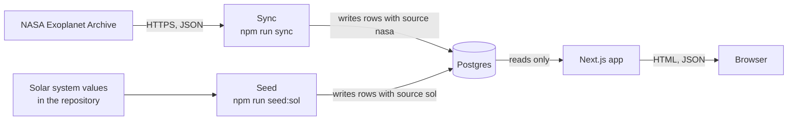

Two rules shape everything else:

1. **Data flows one way.** The sync and the seed write to the database. The app only reads, and in production it connects with a database role that may do nothing else. No request from a browser ever changes data.
2. **The database is the only connection between the two sides.** The sync does not know the app exists, and the app does not call NASA. If NASA is down, the site keeps working with the last synced data. If the sync breaks, the site still works.

| Part | Technology | Runs in production | Runs locally |
| --- | --- | --- | --- |
| Database | Postgres 17 with the `pg_trgm` extension | Neon, Frankfurt | Docker (`docker-compose.yml`) |
| Sync and seed | TypeScript scripts, started with `tsx` | GitHub Actions, daily | `npm run sync`, `npm run seed:sol` |
| App | Next.js 16 (App Router), React 19, Tailwind 4, on Node.js 24 | Vercel Functions in Frankfurt (`fra1`) | `npm run dev` |
| Database access | Drizzle ORM on top of `postgres.js` | inside the scripts and the app | the same |
| Planet images and 3D models | WebGL 2 with our own shaders | in the browser | the same |
| Map | three.js | in the browser | the same |
| Tests | Vitest, Playwright with axe-core | GitHub Actions on every change | `npm run test:all` |

## Where it runs

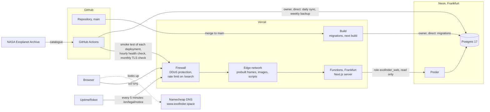

- **Namecheap** holds the domain `exofinder.space` and its DNS, which points at Vercel. Vercel redirects the domain without `www` to `https://www.exofinder.space`.
- **Vercel** serves the site. The firewall in front stops floods and limits search requests per IP. The edge network delivers what does not change between requests: the prebuilt page frames, images, scripts and the legal pages. Everything that needs the database runs in a function in Frankfurt, next to the database.
- **Neon** holds the database in Frankfurt. The site reaches it through Neon's pooler, because Vercel starts many functions at once. The database goes to sleep after a few minutes without queries and wakes on the next one.
- **GitHub** holds the code and runs everything that is not a page view: the checks of every change, the daily sync with NASA, the weekly backup, the smoke test of each deployment before it goes live, the hourly health check and the monthly TLS check.
- **UptimeRobot** asks the site every five minutes from the outside and e-mails when it does not answer. It asks the prebuilt legal notice, so the database can sleep in between.

### Who may do what

Each part gets only the access it needs.

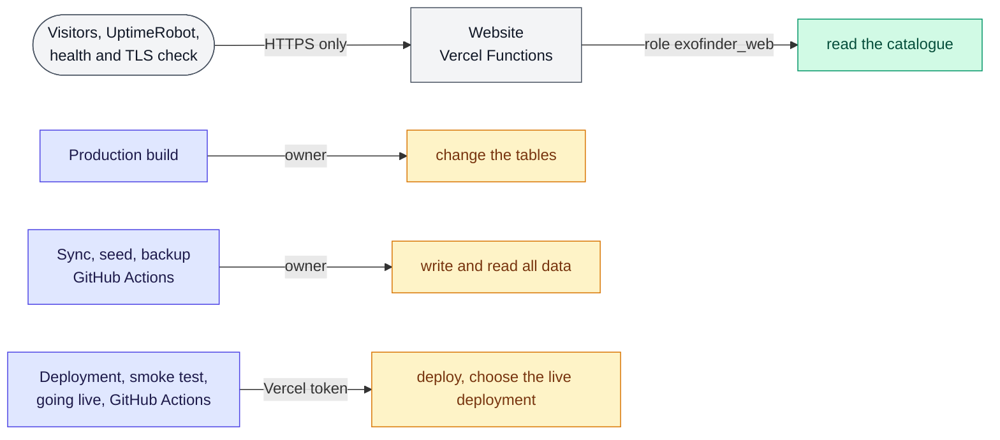

| Who | Connects with | May |
| --- | --- | --- |
| The website (Vercel Functions) | `DATABASE_URL_READONLY`: role `exofinder_web`, through the pooler | read, every query cancelled after 5 seconds |
| The production build | `DATABASE_URL_UNPOOLED`: the owner, direct | change the tables (migrations) |
| Sync, seed and backup (GitHub Actions) | secret `PRODUCTION_DATABASE_URL`: the owner, direct | write and read all data |
| The printed catalogue (GitHub Actions) | the same secret, in the step that builds it; the token of the run, in the step that publishes it | read all data; replace the file of the release `catalogue` |
| Deployment, smoke test and going live (GitHub Actions) | `VERCEL_TOKEN`, `VERCEL_AUTOMATION_BYPASS_SECRET` | deploy a checked commit, open protected deployments, choose which deployment is live |
| Health check, TLS check (GitHub Actions), UptimeRobot | nothing but HTTPS | read pages, like a visitor |
| Visitors | nothing but HTTPS | read pages |

### The automatic jobs

| Workflow | When | Does |
| --- | --- | --- |
| [ci.yml](../.github/workflows/ci.yml) | every pull request and push to `main` | type check, lint, unit, database and browser tests, `npm audit`, build |
| [codeql.yml](../.github/workflows/codeql.yml) | every pull request and push to `main`, Mondays | scans the code for security problems |
| [deploy.yml](../.github/workflows/deploy.yml) | when CI has passed for a pull request or a push to `main` | waits for every other check, CodeQL included, then deploys: a preview, or production from `main` |
| [deploy-check.yml](../.github/workflows/deploy-check.yml) | for every deployment, called by deploy.yml | smoke test; deploy.yml puts a production deployment live only when it has passed |
| [health.yml](../.github/workflows/health.yml) | hourly | asks `/health` on the live site |
| [sync.yml](../.github/workflows/sync.yml) | daily, 03:17 UTC | compares the catalogue with NASA and writes the differences |
| [backup.yml](../.github/workflows/backup.yml) | Sundays, 04:41 UTC | dumps the database and keeps the dump for 90 days |
| [catalogue.yml](../.github/workflows/catalogue.yml) | daily, 05:23 UTC | builds the printed catalogue as a PDF and publishes it as a file of the release `catalogue` |
| [tls.yml](../.github/workflows/tls.yml) | 1st of every month | protocols, certificates, headers and redirects of the live site |
| [Dependabot](../.github/dependabot.yml) | Mondays | pull requests for outdated or vulnerable dependencies |
| UptimeRobot (outside the repository) | every 5 minutes | asks `/en/legal/notice` on the live site |

A failed run turns red and GitHub sends an e-mail; UptimeRobot sends its own. What each check catches: [TESTING.md](TESTING.md).

### From a change to the live site

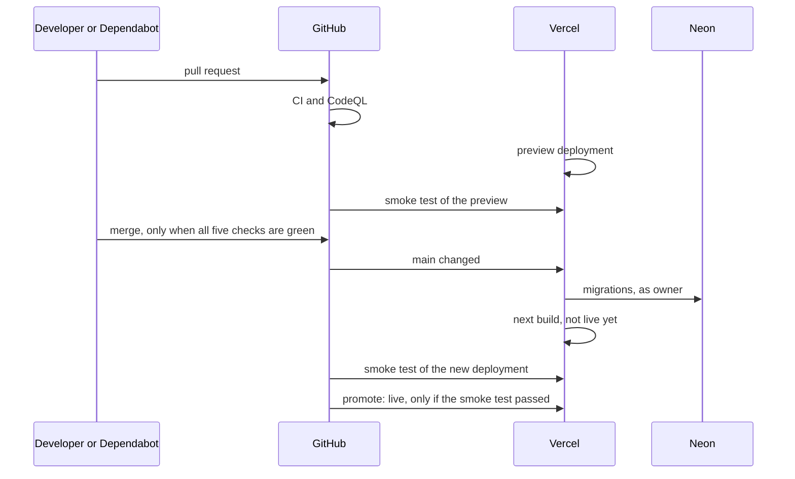

`main` only accepts pull requests whose checks `check`, `audit`, `db`, `e2e` and `analyze` are green, and it cannot be deleted or force-pushed. Setting all of this up, step by step: [DEPLOYMENT.md](DEPLOYMENT.md).

## Code layout

Every feature lives in its own folder inside `src/app/`. A feature folder holds everything that belongs to the feature: its pages, its components, its database queries and its logic. Its tests live in `tests/`, at the same path: the tests of `src/app/planets/classify.ts` are in `tests/unit/app/planets/classify.test.ts`.

```
.github/
  workflows/              CI, CodeQL, deployment check, health check, TLS check, sync, backup, catalogue
  dependabot.yml          weekly update pull requests
scripts/
  sync.ts                 command line entry: calls runSync
  seed-solar-system.ts    command line entry: calls seedSolarSystem
  migrate-on-deploy.ts    migrations during a Vercel production build
  create-readonly-role.ts creates the read-only database role of the website
  rollback-production.ts  puts the previous production deployment back live, when run by hand
  check-tls.sh            checks protocols, certificates, headers and redirects of the live site
  fetch-textures.ts       downloads and scales the images in public/textures
  moon-maps.ts            turns the published mosaics of the moons into textures: centre, colour, brightness, gaps,
                          and for Pluto and Charon terrain in the unseen south, borrowed from the imaged parts
  earth-winds.ts          the winds that keep Earth's cloud map moving: its lows and the usual winds
  winds.ts                stream functions, their winds and the flow maps the shader reads
  fetch-shapes.ts         downloads the shape models of irregular bodies and writes their radius grids
  shapes.ts               reads ZIP and OBJ files and samples a shape model into a radius grid
  generate-presets.ts     simulates the base maps of the exoplanets and writes presets.json
  preview-presets.ts      writes the three channels of a base map side by side, to look at them
  planet-sheet.ts         draws a spread of planets from the catalogue onto one picture
  catalogue.ts            command line entry: builds the printed catalogue as a PDF
  catalogue-entries.ts    every body as the text and the picture source of its page
  catalogue-pictures.ts   draws the picture of every body once and keeps it
  catalogue-pdf.ts        lays out cover, contents, the pages, the sources and the index
  gl-page.ts              draws with the app's shaders in a headless browser, for the catalogue and the shader tests
  docs-screenshots.ts     takes the screenshots of the user guide with headless Playwright
docs/
  ARCHITECTURE.md         this file
  DEPLOYMENT.md           hosting, setup step by step, operations
  wiki/                   the user guide as GitHub Wiki pages, with its screenshots in images/
drizzle/                  SQL migrations: one generated from the schema, two written by hand
public/textures/          surface maps of the solar system and its moons, base maps of the exoplanets, panorama of the sky
public/shapes/            radius grids of the irregular bodies: Vesta, Phobos, Deimos, Hyperion
tests/
  unit/                   unit tests, at the same paths as the code in src/
  scripts/                tests that run a script of scripts/ from start to end
  db/                     tests against a real PostgreSQL
  e2e/                    browser tests (Playwright): flows, what the shaders draw, security, accessibility
  smoke/                  the smoke test that runs against every deployment
  support/                test catalogue, test databases, sample rows from NASA
vercel.json               build command for Vercel; its own Git deployments off (deploy.yml deploys)
src/
  proxy.ts                sends an address without a language to the visitor's language; answers broken
                          percent-encoding with 400
  i18n/
    locales.ts            the languages, the address of a page in one, the language a browser asks for
    messages/             every text of the site: en.ts, and de.ts and tr.ts in the same shape
    server.ts             the language and the texts of the page, for server components
    client.tsx            the same for components in the browser, and links that keep the language
  db/
    schema.ts             all tables
    client.ts             the database connection (getDb, closeDb), read-only inside Next.js
    readonly.ts           the statements that create the read-only role
  deploy/
    rollback.ts           picks the deployment to roll back to
  shared/
    slug.ts               names to URL slugs and search keys
    format.ts             numbers, dates and unit conversions
    math.ts               seeded random numbers, a text hash, clamp, smoothstep and their like
    units.ts              the astronomical unit and the radii of Earth and the Sun, in kilometres
    params.ts             reading a search param, building an address from params
    paging.ts             page numbers: reading, counting, the nearest that exists, which ones a pager shows
    Pager.tsx             the pager of the list and of the search
    cache.ts              how long browsers and the CDN may keep a JSON answer
    security-headers.ts   the HTTP headers of every answer
    facts.ts              a labelled value as plain text, which the pages and the printed catalogue share
    ui.tsx                small building blocks: Section, Facts, Fact, FactRows, ListCard, Notice, PageSkeleton
  app/
    [lang]/               every page of the site, below its language: /en, /de/planets/earth, /tr/map
      layout.tsx          frame of every page: header, footer, the language of the document
      page.tsx            start page  /en
      error.tsx           shown when a page fails
      not-found.tsx       shown for unknown addresses
      .../page.tsx        one file per page; what it shows lives in the feature folders below
    SiteHeader.tsx        the bar at the top with the search field, the links and the languages
    LanguageSwitch.tsx    the links in the header that show the same page in another language
    globals.css           what Tailwind needs to know: colours, fonts, two variants, two utilities
    catalog/              numbers and featured planets on the start page, where the printed catalogue is downloaded from
    search/               /search, /search/suggest and the search field
    planets/              /planets (the list), /planets/[slug], classification, still images
    browse/               the order of the whole catalogue and the links that lead through it body by body
    globe/                the moving image and the 3D model of a planet, moon or irregular body (WebGL)
    stars/                /stars/[slug], sky coordinates
    map/                  /map, /map/stars, /map/systems/[slug], galaxy model, orbits, belts
      scene/              everything that draws the map (three.js)
    sync/                 the comparison with NASA
    solar-system/         the Sun and its eight planets, /solar-system/[slug]: every moon, Ceres, Pluto and Vesta
    legal/                /legal/notice, /legal/privacy and who runs this copy
    credits/              /credits: the source and licence of every picture, map, shape and set of values
    health/               /health: is the site up and does it reach its database
```

Next.js only turns files named `page.tsx` and `route.ts` into addresses. Every other file in `src/app/` is ordinary code. The pages stand together in `app/[lang]/`, because the language is the first part of every address (see [Languages](#languages)); each is short and takes its components, queries and logic from the folder of its feature. The JSON addresses (`route.ts`) carry no language in their path and stay in the feature folders.

| File in a feature folder | Role |
| --- | --- |
| `route.ts`, and `page.tsx` in `app/[lang]/` | An address of the site |
| `queries.ts`, `query.ts`, `stats.ts` | Reads from the database |
| `*.tsx` with a capital letter | A component |
| other `*.ts` | Logic without database or UI, for example `classify.ts` |

`src/` holds only the app. Every test lives in `tests/` ([TESTING.md](TESTING.md)).

### Who may import whom

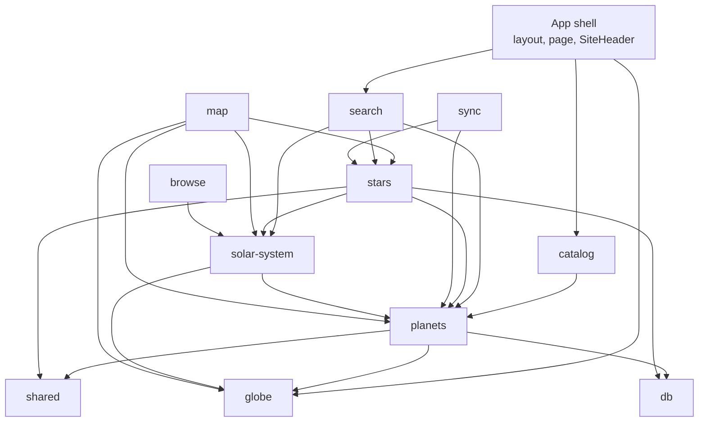

Every feature may use `shared` and `db`; the diagram only draws those arrows for `planets` and `stars`. `globe` only draws: it knows a `GlobeSpec`, not planets, stars or the database, and imports nothing but `shared`. The root layout uses it to build the shaders ahead of time. `planets` is the base feature and imports no other feature but `globe`, with one exception: the page of a solar-system planet lists its moons, so [planets/[slug]/page.tsx](../src/app/[lang]/planets/[slug]/page.tsx) imports the list and its card from `solar-system`. Only that page does, so no module imports itself in a circle. `solar-system` builds on `planets` for the look of its bodies; `search`, `stars` and `map` take the moons and dwarf planets from it. `browse` knows the order of the catalogue: it takes the bodies of the solar system from `solar-system` and reads the order of the exoplanets itself. Only the two detail pages import it, [planets/[slug]/page.tsx](../src/app/planets/[slug]/page.tsx) and [solar-system/[slug]/page.tsx](../src/app/solar-system/[slug]/page.tsx), to show its links; the second hands them to the article of a small moon as children, so no module of `solar-system` that `browse` reads imports it back. Nothing imports `sync` except its script. `map` is imported by nobody; the pages only link to it. It takes the name of the easter-egg star from `stars`, and puts it on the map itself ([map/specialStar.ts](../src/app/map/specialStar.ts)).

`shared` holds what more than one feature needs and none of them owns: a helper that two features would each write for themselves belongs there. `shared` imports no feature.

`i18n` stands beside `shared`: every feature takes its texts from it. It imports no feature either, apart from the types of the planet classes, which its sentences are written for.

### Styling

All styling is done with Tailwind classes in the components. There is one stylesheet, [globals.css](../src/app/globals.css), and it holds no rules of its own, only what Tailwind needs to know:

| In `globals.css` | What it gives the components |
|---|---|
| `@theme` | The seven colours of the site as classes: `bg-surface`, `text-muted`, `border-line`, `text-accent` and so on. The fonts from `next/font`. |
| `@custom-variant on-start-page` and `on-map-page` | Classes that apply only on one page, for the parts of the layout that differ there. The header hides its search field on the start page (`on-start-page:invisible`), the layout drops the footer and stops scrolling on the map (`on-map-page:hidden`, `on-map-page:h-dvh`). |
| `@utility planet-dot` and `planet-dot-banded` | The plain planet image of the list. Five gradients on top of each other do not fit into a class name. |

The map builds its canvas and its labels in code, not in JSX. They get the same classes through `className` ([map/scene/engine.ts](../src/app/map/scene/engine.ts), [map/scene/labels.ts](../src/app/map/scene/labels.ts)); Tailwind reads class names from every source file.

Two things are still set as a style, because their values are not known when the stylesheet is built:

- **The three colours of a planet in the list.** They come from the data, one set per planet, and are handed over as CSS variables ([PlanetDot.tsx](../src/app/planets/PlanetDot.tsx)).
- **Where a label of the map stands.** Its place, and the size of the ring around the selected object, change with every frame.

The still images are SVG, and the moving images and the map are drawn with WebGL. Their colours and shapes are drawing instructions, not styling, and stay in the code that draws them.

## Database

Six tables, defined in [src/db/schema.ts](../src/db/schema.ts).

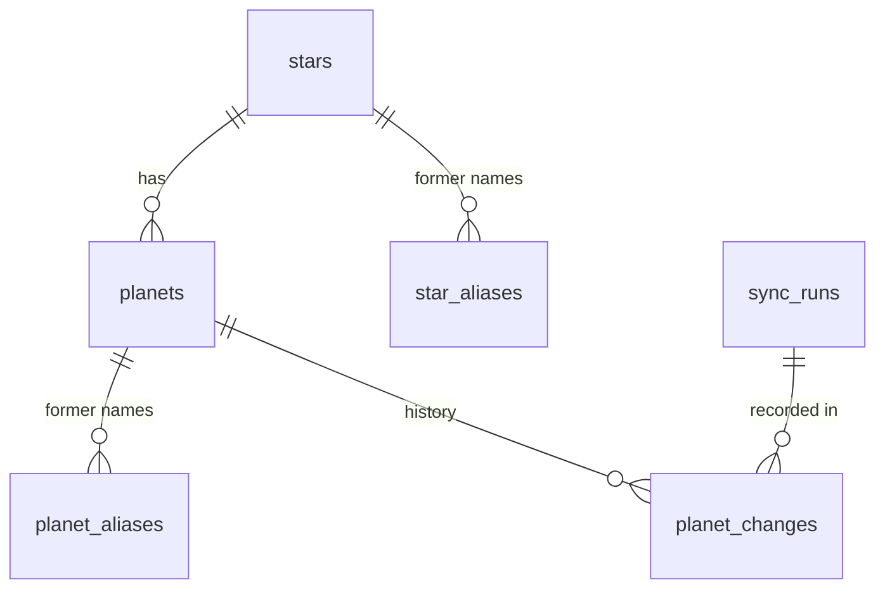

| Table | Content |
| --- | --- |
| `stars` | Stars with at least one known planet, plus the Sun. Holds the position in the sky and the precomputed galactic position `x`, `y`, `z` for the map. |
| `planets` | Planets with their measured values, a flag per value that says whether NASA only calculated it, the planet class, the climate class and a hash of the values. |
| `star_aliases`, `planet_aliases` | Former names, so old addresses lead to the new page after a rename. |
| `sync_runs` | One row per sync run with its counts, including failed runs and their error. |
| `planet_changes` | The history: which value changed from what to what, and in which run. |

Three columns carry the design:

- **`source`** is `nasa` or `sol`. The sync only touches `nasa` rows. The solar system is `sol` and comes from the seed. This is how both live in the same tables without getting in each other's way.
- **`status`** is `active` or `removed`. When NASA drops a planet, the row stays and is marked `removed`, so its page and history survive.
- **`search_name`** is the name reduced to lower-case letters and digits: `Kepler-22 b` becomes `kepler22b`. The search runs on this column. A trigram index (`gin_trgm_ops`) makes "contains" searches fast.

The schema is the single source of truth. `npm run db:generate` turns a schema change into a SQL migration in `drizzle/`, and `npm run db:migrate` applies it.

Two migrations are written by hand, because they set up things a Drizzle schema cannot describe: `0000_extensions.sql` switches on `pg_trgm`, and `0002_natural_order.sql` creates the collation `natural_name`. A collation is a rule for sorting text. This one counts digits as numbers, so `Kepler-9 b` comes before `Kepler-10 b`; the list of all planets sorts with it.

## Data flow 1: from NASA into the database

`npm run sync` starts [scripts/sync.ts](../scripts/sync.ts), which calls `runSync` in [src/app/sync/run.ts](../src/app/sync/run.ts).

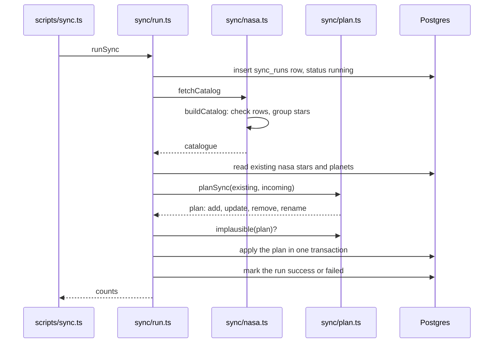

The work is split into three steps on purpose:

1. **Fetch** ([nasa.ts](../src/app/sync/nasa.ts)). One request to the archive's TAP interface for about 30 columns of the table `pscomppars`. `buildCatalog` checks every row and groups the planet rows by star. NASA delivers star values once per planet, and for some stars the rows disagree. The most common value wins.
2. **Plan** ([plan.ts](../src/app/sync/plan.ts)). `planSync` compares the catalogue with what is stored and returns a plan. It does not touch the database, so the whole logic is covered by ordinary tests.
3. **Apply** ([run.ts](../src/app/sync/run.ts)). The plan is written in a single transaction. If anything fails, the database stays exactly as it was.

What the plan takes care of:

- **Changes.** Each planet has a SHA-256 hash over 17 tracked values. If the hash is the same, the planet is skipped. If it differs, every changed value goes into `planet_changes` with its old and new value.
- **Removed planets.** A planet missing from the catalogue is marked `removed`. If it comes back, it becomes `active` again.
- **Renames.** NASA has no stable ids. A star counts as renamed when one name disappears and a new one appears within 5 arcseconds of the same position. A planet counts as renamed when exactly one new planet at the same star has the same orbital period (within 1 %) or the same letter. The old name is kept as an alias.
- **Broken responses.** The run stops when fewer than 1,000 planets arrive, when fewer than 90 % of the stored planets arrive, or when more planets would be removed than the limit of 25 or 5 %. `npm run sync -- --force` overrides this.

The `sync_runs` row is written outside the transaction, so a failed run still leaves a record with its error message.

`npm run seed:sol` is the small sibling: [seed.ts](../src/app/solar-system/seed.ts) writes the Sun and the eight planets from [data.ts](../src/app/solar-system/data.ts) as `sol` rows. It can run any number of times.

The large moons of the planets, the dwarf planets Ceres and Pluto (with Charon) and the asteroid Vesta are not in the database. They live in [bodies.ts](../src/app/solar-system/bodies.ts), with their values from JPL Solar System Dynamics, because nothing ever syncs them and they belong to no star's list of planets: the numbers on the start page, the list of all planets and the filters stay about planets. Their pages, `/solar-system/[slug]`, are built ahead of time from that list. Masses are stored as G·M, which spacecraft measure far more precisely than the mass itself, and converted relative to Earth for the page. A test checks that each density agrees with its mass and radius, which caught a value in JPL's table that does not (Charon's; the page uses the one from New Horizons).

All the other moons of the planets and of Pluto, 428 of them, are in [small-moons.json](../src/app/solar-system/small-moons.json) ([smallMoons.ts](../src/app/solar-system/smallMoons.ts)): their orbits from JPL's mean elements, their discovery from JPL, and their size where JPL measured it, otherwise estimated from their brightness or taken from Scott Sheppard's tables and marked as estimated. With the large moons they number what JPL lists for every planet, which a test checks. Most were found as faint points by telescopes on Earth. The page of their planet lists them all in a table, and the map shows them as points. Each has a page of its own under `/solar-system/[slug]` as well, built ahead of time like those of the large moons ([SmallMoonArticle.tsx](../src/app/solar-system/SmallMoonArticle.tsx)); its address is its name as a slug (`S/2004 S12` is `s-2004-s12`), which is also how the map's address names it. The page shows what the file knows, the orbit, the size and the discovery, and a 3D model whose shape and surface are made up from the name (`inventedBody` in [globe/shape.ts](../src/app/globe/shape.ts)): the same body the map draws when the camera follows the moon, in the viewer of the real shape models. The page says that it is an illustration.

**Irregular bodies.** Vesta, Phobos, Deimos, the tumbling Hyperion, Phoebe and ten small moons near Saturn's rings (Pan, Daphnis, Atlas, Prometheus, Pandora, Epimetheus, Janus, Telesto, Calypso, Helene) are far from round. `npm run shapes` ([fetch-shapes.ts](../scripts/fetch-shapes.ts)) downloads their published shape models (from the PDS Small Bodies Node and the APL's Small Body Mapping Tool) and samples each into a radius grid ([shapes.ts](../scripts/shapes.ts)): from the centre, a ray in every direction of a raster of 256 longitudes and 129 latitudes finds the outermost surface. That keeps the shape at 66 KB instead of several megabytes, and its directions are those of the map, so the map needs no texture coordinates. The volume of each grid matches the published mean radius, which a test checks. [globe/shape.ts](../src/app/globe/shape.ts) turns a grid into a surface with smooth normals and lights it with a mix of the Lommel–Seeliger law and Lambert's, as dusty, airless bodies scatter light. The pages draw it with three.js, which only loads there ([ShapeViewer.tsx](../src/app/solar-system/ShapeViewer.tsx)); the map draws it like any other globe. No spacecraft mapped all of Deimos, Hyperion or the small moons near the rings, so they show their shape in their colour, and their pages say so; Phoebe has a Cassini map, cut out of its published frame (`crop` in maps.ts). Where no spacecraft measured a small moon's pull (Daphnis, Telesto, Calypso), its mass, density and gravity stay unknown on the page rather than guessed.

### Values derived on the way in

Both the sync and the seed pass every planet through `withDerived` in [planets/measurements.ts](../src/app/planets/measurements.ts). It adds three columns:

| Column | Rule ([classify.ts](../src/app/planets/classify.ts)) |
| --- | --- |
| `planet_class` | From the radius in Earth radii: rocky below 1.25, super-Earth below 2, Neptune-like up to 6, gas giant above. Without a radius it is estimated from the mass (Chen & Kipping 2017). |
| `climate_class` | From the equilibrium temperature: frozen below 150 K, cold below 250 K, temperate below 350 K, hot up to 1,000 K, scorching above. |
| `data_hash` | The hash that the next sync compares against. |

The equilibrium temperature ignores any atmosphere. That is why Venus counts as "cold" here although its surface is the hottest in the solar system. For exoplanets no better value exists, and the same rule is applied to every planet.

For stars, the sync also converts right ascension, declination and distance into galactic coordinates ([stars/coordinates.ts](../src/app/stars/coordinates.ts)). The map reads them directly.

## Data flow 2: from the database to the browser

Pages are server components. They query the database on the server and send finished HTML. The browser gets no database access. Three things run in the browser: the suggestions of the search field, the moving planet images with the 3D model, and the map. Everything else works without JavaScript, and every planet has a still image in the HTML.

### Static frame, streamed content

The app uses Next.js Cache Components (`cacheComponents: true` in [next.config.ts](../next.config.ts)). Every page has two layers:

- The **frame** (header, headings, search field, skeletons) is built once at build time and is served immediately.
- The **content** that depends on the database or on the address sits inside `<Suspense>`. It is rendered for every request and streamed into the open response as soon as it is ready. What it reads from the database is cached (see below).

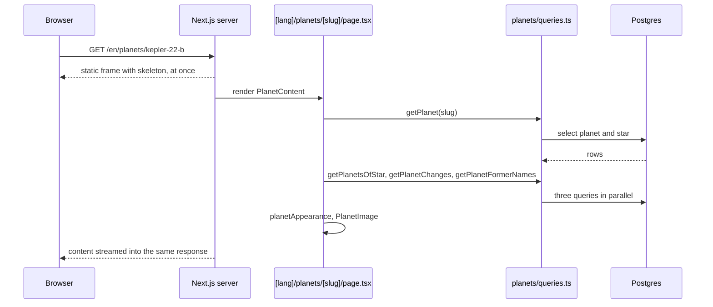

Because the build never needs the database, `npm run build` works without one. A finished sync shows up without a rebuild, within the hour that an answer from the database is kept.

### The pages

Every page stands below its language, so `/planets` in the table is `/en/planets`, `/de/planets` and `/tr/planets`; the files are in [app/[lang]/](../src/app/[lang]). The three JSON addresses have no language in their path.

| Address | File | Reads |
| --- | --- | --- |
| `/` | [page.tsx](../src/app/[lang]/page.tsx) | Nine featured planets ([FeaturedPlanets.tsx](../src/app/catalog/FeaturedPlanets.tsx)) and the catalogue numbers ([stats.ts](../src/app/catalog/stats.ts)), each in its own `<Suspense>` |
| `/planets?q=&type=&climate=&sort=&page=` | [planets/page.tsx](../src/app/[lang]/planets/page.tsx) | 200 planets of the list of all planets or of one kind of planet, and how many there are in total |
| `/planets/[slug]` | [planets/[slug]/page.tsx](../src/app/[lang]/planets/[slug]/page.tsx) | The planet with its star, the other planets of the system, the change history, former names, its neighbours in the catalogue |
| `/solar-system/[slug]` | [solar-system/[slug]/page.tsx](../src/app/[lang]/solar-system/[slug]/page.tsx) | Nothing for the body itself, which is built ahead of time from the code; only where the exoplanets start, for the links that browse the catalogue |
| `/stars/[slug]` | [stars/[slug]/page.tsx](../src/app/[lang]/stars/[slug]/page.tsx) | The star, its planets (removed ones listed separately), former names |
| `/search?q=` | [search/page.tsx](../src/app/[lang]/search/page.tsx) | Up to 60 matching planets and stars |
| `/search?type=&climate=&q=&page=` | the same page | 60 planets of one kind per page, all of them or those matching the name, and how many there are in total |
| `/search/suggest?q=&lang=` | [search/suggest/route.ts](../src/app/search/suggest/route.ts) | Up to 8 suggestions as JSON, described in the language asked for |
| `/map` | [map/page.tsx](../src/app/[lang]/map/page.tsx) | Nothing. The page is only a frame; the map fetches its data itself |
| `/map/stars` | [map/stars/route.ts](../src/app/map/stars/route.ts) | Every star with a position, as JSON |
| `/map/systems/[slug]?lang=` | [map/systems/[slug]/route.ts](../src/app/map/systems/[slug]/route.ts) | One star with its active planets, as JSON, with names and descriptions in the language asked for |
| `/legal/notice`, `/legal/privacy` | [legal/notice/page.tsx](../src/app/[lang]/legal/notice/page.tsx), [legal/privacy/page.tsx](../src/app/[lang]/legal/privacy/page.tsx) | Nothing. Both are static and take the operator from environment variables |

All database reads go through the query files of the features. They call `getDb()` from [db/client.ts](../src/db/client.ts), which opens the connection pool on first use and reuses it afterwards.

### Languages

The site speaks English, German and Turkish. The language is the first part of every address: `/en/planets/earth`, `/de/planets/earth`, `/tr/planets/earth`. That keeps a page in one language under one address, which search engines and shared links need, and it stores nothing in the browser: no cookie remembers a choice.

- **An address without a language** still works. [proxy.ts](../src/proxy.ts) reads the languages the browser asks for (`Accept-Language`) and answers with a redirect to the first one the site has, or to English. Old links and typed addresses therefore keep leading somewhere. The redirect says `Vary: Accept-Language`, so no cache hands one visitor's language to another.
- **The pages** live in [app/[lang]/](../src/app/[lang]). Its layout builds the frame of every page once per language (`generateStaticParams`) and declares the language of the document. A server component asks [i18n/server.ts](../src/i18n/server.ts) for the texts (`getMessages()`), which reads the language from the address with `next/root-params`; that works inside cached functions too, so nothing has to be passed down by hand.
- **The texts** are one object per language in [i18n/messages/](../src/i18n/messages). English ([en.ts](../src/i18n/messages/en.ts)) defines the shape, and German and Turkish must fill the same shape, so a text that is missing in one language fails the type check. Where a sentence depends on a number or a name, the text is a function, because each language builds such a sentence its own way: German gives the adjective an ending ("1 heißer Gasriese", "keine heißen Gasriesen") and some bodies an article ("Mond der Erde"), Turkish hangs endings on names that follow their last vowel ("Satürn’ün uydusu", "Dünya’nın uydusu"). Numbers and dates are written by `Intl` in the conventions of the language ([shared/format.ts](../src/shared/format.ts)).
- **Components in the browser** cannot receive functions from the server. The texts they need are the part `client` of the catalogue: plain text with places such as `{name}`. The layout hands that part and the language down ([i18n/client.tsx](../src/i18n/client.tsx)), so the browser loads only the language it shows. The same file has a `Link` and a router that put the language in front of an address, so components link to `/planets/earth` and need not know which language they are shown in.
- **What is translated and what is not.** Everything the site says itself is translated, including the texts about the 36 bodies of the solar system, the credits and the legal pages. The planets, the Sun and the Moon carry the names of the language (Erde, Dünya); the search finds them by those names too. Names of exoplanets and stars, and the values and facility names from NASA, stay as the catalogue has them. A discovery method or a group of moons the catalogue does not yet know in a language is shown as the source writes it.
- **The JSON addresses** take the language as `?lang=`, because their paths have none. The stars of the map are the same in every language and are fetched once.
- **The printed catalogue** exists in English only.

The header shows the three languages as `EN DE TR` ([LanguageSwitch.tsx](../src/app/LanguageSwitch.tsx)). They are plain links to the same page in the other language and load it anew, since a new language changes every text and the language of the document.

### Browsing the catalogue

The page of every planet, moon and dwarf planet carries links to the body before it and after it, so the whole catalogue can be read like a book ([browse/](../src/app/browse)). The order has two parts:

- **The solar system** comes first and is fixed in the code ([order.ts](../src/app/browse/order.ts)): the bodies that orbit the Sun from the inside out, Vesta, Ceres and Pluto among the planets, each followed by its large moons and then its small ones, both from the inside out.
- **The exoplanets** follow by the distance of their star from the Sun, and within a system from the inside out, as the star page lists them. Systems at an unknown distance come last, and withdrawn planets are left out. One query numbers them all with a window function and returns a planet with its two neighbours ([queries.ts](../src/app/browse/queries.ts)); the star's name and the ids break ties, so the order is the same in every answer.

[place.ts](../src/app/browse/place.ts) joins the two without touching the database: the first exoplanet follows the last moon of Pluto, and the number of a body counts on from the solar system. A link that leaves the current system names the system it leads to and its distance. Saturn alone has almost 300 moons between itself and Uranus, so a body of the solar system also offers to skip the moons, back to the body they orbit and ahead to the next one that orbits the Sun.

[BrowseNav.tsx](../src/app/browse/BrowseNav.tsx) draws the links. The pages of the solar system are built ahead of time, and the build needs no database, so their links come from the code and are part of the prebuilt page; what the database adds, the total and the first exoplanet after the last moon, streams in afterwards (`await io()`, as on the start page). If the database does not answer, these pages keep their links and only lack the total. The left and right arrow keys follow the links ([BrowseKeys.tsx](../src/app/browse/BrowseKeys.tsx)), but only while nothing else has the focus: the 3D model turns with the same keys.

### What is cached

The catalogue changes once a day, with the sync. Reading it again for every visitor would ask the database the same questions thousands of times, and the database sleeps between visits and takes a moment to wake. So an answer is kept, in two places:

- **In the server.** Every query function starts with `"use cache"`: Next.js keeps its answer under its arguments and hands it out again without running the query. How long is set once, in [next.config.ts](../next.config.ts) (`cacheLife`, the profile `default`): after an hour the next request still gets the kept answer and starts a fresh read in the background, and an answer nobody asked for in a day is dropped. A query that fails is not kept. `getPlanet` and `getStar` are wrapped in React's `cache` as well, because the page title and the page body ask for the same row at the same moment of one request, before either answer is kept.
- **In front of the server.** The three JSON addresses (`/map/stars`, `/map/systems/[slug]`, `/search/suggest`) answer with one `Cache-Control` ([shared/cache.ts](../src/shared/cache.ts)): browsers and the CDN keep the answer for an hour, and the CDN may hand out the old one once more while it fetches the new. An error and "there is no such star" are not kept.

Three rules follow from this:

- **A sync is visible within an hour**, not on the next page view. Locally, restarting `next dev` empties the cache.
- **The build still needs no database.** A cached query that needs nothing from the request would be run during `next build` and its answer shipped with the site. The four places that read that way (the numbers and the featured planets of the start page, `/map/stars`, and the links that browse the catalogue on the prebuilt pages of the solar system) call `await io()` first, which tells Next.js to wait for a request.
- **`/health` is never cached**, and neither is anything the sync and the seed read: they see the database as it is.

How much the server's own cache saves depends on where the site runs. A server that keeps running (`next start`) keeps every answer. Vercel runs the site in functions that it starts and stops as needed, and each keeps its own answers for as long as it lives, so a visitor may still meet a function that has to ask. The CDN's copy of the JSON answers does not depend on that. Keeping the answers of the pages for all functions alike would need `"use cache: remote"`, which Vercel bills, or a database at build time; neither is set up.

A test reads the query files and fails when a query is added without the directive ([caching.test.ts](../tests/unit/app/caching.test.ts)).

### The legal pages

German law asks a website for a legal notice ("Impressum") that names who runs it, and the GDPR for a privacy policy. Both live in [legal/](../src/app/legal/) and are linked from the footer of every page. They are translated like every other page; the German words "Impressum" and "Datenschutzerklärung" stand below the heading in the other two languages, for visitors who look for them. The map has no footer, so it carries the two links in the corner with its credits.

- **The operator is not in the code.** The repository is public, and a private address does not belong there. [legal/operator.ts](../src/app/legal/operator.ts) reads name, address and e-mail from environment variables (`LEGAL_NAME` and so on, listed in `.env.example`) when the pages are built. Anyone who runs their own copy enters their own details.
- **A page with missing details says so.** As long as a required variable is not set, both pages show a notice that names the missing variables. An empty legal notice that looks finished would be worse than a visible gap.
- **The privacy policy describes this code.** No cookies, no storage in the browser, no statistics, nothing loaded from other servers: the fonts are downloaded by `next/font` at build time and served from the site itself. What remains is the log of the web server, and the text of a search in the address of its request. A change that adds any of these must change the policy with it. The hosting company and the number of days the log is kept are optional variables, because they depend on where a copy runs.
- **Both pages ask search engines not to list them** (`robots: noindex`), so the address does not turn up in search results.

### From measured values to an image

There are no photographs of exoplanets, so every image is computed.

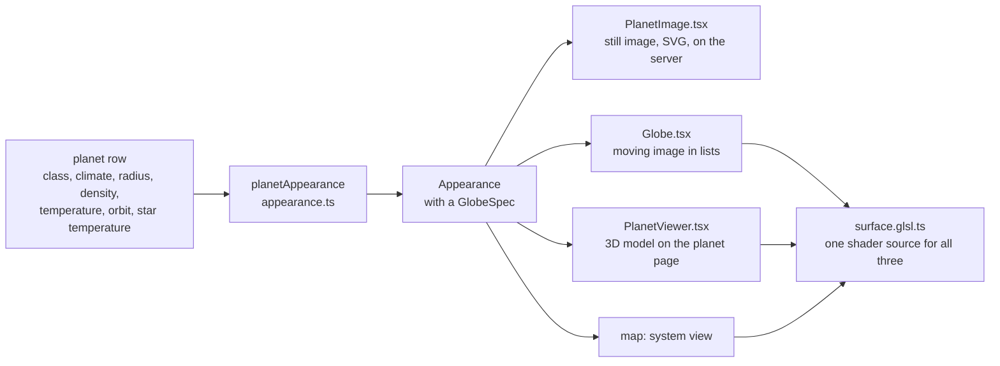

**One description, four pictures.** [appearance.ts](../src/app/planets/appearance.ts) turns what is known about a planet and its star into a description of the planet. Its core is the `GlobeSpec` ([globe/spec.ts](../src/app/globe/spec.ts)): the base maps the planet is drawn from, three surface colours, an ocean with its level, ice, clouds, craters, relief, lava, the belts and winds of a gas planet, an atmosphere, the colour of the starlight, rings, a moon, polar lights, the shape, the tilt of the axis and the spin. The spec is plain data: the server computes it and hands it to the browser as JSON.

**Measured where possible, drawn by lot where not.** Measured values shape the picture wherever they exist:

- **The temperature** gives the colours and the climate. A gas giant takes the colour of the clouds that can exist at its temperature, after Sudarsky's classes: creams and browns of ammonia when cold, white clouds of water, clear blue air, dark when hot, and a glow of its own from about 900 kelvin. The colours run into each other between these, so a planet at 400 kelvin lies between white and blue. On rocky planets the temperature sets the size of the ice caps, the share of clouds, the height of the seas, and on a molten world how much of it is lava and how hot that glows.
- **The size** gives the height of the mountains, because gravity flattens a large planet. On a molten world it also decides between rivers of lava on steep ground and wide seas of it on flat ground.
- **The density**, where both mass and radius were measured (`measuredDensity` in [queries.ts](../src/app/planets/queries.ts)), tells what a rocky planet is made of: a world of iron is darker and greyer, a world of water is nearly all sea, frozen to a shell of ice when cold, under a deck of steam when hot.
- **The orbit** tells whether the planet has days and nights. A planet that circles its star within twelve days is held with one side towards it. It does not turn in front of the viewer (the view swings slowly around it instead), and its climate runs from the point under the star to the night side: ice covers the dark half, lava the bright one.
- **The star** gives the colour of the light, and with it the colour of plants on mild worlds.

What nobody has measured is drawn from the slug of the planet, so it is the same every time and different from planet to planet: which base maps it gets and how they lie on the ball, a small shift of all its colours, the tilt of its axis, and whether it has rings, a moon, polar lights or lightning. Rings and moons only go to planets far enough from their star to keep them. These parts are invention and say so on the page of the planet ("Nobody has seen this planet up close").

**Base maps instead of photographs.** Exoplanets are drawn from eighteen simulated base maps ("presets") in `public/textures/presets`, made by `npm run presets` ([generate-presets.ts](../scripts/generate-presets.ts)). A preset holds no colours, only what shaped a surface. For rocky planets that is the height after erosion, the places where water gathers, and the craters. Each rocky preset comes with a second map of its slopes, worked out from the heights before they are rounded to the 256 steps of a picture: slopes taken from the rounded heights showed as terraces along the terminator. For gas planets a preset is the belts, fine streaks and storms: coloured gas is carried along by jets, a few lasting whirls and turbulence that changes while it flows, which folds the belts into festoons instead of winding them into neat spirals. Three more presets are the weather of rocky planets with seas, simulated the same way: moist and dry air start out in belts by latitude, and trade winds, westerlies, a chain of lows on each storm track and the highs of the subtropics stir them, which winds the moist air into commas around the lows and draws it out into fronts. Banded and weather presets come with a small map of their winds at the end of the run, which the shader lets blow on. The shader turns a preset into a planet with the values of that planet: sea level, ice, lava, colours and climate zones. A rocky planet mixes two presets in large patches, each turned any way in space, so hardly two planets share a face; a gas planet turns its preset about the axis only, as its belts have to follow the latitudes. What the app has to know about a preset is in [globe/presets.json](../src/app/globe/presets.json), written by the same script: the heights below which each share of a rocky surface lies, so a sea can cover a chosen share of it, the jets each banded preset was simulated with, and the names of the weather presets. The planets of the solar system name real maps in `public/textures/planets` instead. Browsers may keep the files in `public/textures` and `public/shapes` for a day ([next.config.ts](../next.config.ts)), so they are not asked for again on every page.

**The still image** ([PlanetImage.tsx](../src/app/planets/PlanetImage.tsx)) is SVG and part of the HTML. It shows at once and stays where WebGL is missing.

**The moving image** ([globe/Globe.tsx](../src/app/globe/Globe.tsx)) fades in on top of the still image as soon as its first picture is drawn. A browser allows only a handful of WebGL canvases per page, and a list shows dozens of planets. So [globe/cards.ts](../src/app/globe/cards.ts) keeps one hidden WebGL canvas for the whole page, draws the planets into it one after the other and copies each result into the plain canvas of its image. Only images on screen are drawn, 30 times per second at most, less often on a slow device. With `prefers-reduced-motion` each planet is drawn once and stands still.

**The 3D model** ([globe/PlanetViewer.tsx](../src/app/globe/PlanetViewer.tsx)) on the planet page has a renderer of its own. How a model is turned and zoomed is the same for planets and for irregular bodies, which three.js draws ([ShapeViewer.tsx](../src/app/solar-system/ShapeViewer.tsx)): the rules are plain functions in [globe/view.ts](../src/app/globe/view.ts), and [globe/ViewerFrame.tsx](../src/app/globe/ViewerFrame.tsx) holds the draw loop, mouse, touch and keyboard and the buttons. A viewer only says how to draw one picture. Dragging turns the camera around the planet, so the night side comes into view. The wheel (with Ctrl, or in full screen), a pinch or the buttons zoom in up to eight times, and the keyboard works too. Zooming in adds finer detail to the clouds, the coasts and the grain of the ground, computed on the spot. The planets of the solar system whose sources allow it also have maps twice as wide (4096 pixels), which load once the planet is two and a half times as large on screen as its usual maps can show sharply. Not earlier: a built-in graphics card needs twice as long for a picture of Earth while it reads those maps pixel for pixel.

**How a planet is drawn.** [globe/renderer.ts](../src/app/globe/renderer.ts) uses no geometry at all. One triangle covers the picture, and for every pixel the fragment shader ([globe/globe.glsl.ts](../src/app/globe/globe.glsl.ts)) works out which point of the ball lies behind it. That gives a perfectly round edge at any zoom. The surface itself comes from [globe/surface.glsl.ts](../src/app/globe/surface.glsl.ts): the map of the planet turned into ground, seas, lava or bands, layered noise for clouds and fine grain, light and shadow from the star, slopes that catch the light, clouds that shade the ground and each other, city lights and clouds for Earth, the glint of the star on water, rings that cast a shadow on the planet and the planet's shadow on the rings, polar lights and lightning on the night side, storms, and air. The colours leave the shader the way a camera would record them: bright light is pressed together instead of cut off, and a grain finer than one step of brightness keeps dark slopes from showing stripes. A fast-turning giant is drawn flattened at its poles, and a moon as a small ball of its own. [globe/uniforms.ts](../src/app/globe/uniforms.ts) translates a `GlobeSpec` into the numbers that shader reads. The map includes the same shader code, so a planet looks the same on its page and on its orbit.

**Air.** Over solid ground the air is worked out the way it scatters light. It scatters most of the colour its sky has, so along a line of sight it takes that colour out of the picture and adds starlight of that colour: a thin veil over the day side that thickens to a bright band at the limb, where the line of sight crosses the most air. The starlight loses the same colour on its way in, so it reddens where the star stands low, on the ground, on the clouds (which lie above half of the air and so stay lit a little longer) and in the veil itself. Beyond the edge of the planet the same air shows as a thin line, because air is a thin skin on a planet. The tint of the starlight is kept pale, so the colours of the ground stay readable; the star itself is redder, and a red star has little of the light that air scatters, so the veil and the line count the tint three times over. Without that, the worlds of red dwarfs lay under a grey veil. A planet of gas has no ground to veil and gets a haze at its limb instead.

**Lava.** A world of lava is mostly dark rock. The lava shows in two places: in rivers that run down the channels of the base map, brightest in their middle, and in the seas that fill its basins. A sea lies under a dark crust, and the melt shows in the channels that thread it. How hot the sea is at a place decides how wide they are: it is hottest where the sea is deep, where it wells up, and under the star of a planet that its star holds. Where it is cool the channels are thin red veins; where it is hotter they widen, and where it is hottest they join to open melt with islands of crust in it. A channel is hottest in its middle and cools towards its banks, and the glow follows that: deep red at the banks, orange further in, yellow only in the hottest middle, without a step in between. Beside a channel the crust is thin, glows dully and shows glowing cracks from close by, and the lava lights the rock of the shore and of the valleys. Smoke and ash hang over parts of it and dim the glow.

What is known about the planet varies this. The temperature sets how much of the surface is lava, how much of it lies open and its colour: a planet at 1100 kelvin has thin red veins in a closed crust, one at 2300 has orange and yellow melt. A small planet has steep ground, so more of its channels carry rivers of lava; a large one has flatter ground, wider seas and holds more smoke. A planet held by its star has an ocean of magma under the star and dark rock on its night side. A world of iron has darker, greyer rock. The look follows pictures of volcanic worlds in films and of flows of lava seen from above at night: dark ground, bright rivers with red banks. A sea of one colour with glowing lines drawn on it, plates with seams drawn evenly around each, or melt in pale soft patches looked like a drawing. A channel narrower than a pixel is drawn a pixel wide and that much fainter, so it neither flickers nor gains light.

**Weather.** A rocky planet with seas and days and nights draws its clouds from one of the weather presets, turned about its axis its own way. The shader reads the preset out of focus, which leaves the weather systems, and lets noise break them into heaps of cloud with ragged edges; the simulation's own filaments are too sharp for clouds and looked like ink in water. A cloud is thin and grey at its narrow, frayed edge and white only in its core, where the tops of its heaps are brighter than the creases between them, and it is read a second time one step towards the star: where it is thicker there, it lies in shade here, and so does the ground. A wide soft edge lay on the planet like milk. High cloud lies above as thin streaks. The clouds keep moving with the winds of the preset, so the lows turn and the fronts sweep round them. A planet held by its star keeps computed clouds, which gather under the star, and so do dry planets, whose clouds are thin hazes.

Earth's clouds are a photograph, and they move the same way: along a flow map of their own ([earth-winds.ts](../scripts/earth-winds.ts)). Nobody recorded the winds of the moment the photograph shows, so the map is put together from what the picture and the climate tell: the lows that can be seen in the clouds, each turning the way its hemisphere makes it, and the usual winds along the latitudes. The lows turn slowly, because the shader fades between two cycles of the motion, and sharp clouds that moved far would show twice meanwhile.

**Storms.** They live and die, and only depend on the time and the seed of the planet, so a planet has the same weather whenever it is shown at the same moment. Over the sea of a rocky planet, a few slots take turns at a storm: a tropical cyclone forms near the equator, drifts west, swings towards the pole, grows an eye and spiral arms that turn, and dies over land (read from a coarse level of the preset) or after its time; storms of the middle latitudes are wider, have no eye and drift east. Lightning glows in thunderclouds on the night side. A dry planet with air, and Mars, gets dust storms that spread and settle, and now and then one wraps the whole planet. On a gas giant every whirl of its preset turns and the festoons between its belts roll on: the shader moves the picture along the winds of the preset's flow map, in the same two phases as the drifting bands, so nothing ever winds up. It reads the wind a second time half-way along, which carries the clouds round a storm; a single straight step would fling them outwards. Now and then a bright plume of fresh cloud breaks out and is drawn out along its band, as on Saturn. How fast all of this moves depends on the planet: the star drives the winds, so they blow at three quarters of the usual pace on a giant at 100 kelvin and over one and a half times as fast at 2000, and a hot giant held by its star has one fast stream round its equator, as the hot Jupiters whose winds were measured do. A faster planet runs through the cycles of its motion sooner; it does not slide its clouds further, which would show them twice.

A Neptune-like planet has few, broad bands, and a broad band that slides along itself shows no motion. So these planets get wisps of bright high cloud above the deck, as Neptune has: they follow the fine streaks the preset was simulated with, so they travel with its winds and are wound up by its whirls at no further cost. How lively such a planet is, is drawn by lot, and most stay calm: a calm one shows a few wisps, a lively one many, with stronger streaks, whirls that turn up to two fifths faster and weather that moves up to three tenths faster. Under a veil of haze only half of that shows. The gas giants are left as they were.

**What keeps a picture cheap.** The surface shader runs for every pixel of a planet, sixty times a second, so what it does not have to do counts:

- **Storms are worked out once per picture, not per pixel.** Where a storm is, how large and how old is the same for every pixel. [globe/storms.ts](../src/app/globe/storms.ts) works it out for the moment of the picture and hands the shader only the storms that are alive (`stormUniforms`, with the same integer hash the shader uses elsewhere). Inside the shader the graphics card ran the whole of it for every pixel and every slot, also where no storm was: on a planet with a sea that was a third of the time of a picture.
- **Nothing is worked out where it cannot show.** The lumps of the clouds are left out where the sky is clear, the channels of melt outside the seas of lava, dunes outside the lowlands, the billows of dust outside the dust storms, the lumps of an outbreak away from its plume, the waves in the glint of the star where there is no glint, the grain of a stretched map while the map is not stretched.
- **What a planet's description alone decides is worked out once.** Which program a planet needs, the values of its uniforms and the addresses of its maps do not change while it is shown, but the renderer needs them for every picture of every planet on the page (`surfaceConstants` in uniforms.ts).
- **What was worked out before is read, not worked out again.** The slopes of a rocky preset come from its relief map. That takes as many reads as taking them from the heights did, but the place on the map is worked out once instead of three times, and the reads need none of the costly filtering that keeps colours sharp towards the limb. The weather of a world with seas comes from its preset, which replaces the coarse layers of noise and the noise that bent them.

Measured on a small built-in graphics card (Radeon 610M), a planet that fills 1200 × 1200 pixels: a world with a sea 12.5 ms per picture instead of 16.4, a dry or lava world 11 instead of 11.5, Mars 8.3 instead of 9.5, Earth 6.9 instead of 7.1, a gas giant 3.4 instead of 4.7 (it lost a grain that was multiplied onto its colours and made the bands look painted). Fine detail is never traded for speed: it is what makes the drifting clouds look alive.

Measured again the same way when the weather presets, the relief maps and the air were added, the old code and the new in turn and the fastest of six runs each (these runs gave lower figures for the same code than the ones above, so the figures only compare within this paragraph): a world with a sea 11.7 ms per picture, where it took 11.6 before, one held by its star 12.3 (12.0), a dry world 14.9 (14.6), a lava world 11.0 (10.9), Mars 7.0 (7.9), Earth 6.0 (6.4), Venus 3.5 (3.6), Jupiter from its map 3.0 (3.1), a gas giant 2.4 (2.8) and one that glows 4.4 (6.6). Runs of the same code differ by two or three in a hundred, which is also what the rocky worlds cost more; the others cost less. On a fast card (RTX 5070) the rocky worlds take about a sixth less than before, at around one millisecond. After the lava was drawn anew and the wisps of the Neptune-like planets were added, the fastest of four runs each on the small card gave a lava world 10.6 ms (10.6 before all of these changes), a Neptune-like planet 4.7 (6.0) and a gas giant 2.4 (3.1); the lava reads the noise of the dry ground again instead of working out its own, and the wisps read the preset's second tracer, which is fetched anyway.

**No grain finer than a pixel.** Much of the surface is layered noise, down to grain that repeats 120 times per planet radius. On a planet a few hundred pixels wide those layers are finer than a pixel: each pixel catches them at random, they show as speckles, and they shimmer while the planet turns. So every layer is faded out once its features shrink below two pixels (`shows` and the `scale` of `fbm` in surface.glsl.ts; the size of a pixel on the planet is read off the neighbouring pixels). Zoomed in, the layers come back. Every layer is still read, faded or not: asking first whether to read it costs more on the graphics card than the reads it saves.

**Why the 3D model appears at once.** WebGL builds a shader when it is first used. On Windows, browsers hand shaders to Direct3D, whose compiler takes several seconds for a large shader with many loops, and our first shader needed almost five. Three things keep that short and out of the way:

- **Noise from a texture.** The shader does not calculate its noise. [globe/noise.ts](../src/app/globe/noise.ts) computes gradient noise once in the browser (about 20 ms) into a 64³ texture, and the shader reads one texel per layer of noise. The pattern repeats every 8 units; the layers are scaled by 2.02 and shifted, so the repetition does not show.
- **One program per kind of surface.** Whether a planet is drawn from a real map, a terrain preset or a band preset, whether its heights catch the light (from the map itself or from a relief map), and whether it has ground under air, is fixed when the shader is compiled (`surfaceDefines` in uniforms.ts, `#if` in surface.glsl.ts). Each of the eight combinations is a program of its own and contains only its own code. Compiling one takes 0.1 to 0.3 seconds instead of 4.7. It also keeps the cheap planets cheap: Jupiter from its map takes 3 ms per picture, so the few steps of arithmetic for air it does not have would show in its time.
- **Built in the background, and ahead of time.** The renderer never asks the driver for a result before `KHR_parallel_shader_compile` reports the program as done, and it does not resize its canvas meanwhile: both would wait for the driver and freeze the page. [globe/GlobeWarmup.tsx](../src/app/globe/GlobeWarmup.tsx) in the root layout builds all eight programs in a hidden canvas once the first page is idle ([globe/warmup.ts](../src/app/globe/warmup.ts)). The browser keeps built programs while it runs, so the planet pages opened later find theirs ready.

The map's system view uses three.js, which on its own builds a program the first time something is drawn with it and waits for the driver: entering a system froze the map for most of a second. [scene/shaderGate.ts](../src/app/map/scene/shaderGate.ts) builds the programs of a scene in the background first (`compileAsync`) and leaves out of the picture what still waits for its program, a few frames at most; planets that wait for their maps are built meanwhile. It passes the same defines and the same noise texture, so its planets are cheap to build as well. On their orbits the planets are small and use the small maps; the large maps of a planet load when the camera first follows it.

## Data flow 3: search

The search field offers two paths that end in the same function.

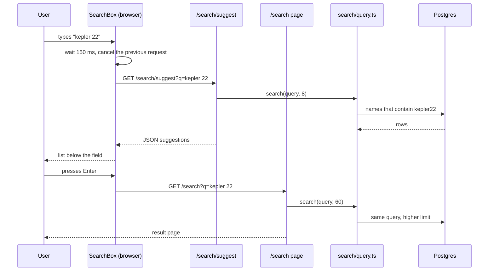

`search` in [query.ts](../src/app/search/query.ts) works in two steps:

1. **Names that contain the query.** The query is reduced to the same form as `search_name`, so `kepler 22b`, `Kepler-22B` and `KEPLER22B` all become `kepler22b`. One SQL statement looks through planets and stars together. Order: the exact name, then names that start with the query as a whole word or number (`Kepler-22 b` for `kepler 22`), then other names that start with it (`Kepler-220`), then the rest. Shorter names come first. The moons and dwarf planets, which live in code, are ranked by the same rules in TypeScript (`matchBodies`) and merged into the rows from the database, so `io` finds Io first. They do not take part in step 2.
2. **Similar names, only if step 1 found nothing.** Trigram similarity from `pg_trgm` catches typos: `proxma` finds Proxima Cen. The result page says that these are only similar names.

Queries shorter than two characters return nothing, and queries are cut off at 80 characters.

The field itself ([SearchBox.tsx](../src/app/search/SearchBox.tsx)) is an ordinary form that leads to `/search`, so it also works when JavaScript has not loaded yet. The suggestions are an addition on top: arrow keys move through them, Enter opens the selected one, Escape closes the list.

**By kind of planet.** Above the results the search page has the same two rows of chips as the list of all planets ([planets/TypeFilters.tsx](../src/app/planets/TypeFilters.tsx), described there): the four classes (`planet_class`: rocky planet, super-Earth, Neptune-like planet, gas giant) and the five climates (`climate_class`: frozen to scorching), which together are every kind a planet can be. One chip of each row can be chosen, so "Earth-like" in the strict sense is **Rocky planet** with **Temperate**. The chips are plain links: each leads to the same search with its part of the filter set (`/search?type=gas_giant&climate=hot`, `searchHref` in [filters.ts](../src/app/search/filters.ts)), the chosen one back to the search without it, so the filter works without JavaScript and every filtered list has an address. A value the address spells wrongly leaves that part open.

With a filter the page calls `searchByType` instead of `search`. It shares with the list of all planets what the two would otherwise each spell out: the columns of a planet (`planetSummaryColumns`), the condition for a kind of planet (`ofType`), both in [planets/queries.ts](../src/app/planets/queries.ts), and the sentences above the results ([planets/listText.ts](../src/app/planets/listText.ts)). The two queries themselves stay apart, because they answer different questions: the list also looks in the name of the star and can sort by year, the search ranks and finds withdrawn planets. Stars, moons and dwarf planets have no class and drop out, so it queries planets alone and can count them and read one page of 60 with `limit` and `offset`, which the merged search by name cannot. Without a query it lists every planet of the kind by name, and only those NASA still lists; with a query it ranks the names that contain it exactly as `search` does, withdrawn planets included, and falls back to similar names of that kind. The search field in the header sits on every page and must not subscribe to the address, which would hold up the static frame, so it reads the filter from the address at the moment its form is sent: a new query on the search page keeps the chosen kind, one from any other page starts without.

### The list of all planets

`/planets` shows every active planet, one per row, 200 per page. A row holds the plain image, the name, the star and the year of discovery. The list is sorted by name or by year of discovery. It is the second way to find a planet, for visitors who want to browse instead of typing a name.

**By kind of planet.** Below the filter field are two rows of chips ([TypeFilters.tsx](../src/app/planets/TypeFilters.tsx)): the four classes (`planet_class`) and the five climates (`climate_class`), which together are every kind a planet can be. One chip of each row can be chosen, and `listPlanets` adds the two conditions to its `where`. The chips are plain links to the same list with that part of the filter set (`/planets?type=gas_giant&climate=hot`, `listHref`; the parts are read by `parseTypeFilter` in [typeFilter.ts](../src/app/planets/typeFilter.ts)), and the chosen chip leads back to the list without it. The text filter, the order and the pager keep the kind; a new kind keeps the text and the order and starts on page 1. The line above the list names what it counts ("2,220 gas giants"), and the numbers of the four classes on the start page link to their lists.

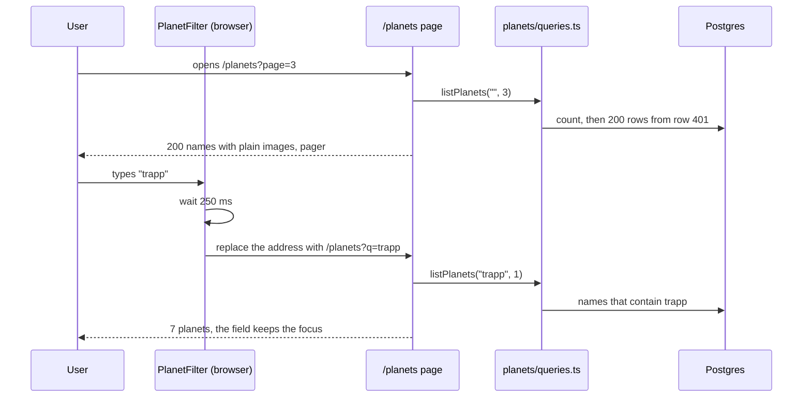

- **The address is the state.** Filter, order and page number live in `?q=`, `?sort=` and `?page=`, nowhere else. A filtered page can be reloaded, shared and reached with the back button. The small rules around that are plain functions: reading the order and building an address in [planets/paging.ts](../src/app/planets/paging.ts), and what the search needs as well in [shared/paging.ts](../src/shared/paging.ts): reading the page number (anything odd counts as page 1) and choosing which page numbers the pager shows.
- **Two orders.** By name is the default and is left out of the address. `?sort=discovery` sorts by year of discovery with the newest first. The catalogue records the year only, not the day, so planets of the same year follow each other by name. The six planets known since antiquity have no year and come last. The switch above the list is two links; the pager and the filter field carry the chosen order along, and a new order starts on page 1.
- **One page, two database reads.** `listPlanets` in [planets/queries.ts](../src/app/planets/queries.ts) first counts the matching planets, then reads 200 of them with `LIMIT` and `OFFSET`. A page number beyond the end shows the last page. The database sorts all 6,478 planets for each request, which takes about 15 ms in either order; no index is needed at this size.
- **The filter** keeps planets whose name, or the name of their star, contains the text, compared on `search_name` like the search. So `sun` lists the eight planets of the solar system. Unlike the search it does not rank and does not guess at typos: the list keeps its order and only gets shorter.
- **The field** ([PlanetFilter.tsx](../src/app/planets/PlanetFilter.tsx)) is an ordinary form that leads to `/planets`, so Enter works without JavaScript. With JavaScript, typing replaces the address 250 ms after the last key press, and Next.js fetches the new list from the server while the field keeps the focus. The list dims while it waits.
- **The plain image** ([PlanetDot.tsx](../src/app/planets/PlanetDot.tsx)) is one `<span>` with three colours from `planetAppearance`, shaded by CSS gradients (the utility `planet-dot` in [globals.css](../src/app/globals.css)). No SVG filter, no canvas, no script. The detailed, turning image would mean 200 canvases to redraw per page.
- **No prefetching.** The 200 links are marked `prefetch={false}`. Otherwise Next.js would fetch the frame of every planet page that scrolls into view.

## Data flow 4: the map

`/map` is the one page that is an application in the browser. The page itself ([map/page.tsx](../src/app/[lang]/map/page.tsx)) is a static frame. [MapLoader.tsx](../src/app/map/MapLoader.tsx) loads the map only in the browser, so three.js is not part of any other page.

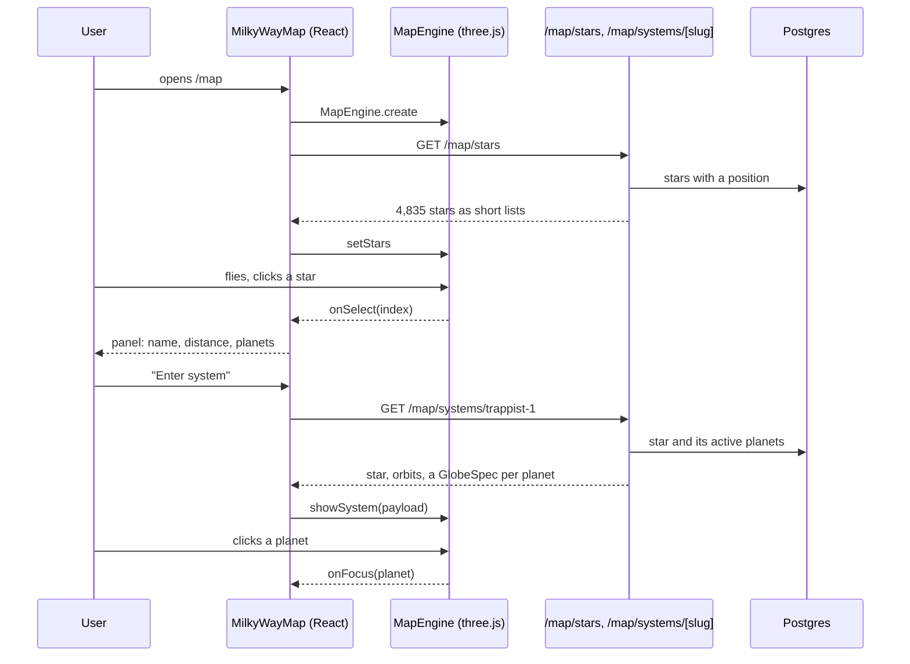

**Two halves with a narrow border.** [MilkyWayMap.tsx](../src/app/map/MilkyWayMap.tsx) is React: it fetches the data, holds what is selected and lays out the panels ([StarPanel.tsx](../src/app/map/StarPanel.tsx), [SystemPanel.tsx](../src/app/map/SystemPanel.tsx)), the star finder ([Finder.tsx](../src/app/map/Finder.tsx)) and the buttons. [scene/engine.ts](../src/app/map/scene/engine.ts) is plain three.js: it owns the canvas, the drawing loop and mouse, touch and keyboard. React tells the engine what to show (`setStars`, `select`, `flyToStar`, `flyHome`, `flyToOverview`, `showSystem`, `showGalaxy`, `focusPlanet`, `setPaused`), and the engine reports back through three callbacks (`onSelect`, `onFocus`, `onEscape`). Nothing that changes 60 times per second is React state.

**The address is the state.** `/map?star=trappist-1` selects a star, `/map?system=sun&planet=saturn` opens a system and follows a planet, `/map?system=sun&planet=saturn&moon=titan` follows one of its moons, `&scale=true` shows the true scale, `&zone=on` the habitable zone, `/map?view=galaxy` shows the whole galaxy. The map writes the current place back into the address, so every view can be shared, and the star and planet pages link straight to their place on the map.

**Two scenes.** From the whole galaxy down to a planet is a factor of a trillion, too much for one scene. So there are two, and the picture fades through black between them:

| | Galaxy ([scene/galaxyView.ts](../src/app/map/scene/galaxyView.ts)) | System ([scene/systemView.ts](../src/app/map/scene/systemView.ts)) |
| --- | --- | --- |
| Unit | Parsec, the Sun at the origin, as stored in `stars.x`, `y`, `z` | Free units, the star at the origin |
| Shows | The sky, the stars with planets, the model of the galaxy | The star, its planets on their orbits |
| Camera | Free flight: drag to look, W A S D to fly, wheel to move forwards. Or circling the galactic centre (**Orbit centre**, and after **Whole galaxy**): drag to turn round it, wheel or W and S to zoom | Circles the star or the planet it follows |
| Data | `/map/stars`, once | `/map/systems/[slug]`, on entering |

**What the galaxy view draws**, from back to front:

1. **The sky** ([scene/sky.ts](../src/app/map/scene/sky.ts)): a photograph of the whole Milky Way as seen from Earth, turned so that its band lies in the galactic plane. It fades out within a few hundred parsecs of the Sun, because from elsewhere the sky would look different; leaving the thin disc upwards or downwards counts four times as much as moving along it. From outside the galaxy the background is black.
2. **The galaxy** ([galaxy.ts](../src/app/map/galaxy.ts), `GALAXY_GLOW_FRAGMENT` in [scene/shaders.ts](../src/app/map/scene/shaders.ts)): nobody has a photograph of the Milky Way from outside, so the map uses the artist's impression that Robert Hurt drew for NASA from the surveys of its stars and gas. The picture is the plan of the disc from straight above, laid out to scale with the galactic centre in the middle and the Sun where the artist put it. A flat picture would be wrong from every other side, so the shader gives it a body: most of its light lies in a thin sheet in the plane and is read from the picture as sharp as it is (until the clouds below take its place); the rest is a soft glow of old stars, thickest in the bulge, added up along each line of sight through a sheet of dust (dust is where the picture is darker than its surroundings). From above the galaxy looks like the picture, from the side like a disc with a bulge and a dark lane, and from inside like the band of the Milky Way. The picture is read once when the map opens, shrunk to 512 pixels square while it is decoded ([scene/picture.ts](../src/app/map/scene/picture.ts)), for the plan of the stars, the clouds and the glow; the galaxy fades in as the sky fades out. The glow never reads it sharper than that: once the clouds are there they carry the sharp picture, and the glow reads its soft light from a blurred level of the picture (the levels are counted for a picture 4096 pixels wide, so any size gives the same blur). So the file is only 1024 pixels square and 80 KB. Seen from outside, a picture would still look like a picture, so from there it is only the plan and is not drawn itself ([galaxyClouds.ts](../src/app/map/galaxyClouds.ts)): where it is bright, and more so where it is brighter than its wider surroundings (in the arms), some 45,000 soft clouds of light are placed in its colours, together with 16,000 clusters of stars drawn as points among the stars; where it is darker than its surroundings, 16,000 clouds of dust. The arms, their gas, young stars and dust lie in a thin layer, as in nature. The height of the galaxy is carried by what has no arms: the smooth thick disc of old stars, which the glow draws from a strongly blurred reading of the picture, an oval bulge (a swarm of yellowish clouds, and in the shader light read from the picture at the same distance from the centre in the oval), and a faint halo. The real disc is about a hundred times as wide as it is thick, which on a screen reads as a sheet of paper, so these heights are drawn larger than they are (the thin layer by `THIN` in galaxyClouds.ts, the thick disc and the bulge in their own sizes), as pictures of galaxies usually do. Seen along the plane, the dust hides most of the thin layer: edge-on the galaxy is a glowing body with a dark lane through its middle. When the camera moves the clouds move against each other, which gives the galaxy depth. Placing them takes a few hundred milliseconds, so a worker does it beside the map ([scene/galaxyClouds.worker.ts](../src/app/map/scene/galaxyClouds.worker.ts)) instead of letting the map stand still. They are drawn into the same picture as the glow, so they cost nothing while the camera rests, and they fade out inside the disc, where the stars take over. A camera that circles the centre rests exactly when it is left alone, so that picture is kept then too.
3. **The stars between them** ([starfield.ts](../src/app/map/starfield.ts), [scene/starfieldView.ts](../src/app/map/scene/starfieldView.ts)): the Milky Way has some hundred billion stars, far too many to store or draw, and from any one place only a few hundred thousand are bright enough to make out. So space is cut into cubes, and a cube only makes its stars when the camera comes near enough to see them, always the same ones, from its own coordinates. Five classes of stars, from red dwarfs to supergiants, each with its own size of cube and its own reach: red dwarfs are made out to 20 parsecs, stars like the Sun to 80, supergiants to 4,000. How many stars a cube holds follows the plan of the arms (the brightness of the artist's impression), a disc that thins out above and below its plane, and the bulge. Where the galaxy is crowded the reach shrinks, so each class keeps to about 50,000 stars. A few cubes are made per frame (3 milliseconds at most), and a class is put on the graphics card at once when all its cubes are there. Near the Sun the bright classes stay hidden while the photograph of the sky shows them anyway, and the faint ones stay dim, so they do not lie over it like grain. Dust in the plane dims what lies far away in it.
4. **Landmarks** ([landmarks.ts](../src/app/map/landmarks.ts)): some twenty famous sights at their published positions: clouds of glowing gas, the shells of dying and exploded stars, young and globular clusters, and the Large and Small Magellanic Clouds outside the Milky Way. Gas is drawn as a picture turned towards the camera, clusters and the two small galaxies also with stars of their own. They get a name when the camera comes near.
5. **The stars with planets**: one point per star at its measured position, coloured by temperature (`starColor`). Near the camera they get names ([scene/labels.ts](../src/app/map/scene/labels.ts), ordinary HTML on top of the canvas).

Adding up the light along every line of sight costs time for each pixel. The galaxy is therefore drawn into a picture of its own with at most 1.3 million pixels, which is stretched over the screen, and that picture is only drawn again when the camera has moved.

**What keeps the map from standing still while it loads.** The shaders are built in the background (`ShaderGate`, see the system view below); the photograph of the sky and the maps of the planets are decoded beside the page as ImageBitmaps (`loadTexture` in scene/picture.ts) instead of on the main thread during the upload; the clouds of the galaxy are placed by a worker. Measured on a small built-in graphics card while the map opens: the whole galaxy blocked the page for 0.66 seconds and now for none, a star system for 0.84 seconds and now for less than a tenth; the whole galaxy loads 1.9 instead of 3.1 MB.

**What the system view draws.** [scene/systemView.ts](../src/app/map/scene/systemView.ts) holds the scene, its clocks and the camera and decides what is shown when. The globes themselves, with their shaders, maps, rings and orbit lines, are built by [scene/globes.ts](../src/app/map/scene/globes.ts), and [scene/textureStore.ts](../src/app/map/scene/textureStore.ts) reads each map once however many globes use it. [orbits.ts](../src/app/map/orbits.ts) lays out the orbits (`layoutOrbits`). Real proportions cannot be shown: Neptune is 80 times as far from the Sun as Mercury, and next to their orbits all planets are dust. The layout keeps the order, the eccentricity and the relative speed, squeezes the distances and enlarges the planets. A missing distance is derived from the period with Kepler's third law and the other way round. Positions on the ellipse come from Kepler's equation (`solveKepler`), so a planet is faster close to its star. Every planet is a ball with the shader of its planet page, lit from the position of the star. While the camera follows a planet it turns with it around the star, so the day side stays in view, and time slows down for planets that would otherwise race.

In the solar system Ceres, Pluto and Vesta have orbits of their own among the planets. The moons appear when the camera follows their planet, and only then are they created and their small maps loaded; a followed moon loads its large map. Following a planet with moons gives the stage to its moon system: the other planets, the orbits around the star and the belts fade out and are neither drawn nor updated, and the camera stays within the moon system. The moons follow the scale like everything else (`layoutMoons`): in the true scale they keep their real distances and sizes relative to the planet (Callisto 27 Jupiter radii out, the Moon 60 Earth radii); in the compressed scale, where the planet is enlarged a thousandfold, they start just outside the planet and its rings and each doubling of the distance adds one radius, and the small moons are squeezed between the large ones by the same rule (`compressedMoonDistance`, repeated in the shader). Each moon's orbit lies in the plane of the planet's equator, tilted by its inclination, so the moons of Uranus circle on their side and Triton runs backwards; the Moon's orbit is measured against the ecliptic. The moons are tidally locked: longitude 0 of each map faces the planet. They run on a clock of their own, so they do not crawl while time slows down for the planet. Every moon can be followed from the list, the small ones too (`&moon=s-2004-s-12`): the processor works out where that one moon is, as the shader does (`SmallMoonsView.place`), and draws it with a shape and surface made up from its name (`inventedBody` in globe/shape.ts): an ellipsoid with the axis ratios measured for small moons, its longest axis towards the planet, lumps, craters and a dark, mottled map. Nobody has seen these moons close up, so the list says under the followed one that its shape and surface are an illustration. The small moons are one instanced draw call of points per planet, moved by the GPU along their orbits like the belts (`SMALL_MOONS_VERTEX`), ([scene/smallMoonsView.ts](../src/app/map/scene/smallMoonsView.ts)). Their orbits are one set of faint lines drawn into a haze at half resolution without multisampling and laid over the picture ([scene/hazeLayer.ts](../src/app/map/scene/hazeLayer.ts)); the globes are drawn into the haze's depth first, so they still hide the lines behind them. Drawn into the picture, the pixels of Saturn's long, crossing ellipses alone cost almost two milliseconds per frame; in the haze they cost nothing measurable. The orbits of the followed planet and moon are traced afresh around them every frame ([scene/orbitTrace.ts](../src/app/map/scene/orbitTrace.ts)): a fixed polygon of Saturn's orbit, 9.5 AU across, strays two radii of Saturn from the planet in the true scale and wobbles as it moves on, while the trace has a corner on the body, short steps near it, and vertices relative to it. Shape models are drawn on the map from every fourth point of their grids, about 4,000 triangles, and in full once the camera follows them (`sharpen`). Their elements refer to the planet's equator or, for most of the far, captured moons, to the ecliptic. **Hide moons**, next to **Page** in the row of the followed planet, switches them all off (`&moons=off`).

**Two scales.** The button next to **Pause** names the scale shown and switches to the other. The true scale shows every distance and size as it is, one view unit to the AU (`TRUE_AU` in orbits.ts), and glides there and back in under two seconds: positions, sizes and the belts are mixed between both layouts by the logarithm, so a change across many powers of ten looks even. In the true scale the planets would be far below a pixel, so every globe is drawn at least `MIN_PIXELS` wide. The camera keeps its distance as a multiple of what it looks at (the radius of the followed planet or moon, or the extent of the system), so the picture stays put while sizes change a thousandfold. In the true scale the camera may go back far enough to take in the Oort cloud. The choice is part of the address (`&scale=true`).

**The habitable zone.** The button **Habitable zone** lays a faint green band into the plane of the orbits where a rocky planet could keep liquid water on its surface (`&zone=on`). [habitableZone.ts](../src/app/map/habitableZone.ts) works it out in the browser from what the system already brings along: the star's radius and temperature give its luminosity, and the limits of Kopparapu et al. (2013, with the coefficients of 2014 for one Earth mass) give the starlight at each edge, which depends on the temperature again because a cool star's infrared light warms a planet more per watt. There are four edges. The conservative ones (runaway greenhouse and maximum greenhouse, 0.95 to 1.68 AU for the Sun) are drawn as hairlines; the optimistic ones (recent Venus and early Mars, 0.75 to 1.77 AU) are where the band has faded out, as the limits are estimates and not borders. A star without a known radius or temperature has no zone, and the button is disabled; a star outside the fitted 2600 K to 7200 K counts as one at the nearest end. In the panel, a dot marks every planet whose orbit lies within the conservative limits and a ring every one that only the optimistic limits take in, by the measured semi-major axis or the one its period gives (`knownAxisAu`, the rule `layoutOrbits` places by), and the panel says so if no known planet circles in the zone.

The band is one quad ([scene/habitableZoneView.ts](../src/app/map/scene/habitableZoneView.ts)) whose shader draws the ring from the distance to the star, so it costs one draw call and nothing per frame on the processor. In the compressed scale its edges are squeezed like the orbits, so it lies between the same planets as in the true scale; inside the innermost orbit, where `viewRadius` is proportional and would put the zone of a star with only a far planet inside the enlarged star, the star's surface is one more knot (`viewRadiusOutsideStar`). The band is light added to the picture but is drawn with the solid bodies, right after the sky: it passes through the middle of every planet, and drawn later it would tint the lower half of each globe. Close above the band, as when the camera follows a planet, none of its shape is in the picture, only a green cast, so the fill fades there and the hairlines stay (`clearance`); it gives way to a moon system like the other planets. Hot Jupiters circle fifty times closer to their star than its zone lies, so while the zone is shown the overview and the camera's range grow to take it in (`zoneReach` in scene/systemView.ts), also across a change of scale.

The asteroid belt, Jupiter's trojans and the Hildas, the Kuiper belt with the scattered disc and the Oort cloud are some 14,500 points ([belts.ts](../src/app/map/belts.ts)), each with an orbit drawn from the distributions the surveys found: the Kirkwood gaps that Jupiter clears, the trojans 60 degrees ahead of Jupiter and behind it, the Hildas in their triangle, the plutinos with Pluto, the cold classical belt close to the ecliptic. The Oort cloud has never been seen; its points stand still at the distances models give, from 2,000 to 100,000 AU. One instanced draw call shows them all, each body a quad of a few pixels, and the vertex shader moves it along its Kepler orbit (`BELT_VERTEX` in scene/shaders.ts), so the processor does no work for them per frame; what never changes, the two vectors that span each orbit, is computed once beforehand (`orbitAxes` in scene/beltsView.ts). They are quads rather than points because ANGLE, which runs WebGL on Direct3D under Windows, draws points through a geometry shader: as points the belts cost 0.7 ms per frame on a small built-in graphics card, as quads too little to tell from the measuring noise while following a planet, and about 0.3 ms in the view of the whole system. Their distances are squeezed by the same rule as the orbits (`viewRadius`), which the shader repeats from the laid-out orbits, and mixed with their true distances for the true scale.

**Credits.** The pictures of the sky and the galaxy and the maps of the planets are under CC BY 4.0, which asks for attribution; it allows that to be a link to a page with the details (section 3(a)(2)). So the map's corner holds only **Credits**, **Legal notice** and **Privacy**, and [credits/page.tsx](../src/app/[lang]/credits/page.tsx) lists every source with its licence and the changes made. The sources are data ([credits/sources.ts](../src/app/credits/sources.ts)), with the moon maps and shape models taken from maps.ts and shapes.ts, so a new source shows up there by itself, and in the list of sources of the printed catalogue as well. The site footer links to it too.

**The answers are short.** `/map/stars` sends each star as a list of seven values (slug, name, x, y, z, temperature, number of planets) instead of an object with named fields ([payload.ts](../src/app/map/payload.ts)). Browsers and the CDN may keep both answers for an hour (see "What is cached"). `/map/systems/[slug]` already contains the `GlobeSpec` of each planet, computed on the server by the same `planetAppearance` as on the planet page, and for the Sun the dwarf planets and the moons with theirs.

## Data flow 5: the printed catalogue

`npm run catalogue` ([scripts/catalogue.ts](../scripts/catalogue.ts)) builds the whole catalogue as one PDF: a cover, a foreword, the contents, a page for every body, the sources and an index. It is a script like the sync: it reads the database, never writes it, and the app does not know it exists. The app only links to the finished file ([catalog/editions.ts](../src/app/catalog/editions.ts), [CatalogueDownload.tsx](../src/app/catalog/CatalogueDownload.tsx)), which a daily workflow publishes as a file of a GitHub release ([DEPLOYMENT.md](DEPLOYMENT.md)). A request to the site could not build it: a function has neither the time nor a graphics card for several thousand pictures.

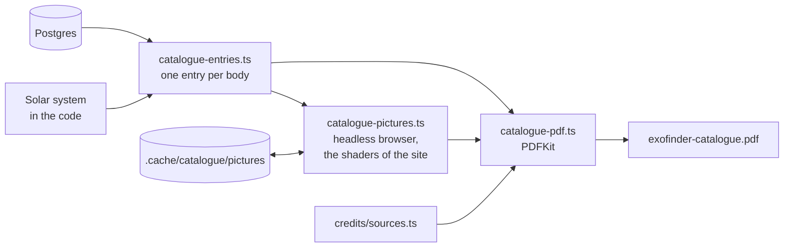

**The same order, the same facts.** [catalogue-entries.ts](../scripts/catalogue-entries.ts) lists the bodies in the order the site is browsed in ([browse/](../src/app/browse)): the solar system from `SOLAR_SEQUENCE`, the exoplanets sorted by `exoplanetOrder` of browse/queries.ts. The number at the top of a page is therefore the number the site shows for the same body. The values of a page are the rows of the body's page on the site: both take them from the same functions ([planets/facts.ts](../src/app/planets/facts.ts), [solar-system/facts.ts](../src/app/solar-system/facts.ts)), which return plain text ([shared/facts.ts](../src/shared/facts.ts)), so the book cannot say something else than the site. A star has no page in the book; its values stand on the page of each of its planets. Only the Sun has one.

**The pictures are those of the site.** [gl-page.ts](../scripts/gl-page.ts) draws in a page of a headless browser. Node works out every uniform with the code of the app (`planetAppearance`, `surfaceUniforms`, `poseUniforms`), and the page only runs WebGL with the shader sources of the app, so the picture is what the 3D model of the site shows, at a fixed moment and from a fixed side. The shader tests draw through the same module ([tests/e2e/lab.ts](../tests/e2e/lab.ts)). The page gets the maps from `public/` without a server: the script answers its requests from the folder. Four kinds of picture come out of it ([catalogue-pictures.ts](../scripts/catalogue-pictures.ts)):

| Body | Drawn from |
| --- | --- |
| a planet, a round moon, a dwarf planet | its `GlobeSpec`, with the globe shader of the planet pages |
| an irregular body with a shape model | its radius grid as a mesh, with the shader and the camera of [ShapeViewer.tsx](../src/app/solar-system/ShapeViewer.tsx) |
| a small moon | the shape and surface that `inventedBody` makes up from its name, as on its page |
| the Sun | a sphere with its map and the star shader of the map |

Every picture is drawn twice as large as it is kept and scaled down, which smooths the edges of the meshes and the grain of the planets.

**A picture is drawn once.** Its file name is a hash of everything that shapes it: the shader sources, the uniforms, the names of the maps, the size and the quality. A run draws only the pictures whose file is not in `.cache/catalogue/pictures` yet, so after the first run the daily changes of the catalogue cost a few pictures. A new shader gives new hashes by itself; a changed map file does not, so `VERSION` in catalogue-pictures.ts is raised by hand then. With a graphics card (`--gpu`, Windows) a planet takes a tenth of a second; in software, as on a CI runner, several times that.

**A file is written once.** When every picture is there, the script works out a stamp of what the file would be made from (`catalogueStamp`): the text of every page, the name of its picture, the sources and the code of the layout, but not the day. If it is the stamp of the last file, kept in `.cache/catalogue/built`, no file is written, and the workflow then publishes nothing: on a day without a change in the catalogue the published file stays as it is. `--force` writes it anyway. When a file is written, it is written whole: a planet that NASA adds takes its place by distance, which moves every page behind it, the contents and the index.

**Small before sharp.** Almost all of the file is pictures, and a PDF takes few picture formats: JPEG is the only one that suits photographs and that every reader shows. So the pictures are JPEGs written by mozjpeg, at 600 pixels and quality 76. A picture is printed 300 points wide, which makes 144 pixels to the inch, twice what a screen shows of it at full size. Measured on 150 exoplanets, that takes 13 kB a picture where 720 pixels at quality 84 took 22 kB, without a difference the eye finds at the printed size. The fonts are embedded as subsets, and the same picture is stored once however many pages show it. Where [qpdf](https://qpdf.sourceforge.io) is installed, as in the workflow, the script packs the file at the end: PDFKit writes every page, link and bookmark as an object of its own in plain text, and qpdf gathers them in compressed streams and orders the file so that a browser shows the first page while the rest is still loading.

**The page numbers are known before the first page is written.** Every body takes exactly one page, so [catalogue-pdf.ts](../scripts/catalogue-pdf.ts) works out the page of each from the lengths of the parts before it. Only the contents list their own length; they are laid out until the number of their pages holds. That lets PDFKit write the file from front to back onto the disk instead of holding several thousand pages in memory. Each page has a named destination, which the lines of the contents and of the index link to, and the bookmarks of the file follow the contents: the bodies that orbit the Sun with their large moons, then star by star.

## When things go wrong

| Situation | What happens |
| --- | --- |
| The database is down | The start page shows a notice instead of the numbers. Planet, star and search pages show [error.tsx](../src/app/[lang]/error.tsx) with a "Try again" button. `/search/suggest` answers with status 503 and an empty list, and the field simply shows no suggestions. |
| Unknown planet or star | The page shows the not-found message. |
| Is the site healthy? | `GET /health` answers 200 when the database answers within three seconds, otherwise 503, never cached and without details ([health/route.ts](../src/app/health/route.ts)). The smoke test of each deployment and the hourly health check ask it. |
| An address that cannot be a slug, or is encoded wrongly | A null byte, a slash or an overlong slug is "not found" without a database query. Broken percent-encoding (`/planets/%E0%A4%A`) gets status 400 from [proxy.ts](../src/proxy.ts). |
| An address without a language, or with one the site does not have | `/planets/earth` is redirected to the visitor's language. `/fr/planets/earth` has no language the site knows, so it is taken for a page without one, redirected to `/en/fr/planets/earth` and "not found" there. |
| The list is asked for a page that does not exist | `/planets?page=999` shows the last page, `?page=abc` the first. A filter that matches nothing gives a hint instead of a list. |
| A planet or star was renamed | The old address leads to the new page. The new page lists the former names. |
| NASA is down or answers nonsense | The sync stops, writes nothing and records the failed run in `sync_runs`. The site keeps showing the last good state. |
| The browser has no WebGL 2 | Planet images stay still (the SVG from the server). The map shows a notice that points to the search and links to the solar system. |
| The map cannot load the stars or a system | `/map/stars` and `/map/systems/[slug]` answer with status 503. The map shows a notice; the sky and the galaxy are still drawn. An unknown star gets status 404. |
| The visitor prefers reduced motion | Planet images stand still, the orbits on the map start paused, and flights and fades on the map happen at once. |

Two limits come from streaming. The server has already sent the status 200 and the page frame before it knows whether the planet exists. So an unknown planet shows the not-found message with status 200 instead of 404, and a renamed planet is redirected by the page itself (a `<meta http-equiv="refresh">` tag) instead of status 308. Visitors see no difference. Search engines handle both less well than real status codes. Addresses outside `/planets/…` and `/stars/…` return a real 404.

## Tests and checks

[TESTING.md](TESTING.md) describes every layer in detail: what runs when, what each layer catches, the test data, and what is not tested automatically. In short:

| Command | Checks |
| --- | --- |
| `npm test` | Unit tests for the logic without database: classification, appearance, coordinates, slugs, formatting, the pages of the planet list, the order the catalogue is browsed in, the details of the operator, reading the NASA response, planning the sync, the description of a globe and its shader values, the noise of the planet shaders, the scale of the galaxy, the orbits, the answers of the map, and that the base maps fit their numbers. Also the security headers, the proxy and the language it picks, that German and Turkish hold every text and build their sentences correctly, and what the JSON endpoints answer when the database fails (no details may leak) |
| `npm run test:scripts` | Runs the generator of the base maps at a small size: every preset is simulated, the files come out complete, the same run gives the same files. Also the printed catalogue: the pages of the bodies in the order and with the facts of the site, the camera of its pictures, and a small PDF with its page count |
| `npm run test:db` | Tests against a real PostgreSQL (`*.db.test.ts`): the search and its ranking, the planet list with filter, order and pages, planets, stars, the order the exoplanets are browsed in, the map, the figures of the start page, the three JSON endpoints, and whole sync runs (unchanged, changed values, new planets, renames, an implausible or broken answer from NASA). Every query also gets hostile input: SQL fragments, wildcards, null bytes, 100,000 characters |
| `npm run test:e2e` | Browser tests with Playwright ([tests/e2e/](../tests/e2e)): builds the app and clicks through it in Chromium, on a desktop and a phone screen. Start page, header and footer, search with suggestions and keyboard, planet list, planet and star pages with the 3D model, the pages of the moons, browsing the catalogue body by body, the map, not-found pages, former names. What the shaders draw: planets and the galaxy are drawn in the test browser and their pixels checked, for properties (day and night, moving clouds, aurora and lightning on the night side only) and against small kept pictures. Security: the headers on every kind of answer, hostile input over HTTP, script injection through the address, framing by another site, no CSP violation. Accessibility: axe-core checks every page against WCAG 2.1 A and AA |
| `npm run test:all` | All four |
| `npm run test:coverage` | The unit tests, with a report of the lines of `src/` they reach |
| `npm run test:smoke` | The smoke test ([tests/smoke/](../tests/smoke)) against a running deployment: `/health`, the main pages with their security headers, the JSON endpoints, a short walk in the browser. Runs against every Vercel deployment, and production goes live only when it has passed ([DEPLOYMENT.md](DEPLOYMENT.md)); `test:e2e` runs it against the local build |
| `npm run typecheck` | Route types and TypeScript |
| `npm run lint` | ESLint |
| `npm run build` | The production build |

The database and browser tests use their own databases (`exofinder_test`, `exofinder_e2e`) and never the one of `DATABASE_URL`. GitHub Actions runs all of it on every pull request and push, with CodeQL and `npm audit` next to it; a deployment goes live only after its smoke test, and the live site is watched by the hourly health check, the monthly TLS check and an uptime monitor.

## Security

[SECURITY.md](SECURITY.md) describes the measures layer by layer: accounts, code and dependencies, network and transport, the application, the database, privacy, watching and recovery, what to do when something happens, and the known limits. The parts that shape the code:

- **Security headers** on every answer ([security-headers.ts](../src/shared/security-headers.ts)): a Content Security Policy that only allows the site itself and forbids framing, HSTS, and the usual protective headers. Scripts need `'unsafe-inline'` for the inline data of Next.js.
- **Checked input.** Queries use bound parameters. Slugs are checked with `isSlug` ([slug.ts](../src/shared/slug.ts)) before they reach the database, the search reduces a query to letters and digits, and [proxy.ts](../src/proxy.ts) answers broken percent-encoding with 400.
- **Read-only database access.** Inside the Next.js server [client.ts](../src/db/client.ts) connects with `DATABASE_URL_READONLY` when that is set: the role `exofinder_web` ([readonly.ts](../src/db/readonly.ts)) may only `SELECT`, runs every transaction read-only and cancels a query after 5 seconds. Scripts and tests run outside Next.js and write with `DATABASE_URL`.

## Not built yet

- **Real stars without planets.** The stars between the stars with planets are computed (see the map); none of them is a real star of a catalogue.
