# Deployment

ExoFinder runs on Vercel with a hosted PostgreSQL database. This page describes how a change gets online, what has to be set up once, and what to keep in mind.

## How a change gets online

Nobody has to start a deployment, but nothing is deployed before its checks have passed. GitHub Actions first runs the checks in [ci.yml](../.github/workflows/ci.yml) (type check, lint, unit, database and browser tests, `npm audit` and the build) and [codeql.yml](../.github/workflows/codeql.yml). When CI has passed, [deploy.yml](../.github/workflows/deploy.yml) waits until every other check of the commit has finished as well, CodeQL's code scanning included, and only then hands the commit to Vercel with the Vercel CLI. If any check fails, nothing is deployed and the live site stays as it is.

| The checks pass for | Vercel builds | Address |
| --- | --- | --- |
| a push to `main` | a **production** deployment | first only its own address; the real address of the site once its smoke test has passed |
| a pull request from a branch of this repository | a **preview** deployment | its own address, in the run of *Deploy* |

Vercel's own deployments from Git are switched off in [vercel.json](../vercel.json) (`"git": { "deploymentEnabled": false }`): they start the moment a commit is pushed and do not wait for any check. Pull requests from forks are not deployed, because the workflow holds the Vercel token. Neither are those of Dependabot: nobody has looked at their new packages yet, and a preview would run them with the database address. CI checks them, and they go live with the next production deployment after the merge, once the smoke test has checked it. GitHub starts `deploy.yml` only in the version on `main`, so a change to it takes effect once it is merged. Protect `main` as well (see step 4 below), so that changes reach it only through a pull request whose checks are green.

The build command comes from [vercel.json](../vercel.json): first `npm run db:migrate-on-deploy`, then `npm run build`. For a production deployment the first step brings the database up to date (see [Migrations](#migrations)). If a step fails, the deployment that is live stays as it is.

A production deployment is built without the domain of the site (`vercel deploy --prod --skip-domain`): it is complete and runs with the production database, but visitors still see the deployment before it. [deploy-check.yml](../.github/workflows/deploy-check.yml) smoke-tests the new one under its own address: is it up, does it reach its database, do the main pages work? Only when that has passed does `deploy.yml` give it the domain (`vercel promote`). A deployment that fails never goes live (see [Smoke test before going live](#smoke-test-before-going-live)). Once an hour, [health.yml](../.github/workflows/health.yml) asks the live site whether it is still up.

The NASA sync does not run on Vercel. [sync.yml](../.github/workflows/sync.yml) starts it once a day in GitHub Actions.

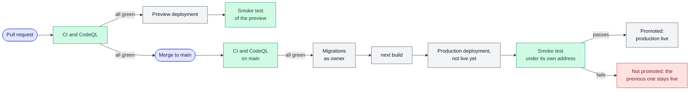

Around the clock, without anybody starting it:

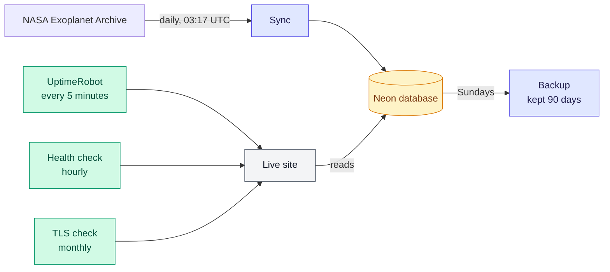

## Setting it up once

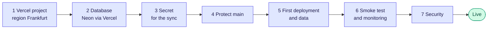

### 1. Vercel project

In Vercel: *Add New → Project*, choose the repository. Vercel recognises Next.js; the build command comes from `vercel.json`. Select **Deploy** without setting any variable: this first build fails, because there is no database yet. Then set *Settings → Functions → Function Region* to the region of the database (Frankfurt, `fra1`, for a database in `eu-central-1`).

### 2. Database

Any hosted PostgreSQL that allows the extension `pg_trgm` works, for example Neon (also available in the Vercel Marketplace) or Supabase. With Neon: *Storage → Create Database → Neon*, region Frankfurt, then connect it to the project for Production and Preview, **without** a database branch per deployment, with the prefix `DATABASE`. Note two addresses:

- **pooled**: goes through the pooler of the provider. The site uses it, because Vercel starts many instances at once and each keeps up to `DATABASE_POOL_SIZE` connections.
- **direct** (unpooled): goes straight to the database. Migrations, the sync and the seed use it.

Neon calls them `DATABASE_URL` and `DATABASE_URL_UNPOOLED` and, when connected through the Vercel Marketplace, sets them in the Vercel project itself. Both belong to the owner role, which may change everything. The site itself only reads; step 7 gives it a role of its own that may only read.

If the pooler runs in transaction mode and does not support prepared statements (Supabase on port 6543, for example), set `DATABASE_PREPARE=false`.

### Where every value comes from

In Vercel, under *Settings → Environment Variables*:

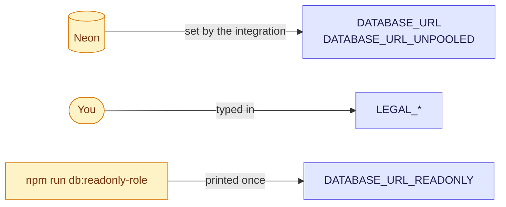

In GitHub, under *Settings → Secrets and variables → Actions*:

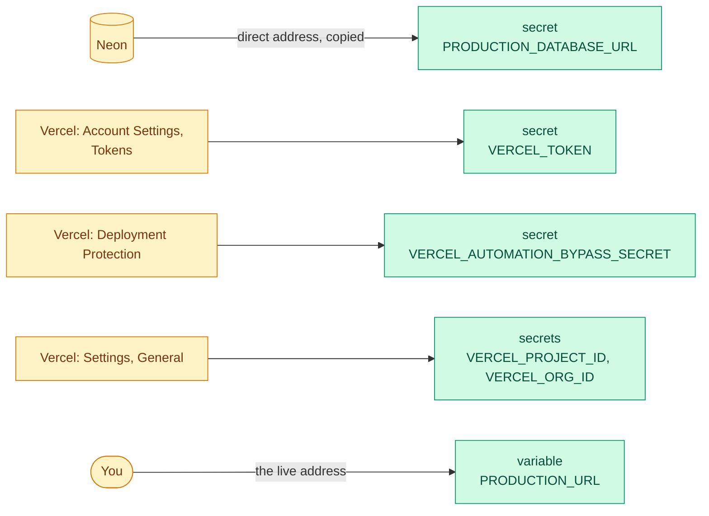

All variables of the project, under *Settings → Environment Variables*. Most of them are set in later steps:

| Variable | Environments | Content | Comes from |
| --- | --- | --- | --- |
| `DATABASE_URL` | Production, Preview | pooled address | set by Vercel when you connect the database (step 2) |
| `DATABASE_URL_UNPOOLED` | Production | direct address, for the migrations | set by Vercel when you connect the database (step 2) |
| `DATABASE_PREPARE` | Production, Preview | only if needed, see above | you, only with such a pooler |
| `LEGAL_NAME`, `LEGAL_STREET`, `LEGAL_CITY`, `LEGAL_EMAIL` | Production | the operator, see [.env.example](../.env.example) | you, after the database |
| `LEGAL_HOSTING`, `LEGAL_HOSTING_TRANSFER`, `LEGAL_HOSTING_DPA` | Production | the host | fixed texts, see [Legal pages](#legal-pages) |
| `LEGAL_COUNTRY`, `LEGAL_PHONE`, `LEGAL_EMAIL_PROVIDER`, `LEGAL_LOG_DAYS` | Production | optional | you, see [Legal pages](#legal-pages) |
| `DATABASE_URL_READONLY` | Production, Preview | the address of the read-only role | printed by `npm run db:readonly-role` (step 7) |
| `CATALOGUE_URL` | Production | optional: the folder the printed catalogue is downloaded from | you, only for a copy of the site, see [The printed catalogue](#the-printed-catalogue) |

Once the database and the `LEGAL_*` values are set, deploy again (*Deployments → … → Redeploy*): this build creates the tables.

The `LEGAL_*` values are read when the app is built. After changing one, deploy again (*Deployments → … → Redeploy*).

### 3. Secret for the sync

In GitHub: *Settings → Secrets and variables → Actions → New repository secret*, name `PRODUCTION_DATABASE_URL`, value the **direct** address of the database.

### 4. Protect `main`

In GitHub: *Settings → Branches → Add branch ruleset* (or *Branch protection rule*) for `main`:

- require a pull request before merging,
- require these status checks to pass: `check`, `audit`, `db` and `e2e` from CI, and `analyze` from CodeQL. They appear in the list once they have run for the first time.

### 5. First deployment and first data

1. Push to `main` or merge a pull request. The production build creates the tables.
2. In GitHub: *Actions → Sync with NASA → Run workflow*, tick **Store the solar system**. This fills the empty database. After that the workflow runs every day by itself.
3. Open the site and check a planet page, the search and the map.

### 6. Smoke test and monitoring

Without this step nothing is deployed, and nothing notices when the site stops answering. What each part does is described below.

1. **Deployment Protection.** In Vercel, *Settings → Deployment Protection*: if it is on (by default it protects every address except the production domain, and the smoke test opens a deployment before it has that domain), create a secret under *Protection Bypass for Automation*. Store it in GitHub (*Settings → Secrets and variables → Actions → Secrets*) as `VERCEL_AUTOMATION_BYPASS_SECRET`.
2. **Token for deploying and going live.** In Vercel, *Account Settings → Tokens*: create a token with access to the team of the project. Store it in GitHub as the secret `VERCEL_TOKEN`. Without it nothing is deployed.
3. **Project and team.** In GitHub, under *Secrets*, set `VERCEL_PROJECT_ID` (Vercel: project *Settings → General → Project ID*) and `VERCEL_ORG_ID` (the team ID under *Team Settings → General*, or for a personal account the user ID under *Account Settings*). `npx vercel link` also writes both into `.vercel/project.json`. The two ids open nothing without the token, but GitHub prints a variable into the log of every step that uses it, and in a public repository everybody can read that log; a secret is replaced by `***` there. Variables of the same names still work, so an older setup keeps deploying: create the two secrets, then delete the variables.
4. **Live address.** In GitHub, set the variable `PRODUCTION_URL` to the address of the site, for example `https://exofinder.example.org`.
5. **Uptime service (recommended).** Let a monitoring service such as UptimeRobot or Better Stack ask `https://<your domain>/en/legal/notice` every few minutes and e-mail you when it does not answer 200. Not `/health`: that asks the database, and a check every few minutes would keep a Neon database from ever going to sleep. On the free plan that alone would use more compute time than included (about 180 of 100 CU-hours a month at 0.25 CU). The legal notice is a prebuilt page without the database, so it shows whether the site is up; the hourly check of `/health` in GitHub Actions covers the database.

Without `VERCEL_TOKEN` and the two ids nothing is deployed: the run of *Deploy* turns red with a message that names the missing value. Without the bypass secret the smoke test cannot open protected deployments and says so; no production deployment goes live until it is set.

### 7. Security

The site has no logins, forms, cookies or uploads, so most of a usual security checklist does not apply. What remains, in order of importance:

1. **Two-factor sign-in** on every account that can change the site: GitHub, Vercel, Neon, Namecheap and the e-mail account they send their messages to. These accounts are the real way in: whoever controls one of them controls the site.
2. **Read-only role.** After the first deployment, run on your computer with the owner addresses from Neon (*Neon console → Connect*, or the Vercel variables):

   ```bash
   DATABASE_URL="<pooled owner address>" DATABASE_URL_UNPOOLED="<direct owner address>" npm run db:readonly-role
   ```

   Store the address it prints in Vercel as `DATABASE_URL_READONLY` (Production and Preview) and deploy again. See [Read-only database role](#read-only-database-role).
3. **Rate limit** for the search, see [Rate limiting](#rate-limiting).
4. **Domain** at Namecheap, see [Domain](#domain).
5. **Backups** run by themselves once `PRODUCTION_DATABASE_URL` is set (step 3), see [Backups](#backups). Try a restore once.
6. **After going live**, test the address at [SSL Labs](https://www.ssllabs.com/ssltest/) (expected: A or better) and [securityheaders.com](https://securityheaders.com).

## Health check and monitoring

`GET /health` ([route.ts](../src/app/health/route.ts)) answers 200 with `{"status":"ok","database":"ok","commit":"abc1234"}` when the site reaches its database within three seconds, and 503 with `"database":"unreachable"` when it does not. `commit` is the deployed Git commit; Vercel provides it, locally it is `null`. The answer is never cached and names no detail of a failure; the details go to the function log in Vercel.

On Vercel there is no server process that could hang and would need a restart: every request runs in a function that Vercel starts and replaces by itself. The health check therefore serves to *notice* problems, mostly a database that is down or a wrong `DATABASE_URL`:

- [health.yml](../.github/workflows/health.yml) asks it once an hour (needs the variable `PRODUCTION_URL`). After three failed tries a minute apart the run turns red and GitHub sends an e-mail. GitHub may start scheduled runs some minutes late, and it switches them off after 60 days without activity in a public repository.
- An uptime service (step 6.5) checks more often and more reliably whether the site answers, using `/en/legal/notice` so that the database can sleep in between. The address names the language, because one without it only answers with a redirect.

`/health` is not rate limited of its own: it costs one `select 1`, and the Vercel Firewall's DDoS protection stops floods. The one rate limit rule of the Hobby plan goes to the search, which asks the database far more.

## Smoke test before going live

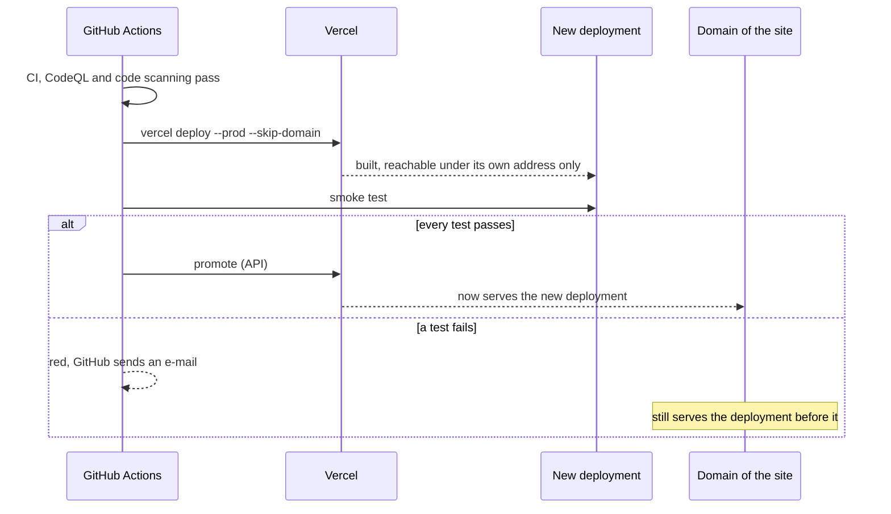

When [deploy.yml](../.github/workflows/deploy.yml) has deployed a commit, it calls [deploy-check.yml](../.github/workflows/deploy-check.yml) with the address, the environment and the commit. That runs `npm run test:smoke` ([tests/smoke/](../tests/smoke)) against the deployment's own address, for previews and production alike. In about a minute it checks:

- `/health` answers 200 and the deployment runs the commit it was started for,
- the start page, the planet list, a planet and a star page, the search, the map and the legal pages answer 200 with the security headers,
- a planet page answers in English, German and Turkish, and an address without a language leads to one,
- the JSON endpoints answer with data from the database,
- in Chromium: from the start page to a planet, the list and the search, without errors in the browser console.

It only relies on the solar system, which every filled database has. Failed tests are retried twice, so a short network hiccup does not count. The browser tests in CI run the same smoke test against the local build, so a change to the pages that would break it shows up before it is merged.

**Production goes live only after this check.** The job `promote` of `deploy.yml` ("Go live" in the run) needs the check and asks Vercel's API to promote the checked deployment, which gives it the domain of the site without building again: what goes live is exactly what was tested. It then waits until Vercel reports that the domains have moved. The job asks the API itself and not `vercel promote`, because that command first asks which user the token belongs to and fails with "User not found" for a token that may act for the team but belongs to no user. If the check fails, the job is skipped, the run turns red, GitHub sends an e-mail and the summary of the run says that the commit did not go live. Nothing has to be undone, because visitors never saw the failed deployment. The same holds when the smoke test cannot open the deployment at all (Deployment Protection without the bypass secret): nothing goes live until the setup is fixed.

The check of a deployment runs the smoke test **as it is on `main`**, not the one of the deployed commit, and installs without the npm cache. It holds the bypass secret, and the code of a pull request could otherwise read it, or leave packages in the cache that later runs of `main` would use. A change to the smoke test therefore checks deployments once it is merged; until then CI runs it against the local build. The check holds no Vercel token: it can look at a deployment, but not change what is live.

By hand, against any address:

```bash
SMOKE_BASE_URL=https://exofinder-abc123.vercel.app npm run test:smoke
```

Or in GitHub: *Actions → Deployment check → Run workflow* with the address.

Vercel puts its toolbar into preview deployments. The Content Security Policy of the site blocks it, so it does not appear in previews. The smoke test ignores the resulting messages in the browser console.

What to know:

- **The database is ahead of the code for a moment.** The migrations run while the new deployment is built, before its smoke test. If the test fails, the site keeps running the old code with the new tables. That is why a migration must never break the code before it (see [Migrations](#migrations)).
- **A deployment that passed but was not promoted** (Vercel did not answer, say) is named in the summary of the run. Promote it by hand: *Deployments → … → Promote* in Vercel, or `npx vercel promote <address>`.
- **Going back by hand.** The smoke test cannot see everything. If a deployment that is live turns out to be broken, *Deployments → … → Instant Rollback* in Vercel puts the one before it back, and so does `npm run deploy:rollback` ([rollback-production.ts](../scripts/rollback-production.ts)) with `VERCEL_TOKEN`, `VERCEL_ORG_ID`, `VERCEL_PROJECT_ID` and the address of the broken deployment in `FAILED_DEPLOYMENT_URL`. Only the code goes back, not the database. On the Hobby plan Vercel can only go back to the deployment directly before the current one.

## Migrations

`npm run db:migrate-on-deploy` ([scripts/migrate-on-deploy.ts](../scripts/migrate-on-deploy.ts)) applies the migrations in `drizzle/` before the production build. It does nothing for a local `npm run build` or for preview deployments.

The new migration runs a minute or two before the new code goes live, so the old code briefly works with the new tables. A migration must therefore not break the code that is still live: add columns and tables first, and remove old ones in a later deployment.

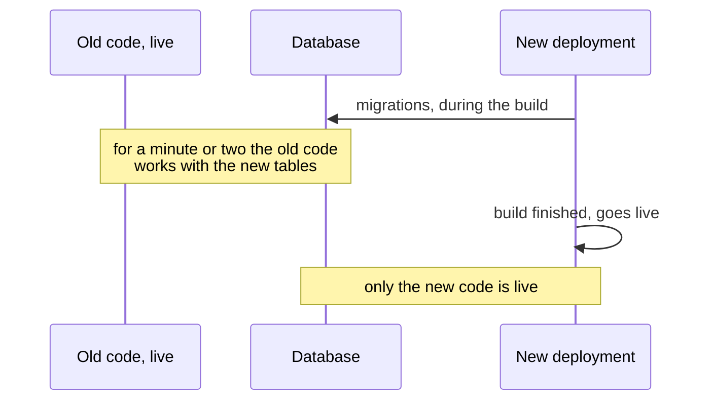

Preview deployments use the production database unless they get their own. A preview whose code expects a newer schema then fails until the change is merged. If the provider can create a database branch for each preview (Neon can), set `DATABASE_MIGRATE_ON_BUILD=true` for the Preview environment: previews then migrate their own branch.

## The daily sync

[sync.yml](../.github/workflows/sync.yml) runs `npm run sync` every day at 03:17 UTC against `PRODUCTION_DATABASE_URL`. When it fails, for example because the answer from NASA looked implausible, the run turns red and GitHub sends an e-mail. Started by hand, it can also store the solar system or force the sync (`--force`).

GitHub switches off scheduled workflows of a public repository after 60 days without activity in it. It says so by e-mail; *Actions → Sync with NASA → Enable workflow* switches it on again.

## Read-only database role

The website never writes to the database; only the sync and the seed do. `npm run db:readonly-role` ([create-readonly-role.ts](../scripts/create-readonly-role.ts), statements in [readonly.ts](../src/db/readonly.ts)) creates the role `exofinder_web`:

- it may read every table, also those of later migrations, and nothing else: no writing, no deleting, no new tables,
- every transaction is read-only, and a query is cancelled after 5 seconds, so one expensive query cannot tie up the database.

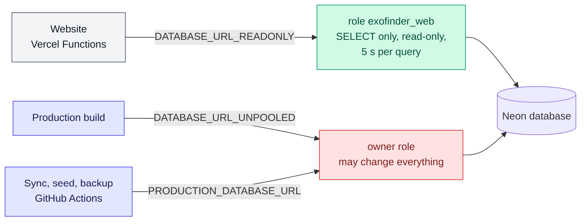

Inside the Next.js server the site connects with `DATABASE_URL_READONLY` when that is set ([client.ts](../src/db/client.ts)); scripts and tests always take `DATABASE_URL`. A flaw in a query of the website can therefore read the public catalogue at most, never change it.

Running the command again gives the role a new password; store the new address in Vercel and deploy again. If the role is missing or its address is wrong, `/health` answers 503, the smoke test fails and the deployment does not go live.

## Rate limiting

Every search, and every suggestion while typing, asks the database. A rule in the Vercel Firewall stops a single source from flooding it.

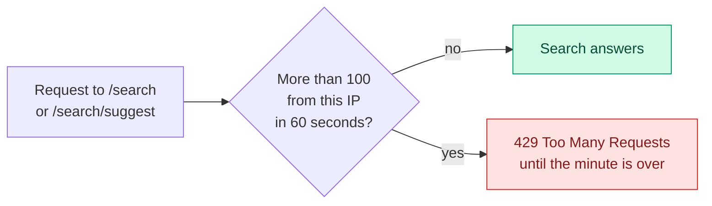

Available on the Hobby plan too (one rate limit rule per project):

*Vercel → project → Firewall → Configure → + New Rule*

| Field | Value |
| --- | --- |
| Name | `Search rate limit` |
| If | *Request Path* · *starts with* · `/search` |
| Then | *Rate Limit* · *Fixed Window* · 60 s · 100 requests · key *IP* |
| Action | *Too Many Requests (429)* |

Then *Review Changes → Publish*. Someone who types fast sends a few suggestion requests per second, so 100 per minute leaves room for real visitors, also several behind one shared address. Do **not** choose *Challenge*: it sets a cookie, and the privacy policy says there are none.

## Backups

[backup.yml](../.github/workflows/backup.yml) dumps the production database every Sunday with `pg_dump` and keeps the dump for 90 days as an artifact of the run. Most of the data could be fetched from NASA again; the dump keeps what could not: the change history, former names and the sync runs. The database holds no personal data. Neon keeps its own short history in addition, which helps after a mistake of the last hours.

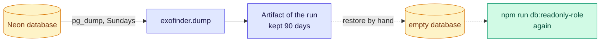

To restore: download the artifact from *Actions → Database backup → a run*, unpack it, and load it into an empty database with the owner's direct address:

```bash
docker run --rm -v "$PWD:/backup" -e TARGET="<direct owner address>" postgres:18 \
  sh -c 'pg_restore --dbname="$TARGET" --clean --if-exists --no-owner --no-privileges /backup/exofinder.dump'
```

Then run `npm run db:readonly-role` again, so that the read-only role can read the restored tables.

## The printed catalogue

[catalogue.yml](../.github/workflows/catalogue.yml) builds the catalogue as a PDF every day at 05:23 UTC, after the sync, with `npm run catalogue` and publishes it as the file `exofinder-catalogue.pdf` of the GitHub release `catalogue`. The download link on the start page points there, so the file is not part of a deployment and a new one needs none. The run only reads the database, with `PRODUCTION_DATABASE_URL`, and does nothing without that secret.

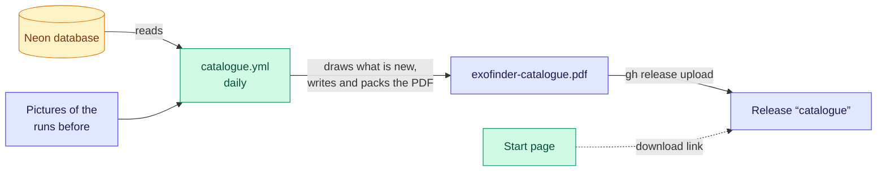

- **The first run takes hours.** A runner has no graphics card and draws every picture in software. The pictures are kept in the cache of GitHub Actions, so a later run only draws the planets that are new or look different, and takes minutes. GitHub drops a cache nobody used for a week, which the daily run prevents; after a longer pause the next run draws everything again.
- **Nothing is made twice.** The cache also holds a stamp of what the last file was made from. A run that finds the same pages writes and publishes nothing, so the file of the release only changes on a day on which the catalogue did.
- **Start it by hand** after the first deployment and whenever the file should be renewed at once: *Actions → Catalogue → Run workflow*, with **force** ticked if no page has changed since the last run. Until the first run has finished, the download link leads to a file that does not exist yet.
- **Only the last step may write.** The job has the permission to write the release, but the token is handed to the step that calls `gh` alone. The steps before it run the code of the repository and its dependencies with no token, and the checkout keeps none.
- **On your own machine** `npm run catalogue -- --gpu` builds the same file in `.cache/catalogue/` with the graphics card, in about twenty minutes for the first run and in seconds after it. Without [qpdf](https://qpdf.sourceforge.io) on the path the file is written unpacked, a little larger.
- **A copy of the site** sets `CATALOGUE_URL` to the folder of its own file, or the link leads to the file of this repository.

## Domain

The site lives at `https://www.exofinder.space`. The domain is registered at Namecheap, whose DNS points it at Vercel: an `A` record for `@` and a `CNAME` for `www`, with the values that Vercel shows under *Settings → Domains*. Vercel redirects `exofinder.space` to `www.exofinder.space` and issues the certificates itself.

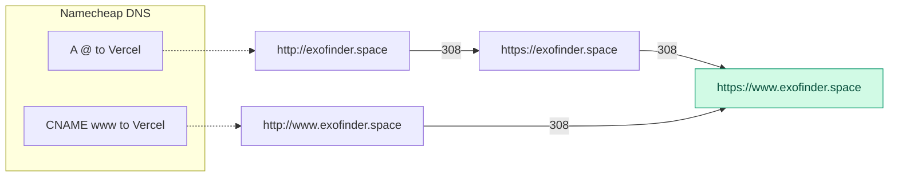

In Namecheap, under *Domain List → Manage*:

- keep **Registrar Lock** on, so that the domain cannot be moved to another registrar without you,
- switch on **DNSSEC** (*Advanced DNS*), as long as Namecheap serves the DNS records,
- add a **CAA** record so that only the certificate authority Vercel uses may issue certificates for the domain: `@  CAA  0 issue "letsencrypt.org"`. Check Vercel's current documentation on custom domains first; if Vercel names other authorities, list them too,
- if no e-mail is sent from the domain, publish two records so that nobody can send mail in its name: `@  TXT  "v=spf1 -all"` and `_dmarc  TXT  "v=DMARC1; p=reject"`.

HSTS is sent without `preload`. The preload list can hardly be left again and would bind every subdomain to HTTPS; it only makes sense for a domain used for nothing else.

## TLS check

[tls.yml](../.github/workflows/tls.yml) runs [check-tls.sh](../scripts/check-tls.sh) against `PRODUCTION_URL` on the 1st of every month, and on pull requests that change the check. It looks at the site from the outside:

- the security headers of the start page, HSTS for at least a year,
- `http://`, the domain without `www` and both together all end on `https://www.…/` with status 200,
- TLS 1.2 and 1.3 are accepted, TLS 1.0 and 1.1 refused,
- the certificates of both names are trusted, issued for the right name and valid for at least 21 more days.

A failed run turns red and GitHub sends an e-mail, so an expiring certificate is noticed three weeks ahead. The TLS setup comes from Vercel, not from the code, so a push does not change it; the headers of each deployment are also checked by the smoke test. By hand: `bash scripts/check-tls.sh www.exofinder.space` (needs curl and OpenSSL 3), or *Actions → TLS check → Run workflow*. A test with [SSL Labs](https://www.ssllabs.com/ssltest/) now and then, after changes to the domain, gives a second opinion; it rated the site A+ in November 2026.

**Do not hammer the site while testing.** A few hundred requests in a short time from one address, or a scan that opens many connections, make Vercel's automatic DDoS protection challenge that address for a while: requests then get `403` with `x-vercel-mitigated: challenge`. The check script says so instead of reporting missing headers. The challenge page sets a cookie of Vercel's; it only reaches traffic that Vercel takes for an attack.

## Legal pages

Vercel processes the visitors' IP addresses (see the privacy policy). The GDPR then asks for a data processing agreement (Art. 28 GDPR) with Vercel.

**Vercel's DPA only covers the Pro and Enterprise plans, not the free Hobby plan.** Its introduction says: "This Addendum applies to Vercel's Processing of Personal Data as a Processor under the Agreement for Customers who are on Enterprise and Pro plans." On those plans it needs no signature: it "shall become legally binding upon Customer entering into the Agreement", and the standard contractual clauses in it count as signed. On the Hobby plan there is no such agreement, and the privacy policy must not claim one. (Checked in November 2026 against the [DPA](https://vercel.com/legal/dpa) of 17 March 2026 and the [Terms of Service](https://vercel.com/legal/terms) of 19 October 2026.)

`LEGAL_HOSTING_DPA` decides which text the privacy policy shows: with `true` it says that the host processes the data under a contract according to Art. 28 GDPR, without it that the host handles the data under its own privacy policy. On the Hobby plan this is legally not fully clean, since the agreement is missing; for a private project without cookies, tracking or content from other servers the risk is small. The Pro plan closes the gap.

Values for Vercel:

| Variable | Hobby | Pro |
| --- | --- | --- |
| `LEGAL_HOSTING` | `Vercel Inc., 440 N Barranca Ave #4133, Covina, CA 91723, USA` | the same |
| `LEGAL_HOSTING_DPA` | empty | `true` |
| `LEGAL_HOSTING_TRANSFER` | `Vercel Inc. is certified under the EU-U.S. Data Privacy Framework (Art. 45 GDPR).` | the same, plus: `In addition, the contract with Vercel contains the standard contractual clauses of the European Commission (Art. 46 (2) (c) GDPR).` |

The address is the one the DPA gives for Vercel Inc. Vercel states that it is certified under the EU-U.S. Data Privacy Framework; check the entry in the [official list](https://www.dataprivacyframework.gov/list) before going live.

Also before going live:

- on the Hobby and trial plans Vercel may use the content of a project to train AI models; switch that off in the team and project settings,
- set `LEGAL_LOG_DAYS` to how long Vercel keeps the logs on your plan, or leave it empty,
- set `LEGAL_EMAIL_PROVIDER` if a mail provider receives the e-mails to `LEGAL_EMAIL`,
- if the database runs at another company, check whether the privacy policy has to name it as well: the search terms pass through it,
- leave Vercel's bot protection and attack challenge mode off, or update the privacy policy: they can set cookies, and the policy says there are none.

The legal pages are a careful draft, not legal advice.
