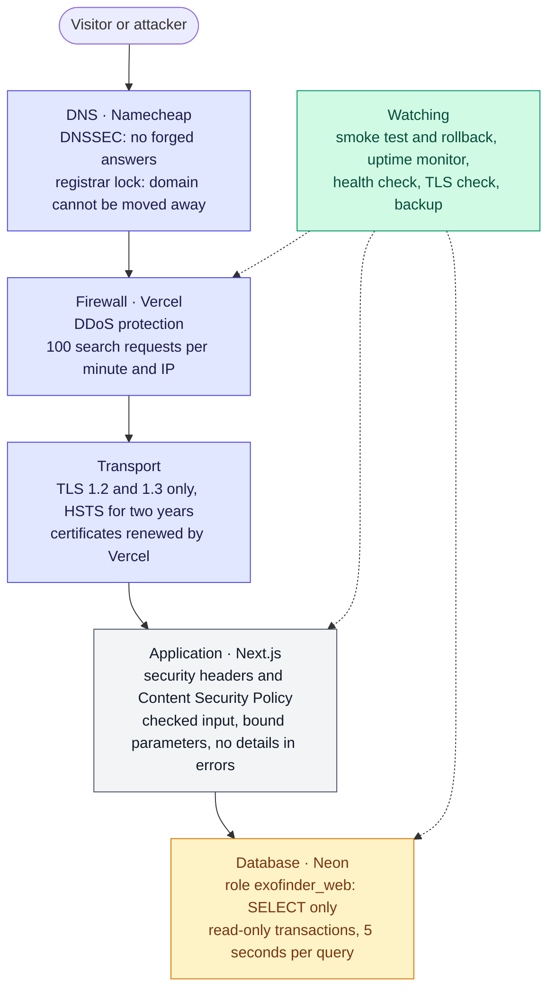
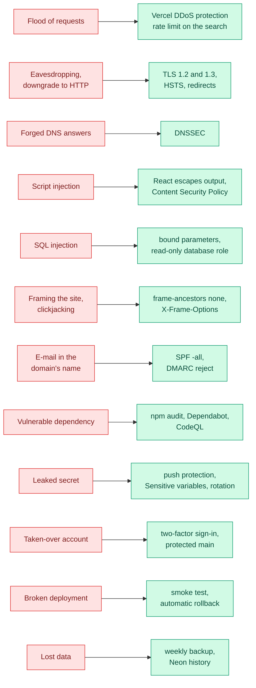
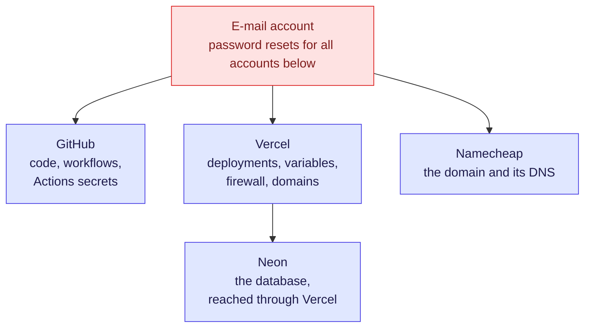
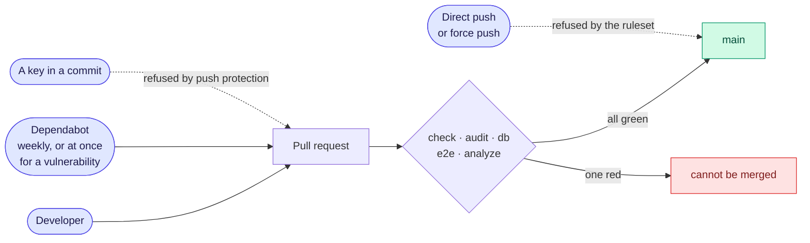
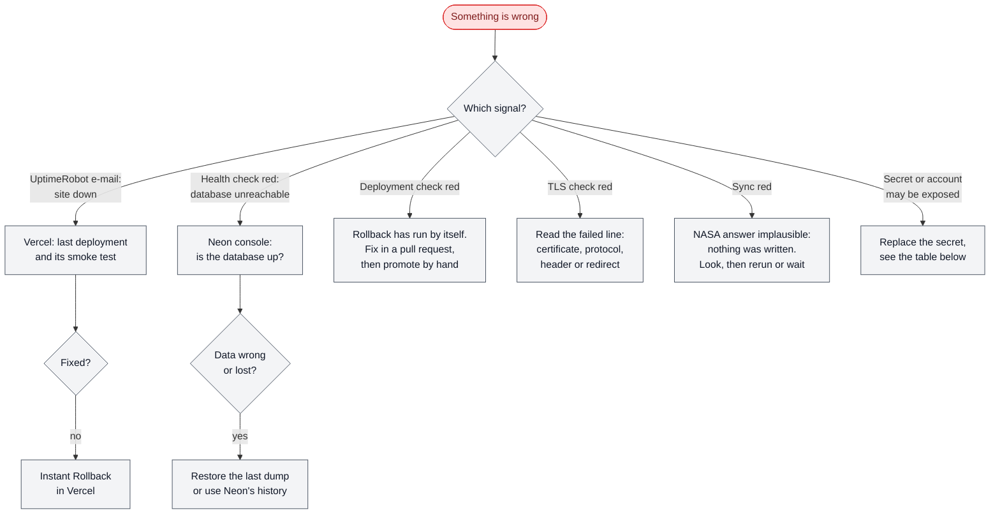

# Security

How ExoFinder is protected, layer by layer, what is watched, what to do when something happens, and what is knowingly left open. How to report a vulnerability: [SECURITY.md](../SECURITY.md) in the root of the repository.

## What there is to protect

ExoFinder is a public catalogue without accounts, forms, uploads or payments. No visitor can change data. What is worth protecting:

- **The site being up**, and showing correct data.
- **The data** in the database: the catalogue can be fetched from NASA again, the change history cannot.
- **The visitors' privacy**: the only personal data is the IP address in the host's log.
- **The accounts** that can change the site: GitHub, Vercel, Neon, Namecheap and the e-mail account behind them. Whoever controls one of them controls the site.

## The layers at a glance

The way of a request, from the address bar to the database, and what guards each step:

## Threats and what stops them

In short:

| Layer | Measures |
| --- | --- |
| Accounts | two-factor sign-in everywhere, `main` protected, secrets only in GitHub and Vercel, push protection |
| Code and dependencies | review through pull requests, five required checks, CodeQL, `npm audit`, Dependabot |
| Network and transport | Vercel's DDoS protection, rate limit on the search, TLS 1.2 and 1.3 only, HSTS, DNSSEC, SPF and DMARC |
| Application | security headers with a strict Content Security Policy, bound parameters, checked input, no details in errors |
| Database | read-only role for the site, 5-second limit per query, owner access only for migrations, sync and backup |
| Privacy | no cookies, no tracking, nothing loaded from other servers |
| Watching and recovery | smoke test with rollback, health check, uptime monitor, TLS check, weekly backup |

## Accounts and access

Which account controls what. The e-mail account sits on top: it can reset the passwords of all the others.

- **Two-factor sign-in** on GitHub, Vercel, Namecheap and the e-mail account. Neon is reached through Vercel and covered by Vercel's sign-in.
- **`main` is protected** by a ruleset: changes only through pull requests whose checks `check`, `audit`, `db`, `e2e` and `analyze` are green; no deletion, no force push. The repository admin may bypass it for pull requests only, never for direct pushes.
- **Secrets live in GitHub Actions secrets and Vercel environment variables**, never in the repository. `.env*` files are ignored by Git, except the example without values. The database addresses in Vercel are marked *Sensitive*: they cannot be read back in the dashboard.
- **GitHub secret scanning with push protection** refuses a push that contains a known kind of key or password.
- **Each part has only the access it needs**; the table is in [ARCHITECTURE.md](ARCHITECTURE.md), "Who may do what". The workflows run with read-only access to the repository (`permissions: contents: read`); only CodeQL may also write its findings.

## Code and dependencies

- **Every change is a pull request** that runs type check, lint, unit, database and browser tests, the build, `npm audit` and CodeQL ([TESTING.md](TESTING.md)).
- **CodeQL** scans with the `security-and-quality` queries on every change and every Monday. A finding rated high or above fails the check.
- **`npm audit`**: production dependencies must have no known vulnerability at all; development tools none rated high or critical, except an advisory without any fixed version, accepted by its id for a few weeks in [src/deploy/audit.ts](../src/deploy/audit.ts).
- **Dependabot** keeps npm packages, GitHub Actions and the local database image up to date, and opens a pull request at once for a known vulnerability. Dependabot alerts and security updates are on. Its pull requests get no preview deployment, so packages nobody has looked at never run with the database address.
- **Code of a pull request never runs next to a secret.** Deploying uploads the commit without running it, and the smoke test that follows, which holds the bypass secret, runs in the version on `main` and without the npm cache ([DEPLOYMENT.md](DEPLOYMENT.md), "Smoke test after each deployment").
- **`package-lock.json`** fixes every version; CI and Vercel install with `npm ci`.
- **An `override` in `package.json`** lifts the `esbuild` of `drizzle-kit` past an advisory (requests to esbuild's development server) that Dependabot cannot fix (November 2026): `drizzle-kit` 0.31 pulls in esbuild 0.18 through the abandoned `@esbuild-kit/core-utils`, and the override gives it the 0.28 that `tsx` and Vite use. It does not reach visitors, and `drizzle-kit generate` and `migrate` were checked with it. Remove it once a stable `drizzle-kit` no longer needs the old esbuild: the release candidate of 1.0 has dropped it, but needs `drizzle-orm` 1.0 as well.

## Network and transport

- **DDoS protection.** Vercel's firewall stops floods by itself. Traffic it takes for an attack gets a challenge page or `403` with `x-vercel-mitigated: challenge`.
- **Rate limit on the search.** A firewall rule allows 100 requests per minute and IP on everything under `/search`, including the suggestions while typing; more get `429`. The search is the part that asks the database most ([DEPLOYMENT.md](DEPLOYMENT.md), "Rate limiting").
- **HTTPS only.** `http://` and the domain without `www` redirect to `https://www.exofinder.space`. Only TLS 1.2 and 1.3 are accepted. Vercel issues and renews the Let's Encrypt certificates. SSL Labs rated the site A+ in November 2026.
- **HSTS** for two years, including subdomains: browsers that have seen the site once never use plain HTTP for it again. Not on the preload list, on purpose ([DEPLOYMENT.md](DEPLOYMENT.md), "Domain").
- **The domain**: registrar lock on, owner data withheld in the public registry, DNSSEC on, and SPF `-all` with DMARC `p=reject`, so nobody can send e-mail in its name.

## Application

- **Security headers** on every answer ([security-headers.ts](../src/shared/security-headers.ts), set in [next.config.ts](../next.config.ts)):

  | Header | Effect |
  | --- | --- |
  | `Content-Security-Policy` | scripts, styles, images, fonts and requests only from the site itself; no plugins; no framing by other sites (`frame-ancestors 'none'`) |
  | `Strict-Transport-Security` | HTTPS only, two years, including subdomains |
  | `X-Frame-Options: DENY` | no framing, for older browsers |
  | `X-Content-Type-Options: nosniff` | the browser keeps to the declared type of a file |
  | `Referrer-Policy: strict-origin-when-cross-origin` | other sites only learn the domain a visitor came from |
  | `Permissions-Policy` | no camera, microphone, location, payment or USB; fullscreen stays allowed for the planet model |
  | `Cross-Origin-Opener-Policy: same-origin` | other windows cannot reach into the site |

  `X-Powered-By` is switched off. Scripts need `'unsafe-inline'`, because Next.js writes the data of each page into small inline scripts; nonces would avoid that, but force every page to render on each request and lose the prerendered frames.
- **Queries** all go through Drizzle with bound parameters; no SQL is built from text.
- **Input is checked before it reaches the database.** The search reduces a query to letters and digits and cuts it at 80 characters. Slugs from the address are checked with `isSlug` ([slug.ts](../src/shared/slug.ts)): a null byte or a 5,000-character slug is "not found" without a query. Page numbers and orders of the planet list fall back to safe values. [proxy.ts](../src/proxy.ts) answers broken percent-encoding with `400` instead of a server error.
- **Output** is escaped by React; the code uses no `dangerouslySetInnerHTML`, `innerHTML` or `eval`.
- **Errors say nothing about the inside.** Pages show a general message, the JSON endpoints a short one, `/health` only `ok` or `unreachable`. Details go to the function log in Vercel.
- **The JSON endpoints only answer `GET`.**

## Database

- **The site reads with a role that may only read** (`exofinder_web`, [readonly.ts](../src/db/readonly.ts)): `SELECT` on the tables and nothing else, every transaction read-only, every query cancelled after 5 seconds. Even a flaw in a query could only read the public catalogue. Tested: inserting, updating, deleting, creating and dropping tables are all refused, also after switching read-only mode off.
- **Owner access** only where it is needed: the migrations during the production build, and the sync, seed and backup in GitHub Actions.
- **The database holds no personal data**, only the catalogue and the records of the sync. It runs at Neon in Frankfurt and is reached over TLS.

## Privacy

- **No cookies, no storage in the browser, no statistics, no tracking, no advertising.**
- **Nothing is loaded from other servers**: fonts are downloaded at build time and served by the site. The Content Security Policy enforces this, so a mistake would be blocked and would fail the browser tests.
- The legal notice and the privacy policy are not listed by search engines (`noindex`).
- The one exception lies with the host: when Vercel's DDoS protection takes traffic for an attack, its challenge page sets a cookie of Vercel's. Ordinary visitors never see it.

## Watching and recovery

| What | How often | Notices |
| --- | --- | --- |
| Smoke test with rollback | after every deployment | a broken deployment; production goes back to the previous one |
| Uptime monitor (UptimeRobot) | every 5 minutes | the site does not answer |
| Health check | hourly | the site cannot reach its database |
| TLS check | monthly | weak protocols, a certificate that expires within 21 days, missing headers, wrong redirects |
| Sync guard | daily | an implausible answer from NASA; nothing is written |
| Backup | weekly, kept 90 days | an empty dump fails the run |

Neon keeps its own short history in addition to the weekly dump. A restore from the dump was tried in November 2026 and worked.

## When something happens

| Situation | What to do |
| --- | --- |
| The site is down | Look at the last deployment in Vercel and at its smoke test in GitHub. Roll back by hand if needed: *Deployments → … → Instant Rollback*. If `/health` says `unreachable`, look at Neon. |
| A deployment broke production | The rollback runs by itself. Fix the problem in a pull request, then promote the new deployment by hand ([DEPLOYMENT.md](DEPLOYMENT.md), "Automatic rollback"). |
| Wrong or lost data | Restore the last dump ([DEPLOYMENT.md](DEPLOYMENT.md), "Backups"), or use Neon's history for a mistake of the last hours. The catalogue itself comes back with the next sync. |
| A secret may have leaked | Replace it, see below. Then look at the logs of Vercel and Neon for what happened in between. |
| An account may be taken over | Change its password, sign out all sessions, check the two-factor setup, then replace every secret that account could see. |
| Someone reports a vulnerability | Confirm receipt, fix it in a pull request, publish the advisory once the fix is live, and credit the reporter if they want ([SECURITY.md](../SECURITY.md)). |

Replacing secrets:

| Secret | How |
| --- | --- |
| Read-only role (`DATABASE_URL_READONLY`) | `npm run db:readonly-role` gives the role a new password; store the new address in Vercel and redeploy. |
| Database owner | Reset the password of the owner role in the Neon console. Check that `DATABASE_URL` and `DATABASE_URL_UNPOOLED` in Vercel and `PRODUCTION_DATABASE_URL` in GitHub carry the new one, and update them if not. |
| `VERCEL_TOKEN` | Delete it under *Account Settings → Tokens*, create a new one, store it in GitHub. |
| `VERCEL_AUTOMATION_BYPASS_SECRET` | Create a new one under *Deployment Protection*, delete the old one, store it in GitHub. |

## Known limits and recommendations

- **`'unsafe-inline'` for scripts** in the Content Security Policy, explained above. The site has no input that is ever rendered as HTML, so the main way to use it is closed.
- **Preview deployments read with the owner's access**, because `DATABASE_URL_READONLY` is only set for Production. Previews are behind Vercel's Deployment Protection, and pull requests from forks need approval before they are deployed. Recommended anyway: add the Preview environment to `DATABASE_URL_READONLY` in Vercel, so previews read with the read-only role too.
- **GitHub Actions are pinned to major versions** (`@v7`), not to commit hashes. Dependabot keeps them current; pinning to hashes would protect against a hijacked action release at the cost of more update noise.
- **No data processing agreement with Vercel** on the Hobby plan. The privacy policy says so honestly; the Pro plan would close the gap ([DEPLOYMENT.md](DEPLOYMENT.md), "Legal pages").
- **Vercel's challenge cookie**, see Privacy above.
