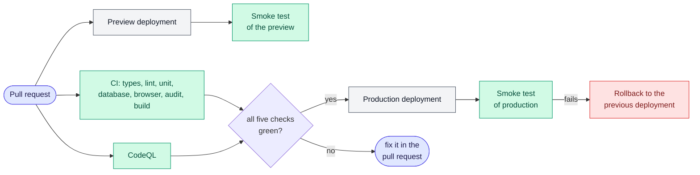
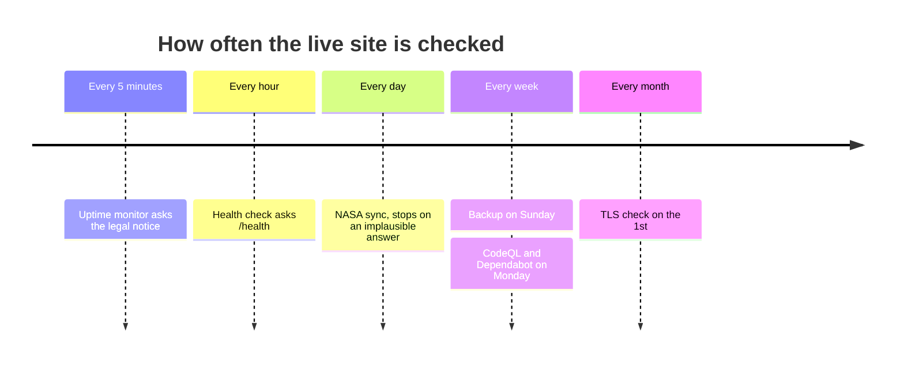

# Tests and checks

What checks ExoFinder, when it runs and what it catches. The checks form layers: the fast ones run on every change before it can be merged, the slower ones after each deployment, and a few keep watching the live site.

```mermaid
flowchart LR
    subgraph Before["1. Before the merge"]
        direction TB
        T1[Type check and lint]
        T2[Unit and script tests]
        T3[Database tests]
        T4[Browser tests<br>flows, drawing, security, accessibility]
        T5[Build, npm audit, CodeQL]
    end
    subgraph After["2. After each deployment"]
        direction TB
        S1[Smoke test]
        S2[Rollback if<br>production fails]
    end
    subgraph Live["3. On the live site"]
        direction TB
        L1[Uptime monitor, 5 min]
        L2[Health check, hourly]
        L3[Sync guard, daily]
        L4[Backup, weekly]
        L5[TLS check, monthly]
    end
    Before -->|merge only when green| After -->|deployment stays live| Live

    style Before fill:#e0e7ff,stroke:#4f46e5,color:#1e1b4b
    style After fill:#fef3c7,stroke:#d97706,color:#78350f
    style Live fill:#d1fae5,stroke:#059669,color:#064e3b
```



## Where the tests live

Every test is in `tests/`; `src/` holds only the app. Unit and database tests sit at the same path as the code they test, so `src/app/planets/classify.ts` is tested in `tests/unit/app/planets/classify.test.ts`.

```
tests/
├── unit/      unit tests, mirroring src/                 npm test
├── scripts/   tests that run a script from start to end  npm run test:scripts
├── db/        tests against a real PostgreSQL            npm run test:db
├── e2e/       browser tests in Chromium                  npm run test:e2e
│   └── looks/ the kept pictures of planets and galaxy
├── smoke/     the check of a running deployment          npm run test:smoke
└── support/   test catalogue, test databases, sample NASA rows
```

Test code imports the app as `@/…` and the helpers as `@tests/…`, for example `@tests/support/catalog`.

## At a glance

| Layer | Tool | Runs | Catches |
| --- | --- | --- | --- |
| Type check | TypeScript, `next typegen` | every pull request and push to `main` | wrong types, broken route parameters |
| Lint | ESLint with the Next.js rules | every pull request and push | mistakes and patterns the rules forbid |
| Unit tests | Vitest, about 490 tests in 60 files | every pull request and push | errors in the logic, without database or browser; base maps that do not fit their numbers |
| Script tests | Vitest, runs `generate-presets.ts` at a small size | every pull request and push | a generator of the base maps that fails, forgets a map or gives another result for the same run |
| Database tests | Vitest against a real PostgreSQL 17 | every pull request and push | wrong queries, ranking, sync runs, hostile input |
| Browser tests | Playwright in Chromium, desktop and phone | every pull request and push | broken pages and flows, shaders that do not compile or draw something else than before, security, accessibility |
| Build | `next build` | every pull request and push | anything that only fails when the production build runs |
| Dependency audit | `npm audit` | every pull request and push | known vulnerabilities in dependencies |
| Code scanning | CodeQL, `security-and-quality` | every pull request and push, Mondays | security problems in our own code |
| Smoke test | Playwright against the deployment | after every Vercel deployment | a deployment that does not work; production is rolled back |
| Health check | GitHub Actions, `GET /health` | hourly | the site or its database is down |
| Uptime monitor | UptimeRobot, `/legal/notice` | every 5 minutes | the site does not answer |
| TLS check | `scripts/check-tls.sh` | 1st of every month | weak protocols, an expiring certificate, missing headers, wrong redirects |
| Sync guard | the plan of the sync | daily, with the sync | an implausible answer from NASA; nothing is written |
| Backup | `pg_dump` | Sundays | a dump that would be empty fails the run |

`main` only accepts a pull request when `check`, `audit`, `db`, `e2e` and `analyze` are green. Every scheduled check that fails turns its run red, and GitHub sends an e-mail; UptimeRobot sends its own.

## When what runs

On every change:



On the live site, without any change:



## The layers in detail

### Unit tests

`npm test` ([vitest.config.mts](../vitest.config.mts), project `unit`) runs every `*.test.ts` in `tests/unit/`, which mirrors `src/`. They need neither a database nor a browser and take a few seconds.

They cover the logic: classification, appearance, colours, coordinates, slugs, formatting, the shared helpers (random numbers, hashes, units, search params, page numbers), the pages and the sentences of the planet list, how a 3D model is turned and zoomed, the globes and the star finder of the map, that every read of the catalogue is cached, the details of the operator, reading the NASA response, planning the sync, the description of a globe and its shader values, the storms of a planet at a moment, where and how large a planet is drawn, from which size on it gets its extra-large maps, the noise of the planet shaders, the scale of the galaxy, its clouds and the worker that makes them, the stars between the stars with planets, the landmarks and the globular clusters, how the map reads its pictures, how it keeps its textures (each read once, and level ground laid where a relief or flow map cannot be read), the camera that circles the galactic centre (it rests exactly when left alone), how the map builds its shaders in the background, the orbits, the answers of the map. They also check the files the drawing relies on: every base map of `presets.json` is there in both sizes and fits its numbers, with its relief map or its flow map, every extra-large map the 3D view may ask for is there, Earth's relief map holds its seas and its slopes the right way round in every size, and the picture of the galaxy is square with its core in the middle, which the scale of the map assumes. And the parts that matter for security and operations: the security headers, the proxy, what the JSON endpoints answer when the database fails (no details may leak), the health report, which address the database connection uses, the statements of the read-only role and the choice of the deployment to roll back to.

`npm run test:coverage` runs them once more and counts which lines of `src/` they reach; the report is in `coverage/`. The number is low on purpose, about a third: the unit tests reach the logic, while pages, routes and everything that draws are tested in the browser, which the count does not see. Use it to find logic without a test, not as a target.

### Script tests

`npm run test:scripts` (project `scripts`, [tests/scripts/](../tests/scripts)) runs [generate-presets.ts](../scripts/generate-presets.ts) from start to end, at a fraction of the real size and into a temporary folder (`PRESET_DIR`), so the maps of the app stay untouched. It takes most of a minute. Every preset is simulated without an error, the files and `presets.json` come out complete, a rocky map carries height, water and craters in its three channels and comes with its slopes, a banded or weather map comes with its winds, and the same run gives the same files again. Whether the real maps look right is still for the eye: `npx tsx scripts/preview-presets.ts <name> <output.jpg>` writes the three channels of a map side by side. The same project tests [moon-maps.ts](../scripts/moon-maps.ts), which prepares the maps of the moons for `npm run textures`, on small made-up pictures: it turns longitude 0 into the middle, finds the parts no spacecraft saw and fills them with the neighbouring tones without inventing anything, tints grey mosaics, tones down false colours and sets the brightness after the albedo without clipping it to white. It also checks that every moon and dwarf planet names a map, a credit and a licence, apart from Deimos and Hyperion, which no spacecraft mapped whole. And it tests [earth-winds.ts](../scripts/earth-winds.ts), the winds of Earth's cloud map: the air turns anticlockwise round every low of the north and clockwise round every low of the south, the usual winds blow where no low is near, and the map in `public/textures` is the one the script gives. It tests [shapes.ts](../scripts/shapes.ts) too: the ZIP and OBJ readers, the radius grid of an ellipsoid against the exact one, its volume, the packing, and that the grid of every irregular body matches its published mean radius.

### Database tests

`npm run test:db` (project `db`) runs every `*.db.test.ts` in `tests/db/` against a real PostgreSQL: the search and its ranking, the planet list with filter, order and pages, planets, stars, the map, the figures of the start page, the three JSON endpoints, and whole sync runs (unchanged, changed values, new planets, renames, an implausible or broken answer from NASA).

Every query also gets hostile input: SQL fragments, wildcards, null bytes and 100,000 characters.

### Browser tests

`npm run test:e2e` ([playwright.config.ts](../playwright.config.ts), [tests/e2e/](../tests/e2e)) builds the app, starts it against its own database and clicks through it in Chromium, once on a desktop screen and once on a phone screen (Pixel 7).

| File | Checks |
| --- | --- |
| `navigation.spec.ts` | start page, header and footer, links to the credits and the legal pages, the credits page naming every source and licence, not-found pages (also of an unknown moon), old addresses of renamed planets and stars |
| `search.spec.ts` | suggestions while typing, also for moons, keyboard and Escape, the results page, similar names for typos, empty and unmatched queries |
| `planets.spec.ts` | the list of all planets with filter and order, planet and star pages, the 3D model and its buttons, a 3D model from each kind of base map and from the photographs of Earth and Mars, how long browsers may keep the maps, withdrawn planets, the solar system, the pages of moons and dwarf planets with their real maps, the moons on a planet's page with the table of all its moons, the dwarf planets and Vesta on the Sun's, the shape models of Phobos and Hyperion |
| `map.spec.ts` | loading the stars, finding one by name, opening a system from the address and going back to the galaxy, the whole galaxy from outside on a black sky with its clouds made by a worker, compared with a kept picture of the map, circling the centre and flying freely again, the names of famous sights near the Sun, small maps on the orbits and the large map of the planet the camera follows, the dwarf planets among the planets, moons that load only with their planet, following a moon from the list and from the address, the scale button naming the scale shown, hiding the moons from the planet's row, following any small moon from the list, the other planets making way for a moon system, only the credits and legal links in the corner |
| `shaders.spec.ts` | what the shaders draw, see below |
| `scripts.spec.ts` | `planet-sheet.ts` against the running app: the sheet has its size and a lit planet in every tile |
| `security.spec.ts` | the headers on every kind of answer, hostile input over HTTP, script injection through the address and the search, `GET` only on the JSON endpoints, framing by another site, broken encoding, null bytes, no violation of the Content Security Policy |
| `accessibility.spec.ts` | axe-core checks every page and the open suggestion list against WCAG 2.1 A and AA; the site can be used with the keyboard alone |

The server keeps what it reads from the catalogue for an hour ([ARCHITECTURE.md](ARCHITECTURE.md), "What is cached"), and the test database is seeded while the server starts. So Playwright waits for `/legal/notice`, which reads nothing, and no test may change the database once the tests run: the server would not see it.

The browser tests fail on every error in the browser console, so a hydration error or a blocked script shows up even when the page looks right. They also run the smoke test against the local build, so a change that would break it shows up before it is merged.

In CI a test that fails gets one retry. If the retry passes, the test counts as flaky and the run stays green. Each run keeps its Playwright report for 14 days (*Actions → the run → Artifacts → playwright-report*), with a trace of every failed attempt. A flaky test leaves its trace there, which tells a crash of the browser in the runner from a fault of the site.

In November 2026 a map test now and then timed out in CI before it began (`browser.newContext … Failed to find browser context`). The traces showed the browser alive but blocked for a minute, and each time the test before it in the same worker had ended in the middle of a flight across the galaxy, which the browser renders slowly in software. Closing that page waited for the picture being drawn. So every map test now leaves the map at its end (`about:blank` in an `afterEach` of [map.spec.ts](../tests/e2e/map.spec.ts)): the drawing loop and the workers stop within the test that started them, and a test that leaves the browser busy fails itself instead of the next one.

### What the shaders draw

[shaders.spec.ts](../tests/e2e/shaders.spec.ts) draws planets and the galaxy with the real shaders and textures inside a page of the test browser and reads the pixels back ([lab.ts](../tests/e2e/lab.ts)). Chromium draws with SwiftShader there, in software, so the result does not depend on a graphics card. It runs on the desktop screen only; the shaders are the same on a phone. Two kinds of test:

- **Properties** that must hold whatever the colours are: every program compiles; the day side is lit and the night side dark; the same moment gives the same picture; the light reddens only in the narrow seam of the sunset; the clouds of the Earth and the bands of a gas giant move, and stand still when asked to; a moon, rings, flattening, the aurora and lightning on the night side only, the hot day side of a planet held by its star. Lava glows in the night of a molten world, redder than it is green, brighter and less red the hotter the planet is, a little dimmer under smoke and in more rivers on steep ground. The weather of a world with seas moves while the planet stands still, the star glints on the sea around the place that mirrors it, and mountains catch the light by day and change nothing at night. The wisps of high cloud on a Neptune-like planet are brighter than the deck below and move with its winds. Storms: cyclones over the sea, dust storms on Mars and plumes on a gas giant change the picture while they live and nothing when none does; the storms of a gas giant turn only where its bands drift. A small planet shows no grain finer than its pixels: drawn at the size of a page, it stays close to the same planet drawn four times as large and shrunk, and its clouds show no blocks of two by two pixels. The galaxy from above matches its picture, from the side it is thin with a bulge, away from it the sky is black, and from inside it is a band across the sky.
- **Looks.** A small picture of fourteen planets and of two views of the galaxy is compared with the one kept in [tests/e2e/looks/](../tests/e2e/looks); `map.spec.ts` keeps one of the whole galaxy as the map shows it, with its clouds and stars. The pictures are 48 pixels wide and may differ by a mean of 5 of 255 levels, so they notice a planet that turned grey, lost its clouds or changed its colours, and not a single pixel. A change that is meant renews them: `UPDATE_LOOKS=1 npm run test:e2e -- shaders`. Look at the new pictures before committing them; the test only says that the look changed, not whether it is better.

### Smoke test

`npm run test:smoke` ([tests/smoke/](../tests/smoke)) checks a running deployment in about a minute: `/health` answers and runs the expected commit, the main pages answer 200 with their security headers, the JSON endpoints return data, and a short walk in the browser has no console errors. It relies only on the solar system, which every filled database has.

[deploy-check.yml](../.github/workflows/deploy-check.yml) runs it, in the version on `main`, after every deployment, previews and production; [deploy.yml](../.github/workflows/deploy.yml) deploys a commit only once all its checks have passed and then calls it. When production fails it, the workflow puts the previous deployment back live ([DEPLOYMENT.md](DEPLOYMENT.md), "Automatic rollback").

### Checks of the live site

- **Health check** ([health.yml](../.github/workflows/health.yml), hourly): `GET /health` must answer 200, which means the site reaches its database. Three tries a minute apart.
- **Uptime monitor** (UptimeRobot, every 5 minutes, set up outside the repository): asks `https://www.exofinder.space/legal/notice` and e-mails when it does not answer and when it is back. It asks the legal notice, a prebuilt page, so the Neon database can go to sleep between visits; the hourly health check covers the database.
- **TLS check** ([tls.yml](../.github/workflows/tls.yml), monthly, and on pull requests that change it): [check-tls.sh](../scripts/check-tls.sh) checks the security headers, that every way in ends on `https://www.exofinder.space/`, that TLS 1.2 and 1.3 are accepted and TLS 1.0 and 1.1 refused, and that both certificates are trusted and valid for at least 21 more days. Details: [DEPLOYMENT.md](DEPLOYMENT.md), "TLS check".

### Supply chain

- **`npm audit`** in CI: what ships to visitors must have no known vulnerability at all (`--omit=dev --audit-level=low`); tools that only run during development may have moderate ones, never high or critical (`npm run audit:tools`). When an advisory rated high is published before any fixed version exists, no update can help: [src/deploy/audit.ts](../src/deploy/audit.ts) can accept it by its id, with the reason and a date a few weeks ahead, after which CI fails again. The runs show each accepted advisory as a warning, and say when an exception is no longer needed.
- **CodeQL** ([codeql.yml](../.github/workflows/codeql.yml)) scans JavaScript and TypeScript with the `security-and-quality` queries. Findings appear under *Security → Code scanning*; one rated high or above fails the check.
- **Dependabot** ([dependabot.yml](../.github/dependabot.yml)) opens pull requests every Monday for npm packages, GitHub Actions and the Docker image of the local database, and at once for a known vulnerability. They go through the same checks as every other change.

## Test data

The database and browser tests never touch the database of `DATABASE_URL`. They create their own, `exofinder_test` and `exofinder_e2e`, empty them and fill them with a small test catalogue ([tests/support/catalog.ts](../tests/support/catalog.ts)): TRAPPIST-1, Proxima Cen b, a few Kepler planets, the solar system, a star without a distance and a planet that NASA withdraws. [tests/support/db.ts](../tests/support/db.ts) refuses any database whose name does not end in `_test` or `_e2e`. `TEST_DATABASE_URL` and `E2E_DATABASE_URL` point them elsewhere.

## Running them locally

The database and browser tests need the database from `docker-compose.yml` (`npm run db:up`); the browser tests need Chromium once (`npm run e2e:install`).

| Command | Runs |
| --- | --- |
| `npm test` | unit tests |
| `npm run test:db` | database tests |
| `npm run test:scripts` | the generator of the base maps, at a small size |
| `npm run test:e2e` | browser tests, including the smoke test against the local build |
| `npm run test:all` | all four |
| `npm run test:coverage` | unit tests, with a report in `coverage/` of the lines they reach |
| `UPDATE_LOOKS=1 npm run test:e2e -- shaders` | renews the kept pictures after a change to the look that is meant |
| `SMOKE_BASE_URL=https://… npm run test:smoke` | the smoke test against any deployment |
| `bash scripts/check-tls.sh www.exofinder.space` | the TLS check (needs curl and OpenSSL 3) |
| `npm run typecheck`, `npm run lint`, `npm run build` | type check, lint, production build |

Do not hammer the live site while testing: a few hundred requests from one address in a short time make Vercel's DDoS protection challenge that address for a while ([DEPLOYMENT.md](DEPLOYMENT.md), "TLS check").

## What is not tested automatically

- **Whether the planets and the map look good.** The tests notice that a look changed, not whether it is real: that is checked by eye in a browser. `npm run planets:sheet` ([planet-sheet.ts](../scripts/planet-sheet.ts)) draws a spread of planets from the catalogue onto one picture, always the same ones: whether they look real and differ enough only shows side by side. `npm run docs:screenshots` renews the pictures of the user guide.
- **How fast it draws on a real graphics card.** The browser tests draw in software. After a change to a shader, watch the frame rate of the map and of a planet on a phone.
- **The downloads of `fetch-textures.ts`.** The script fetches from NASA, ESO and others and is run by hand, rarely; a test would depend on their servers. What it leaves behind is tested: the files in `public/textures` the app needs.
- **The settings outside the repository**: the firewall rule, the variables in Vercel, the DNS records. The TLS check and the smoke test notice the most important consequences.
- **The wording of the legal pages.** The tests check that they exist and are linked, not what they say.
- **A restore of the backup.** It was tried once in November 2026 and worked; repeat it now and then ([DEPLOYMENT.md](DEPLOYMENT.md), "Backups").

## For new code

- Logic without database or browser gets unit tests in `tests/unit/`, at the same path as the code.
- A new query gets a database test, including hostile input.
- A new page or flow gets a browser test; a new page also joins the list of `accessibility.spec.ts` and of the security header checks.
- A new effect of a shader gets a property test in `shaders.spec.ts`: where it shows and where it must not. A new kind of planet gets a kept picture.
- A new base map joins `presets.json` through `npm run presets`; the unit and script tests then check it without a change.
- A new address that the smoke test should cover joins [tests/smoke/deployment.spec.ts](../tests/smoke/deployment.spec.ts).
