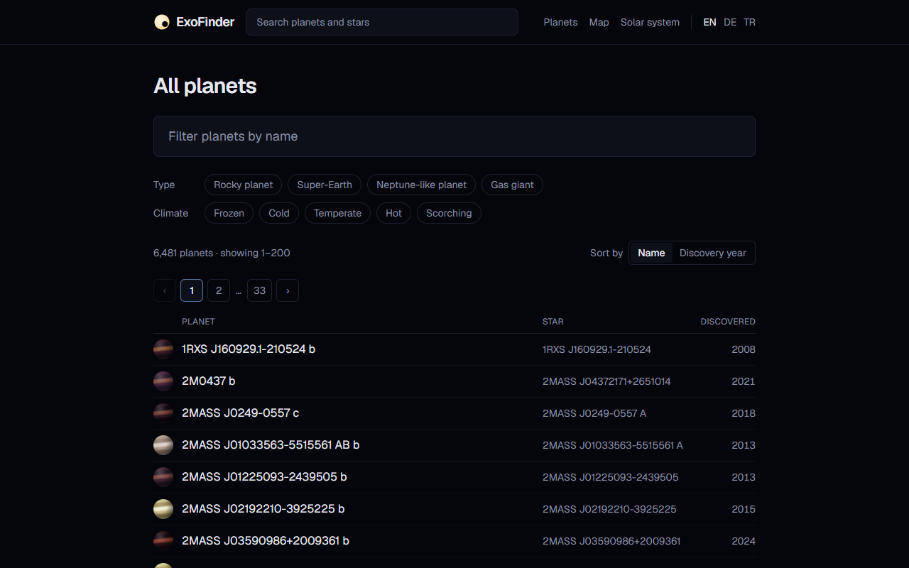
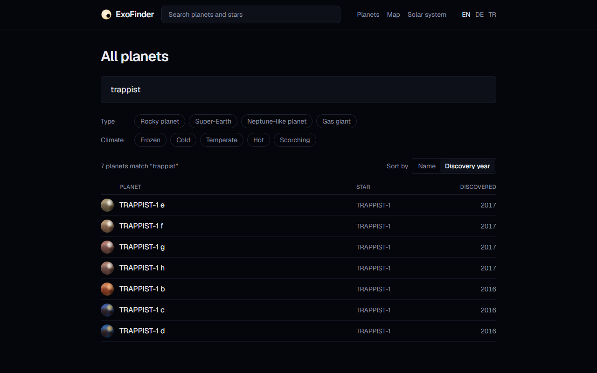

# All planets

The list shows every planet in ExoFinder: all known exoplanets and the eight planets of our solar system.

## Open the list

1. Click **Planets** in the bar at the top.
2. The page **All planets** opens. Each row is one planet with a small picture, its name, its star and the year it was discovered.
3. Click a row to open the page of that planet.

The list shows 200 planets at a time. Use the page numbers above and below the list to see the next ones. The arrows **‹** and **›** go one page back or forward.

## Show only some planets

1. Click into the field **Filter planets by name** above the list.
2. Type a part of a name, for example `trappist`.
3. The list updates while you type. Above the list you see how many planets match.
4. To see all planets again, empty the field.

## Show only one kind of planet

Below the filter field are two rows of buttons.

1. **Type** says how big a planet is: **Rocky planet**, **Super-Earth**, **Neptune-like planet** or **Gas giant**. Click one, and the list shows only these planets. Above the list you see how many there are.
2. **Climate** says how warm a planet is: **Frozen**, **Cold**, **Temperate**, **Hot** or **Scorching**. Click one to show only these.
3. Click one button in each row to combine them. **Rocky planet** with **Temperate** lists the planets most like Earth.
4. Click a chosen button again to remove it. It is the one with the **✕**.

The buttons work together with the filter field and the order: type `kepler` and click **Gas giant** to see the gas giants around the Kepler stars.

On the start page, the four kinds under the big numbers lead straight to these lists.

## Change the order

The list is sorted by name at first. Next to **Sort by** you can switch:

- **Name** sorts from A to Z.
- **Discovery year** shows the newest discoveries first.

The filter and the kind of planet stay when you change the order.

## Good to know

- The planets of our solar system have a dash (–) instead of a year. They have been known since ancient times.
- You can copy the address from your browser and send it to someone. It keeps the filter, the kind of planet, the order and the page, so they see the same list.

## Next step

Open a planet and see what its page tells you: [Planet pages](Planet-Pages).
