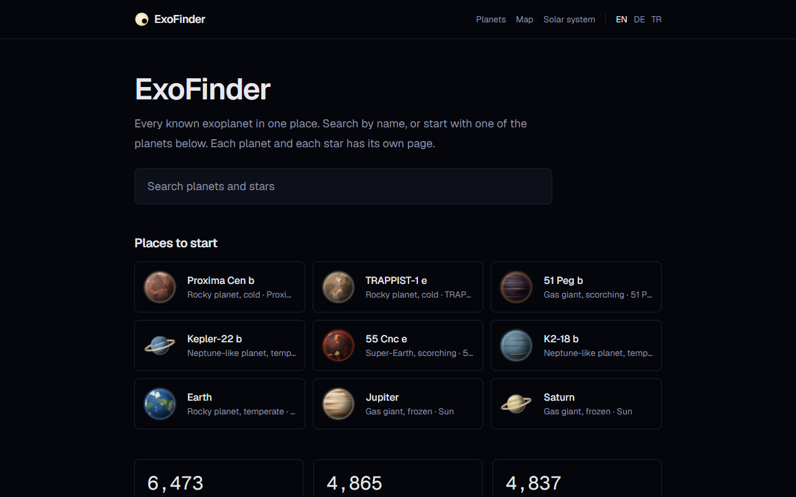
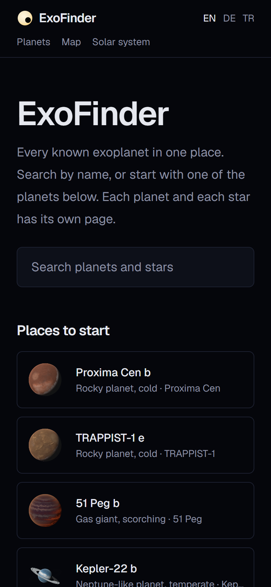

# Getting started

This page shows you the parts of ExoFinder that you see on every page, and what the start page offers.

## The bar at the top

The bar at the top is the same on every page.

| Part | What it does |
| --- | --- |
| **ExoFinder** with the logo | Takes you back to the start page. |
| **Search field** | Finds planets and stars by name. See [Searching](Searching). On the start page the search field sits in the middle of the page instead. |
| **Planets** | Opens the list of all planets. See [All planets](All-Planets). |
| **Map** | Opens the 3D map of the Milky Way. See [The map](The-Map). |
| **Solar system** | Opens the page of our Sun with its eight planets. See [Our solar system](Our-Solar-System). |
| **EN DE TR** | Shows the page you are on in English, German or Turkish. The language you read in is the bright one. |

### Languages

ExoFinder speaks English, German and Turkish.

1. Open ExoFinder. It starts in the language of your browser, or in English if your browser asks for another language.
2. To change the language, click **EN**, **DE** or **TR** at the right end of the bar. The page you are on opens again in that language.
3. The language is part of the address, for example `/de/planets/earth`. A link you share therefore opens in the language you read it in.

The planets of the solar system, the Sun and the Moon have their own names in each language, and you can search for them by those names. The names of exoplanets and stars are the same everywhere. The [catalogue as a book](The-Catalogue-as-a-Book) is in English only.

## The start page

1. Open ExoFinder. You land on the start page.
2. Type a name into the big search field, for example `Kepler`. Suggestions appear below the field.
3. Or pick one of the cards under **Places to start**. Each card is a well-known planet. Click it to open its page.
4. Scroll down to see the catalogue in numbers: how many exoplanets there are, how many stars have planets, and how many planets there are of each kind.

The line under the numbers says when the catalogue was last compared with NASA.

## On a phone

On a phone the page shows one card per row. The bar at the top has more rows: the name and the languages first, then the links **Planets**, **Map** and **Solar system**. On the other pages the search field gets its own row below them.

## Next step

Look up your first planet: [Searching](Searching).
