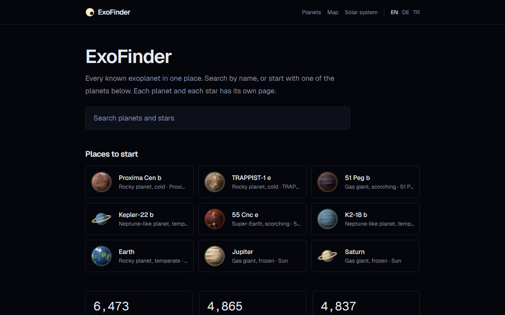

# Welcome to ExoFinder

ExoFinder shows every known exoplanet in one place. An exoplanet is a planet that circles a star other than our Sun. NASA has confirmed more than 6,000 of them, and ExoFinder has a page for each one, for each of their stars and for the planets of our own solar system.

## What you can do

| I want to … | Read this |
| --- | --- |
| find my way around the site | [Getting started](Getting-Started) |
| look up a planet or a star by name | [Searching](Searching) |
| browse the full list of planets | [All planets](All-Planets) |
| learn about one planet and turn it in 3D | [Planet pages](Planet-Pages) |
| see a star and all of its planets | [Star pages](Star-Pages) |
| compare with Earth and our neighbours | [Our solar system](Our-Solar-System) |
| fly through the Milky Way | [The map](The-Map) |
| read the whole catalogue as one PDF file | [The catalogue as a book](The-Catalogue-as-a-Book) |
| understand a word or a value | [Questions and answers](Questions-and-Answers) |

## Good to know

- You do not need an account. Everything is free to look at.
- ExoFinder works on a computer, a tablet and a phone.
- The [map](The-Map) and the 3D models need a browser with WebGL 2. All current versions of Chrome, Edge, Firefox and Safari have it.
- The data comes from the [NASA Exoplanet Archive](https://exoplanetarchive.ipac.caltech.edu/). Each time ExoFinder is compared with NASA again, new planets are added and changed values are updated.
