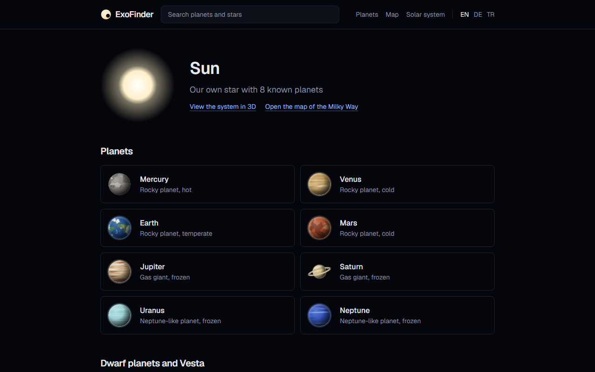
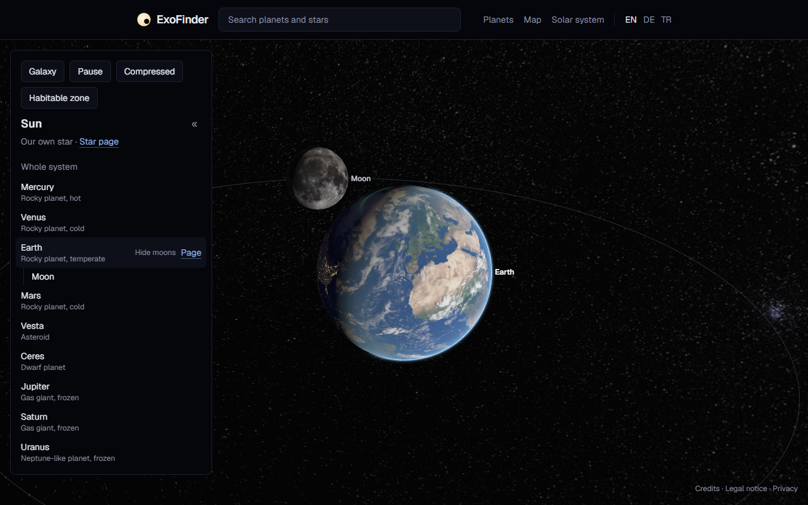

# Our solar system

ExoFinder also has our own Sun and its eight planets, from Mercury to Neptune, every one of their known moons, the dwarf planets Ceres and Pluto and the asteroid Vesta. They help you compare: is this exoplanet bigger than Earth? Hotter than Venus? Smaller than the Moon?

## Open the solar system

1. Click **Solar system** in the bar at the top.
2. The page of the **Sun** opens. It looks like every other [star page](Star-Pages).
3. Under **Planets** you see the eight planets. Click one to open its page.
4. Under **Dwarf planets and Vesta** you see Ceres, Pluto and Vesta.

## See it in 3D

1. On the page of the Sun, click **View the system in 3D**.
2. The [map](The-Map) opens with the Sun and its planets on their orbits.
3. In the list on the left, click a planet, for example **Earth**. The camera flies to it and follows it.
4. Click **Page** next to the planet to open its page.
5. When you follow a planet that has moons, its moons appear around it and in the list below its name. Click a moon to follow it.
6. Click **Whole system** to see all planets again.

## Moons and dwarf planets

Every large moon has its own page, for example the [Moon](https://www.exofinder.space/solar-system/moon), Europa or Titan, and so do the irregular moons that spacecraft measured: Phobos, Deimos, Hyperion, Phoebe and the small moons near Saturn's rings, such as Pan, Atlas, Janus and Epimetheus. A planet's page lists them under **Moons**; click **All … known moons** below them for a table of every known moon of the planet, with its size, distance, orbit and the year it was found. Most small moons are only points of light in telescopes: their sizes are estimated from their brightness and marked with ≈. The page of a moon shows:

- a 3D model made from a real map of its surface,
- what it orbits, how far away and how fast,
- its size, mass, density and surface gravity, with a size comparison against Earth,
- who discovered it and when,
- the other large moons of the same planet.

Vesta, Phobos, Deimos, Hyperion, Phoebe and the small moons of Saturn are not round. Their models show their real shape, measured by spacecraft. Where nobody has mapped a whole moon, it is shown in its colour only.

Some maps have parts that no spacecraft has seen, for example the northern half of the moons of Uranus. These parts are filled with the colours around them, without made-up craters, and the page says so below the model. Pluto and Charon are the exception: when New Horizons flew past, their south was in winter darkness, a third of each globe. A smooth fill there looked as if the globe had been cut off, so it shows craters and relief taken from the parts New Horizons saw closely. That part is an illustration, and the page says so too. Titan is covered by orange haze, so its model looks orange, as your eye would see it.

The search finds moons and dwarf planets too. Type **Ganymede** or **Pluto**.

## The belts

In the 3D view of the solar system you see the small bodies as points:

- **The asteroid belt** between Mars and Jupiter, with gaps where Jupiter's pull has cleared it, and two swarms that share Jupiter's orbit, 60 degrees ahead of it and behind it.
- **The Kuiper belt** beyond Neptune, where Pluto lives.
- **The Oort cloud**, a huge shell of icy bodies far beyond. Nobody has seen it yet; the points show where scientists expect it.

Each point stands for many real bodies. Zoom out to see the Oort cloud.

## What is different about these planets

- **Real pictures:** the 3D models of the solar system planets use real maps of their surfaces, made from spacecraft images. The exoplanets are computed pictures.
- **Values from another source:** the values come from the NASA Planetary Fact Sheet, not from the Exoplanet Archive.
- **No discovery year:** these planets have been known since ancient times, so the list shows a dash instead of a year.
- **Size comparison:** every planet page compares the planet with Earth, so you can use the eight planets as a reference.
