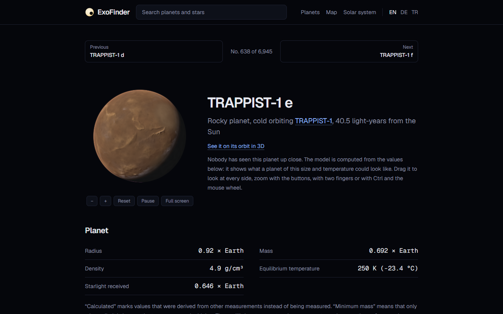
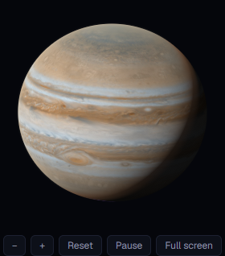
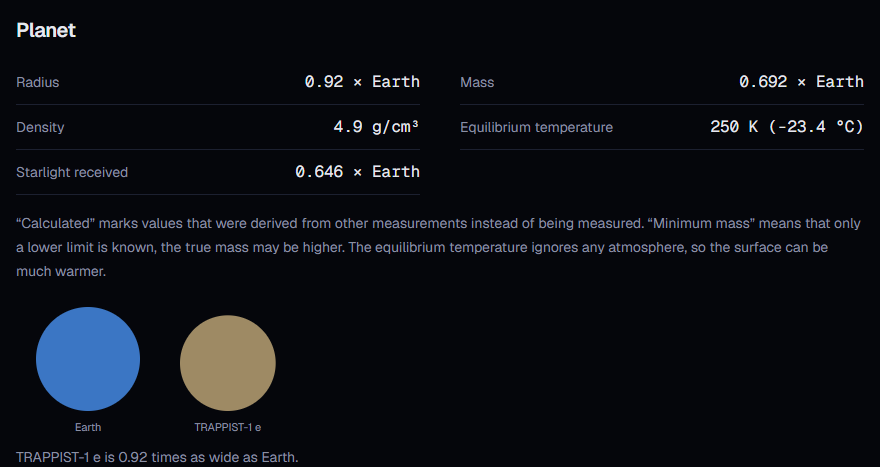
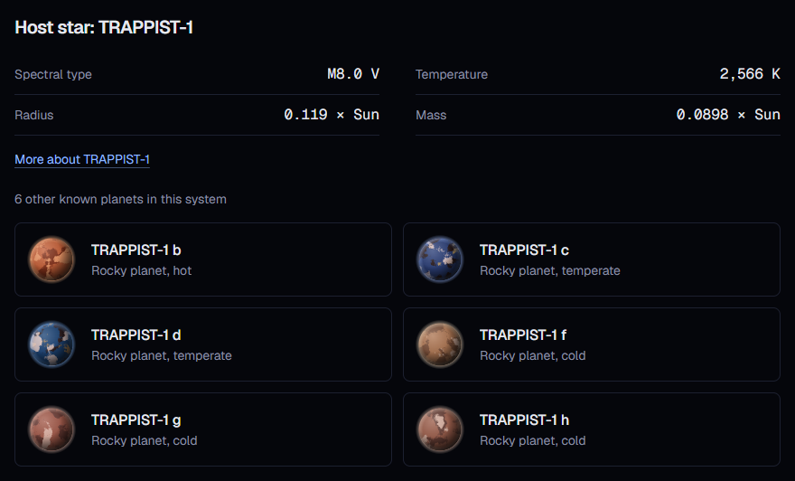

# Planet pages

Every planet has its own page. It shows a 3D model of the planet, its measured values, its orbit, how it was found and its star.

To open a planet page, click a planet anywhere in ExoFinder: in the [search](Searching), in the [list of all planets](All-Planets), on a [star page](Star-Pages) or in the [map](The-Map).

## The top of the page

| Part | What it tells you |
| --- | --- |
| **Name** | The name of the planet, for example TRAPPIST-1 e. |
| **Line below the name** | What kind of planet it is (for example rocky planet, gas giant), how warm it is (see [Questions and answers](Questions-and-Answers)), which star it circles and how far away that star is. Click the star's name to open its page. |
| **See it on its orbit in 3D** | Opens the [map](The-Map) with this planet's system and flies to the planet. |
| **Formerly listed as** | Only shown if the planet had another name before. |

## Browse from planet to planet

Above the name, two links lead through the whole catalogue like the pages of a book.

1. Click **Next** to open the next planet, and **Previous** to go back. The left and right arrow keys do the same.
2. Within a system the planets come from the inside out. After the outermost planet, **Next** leads to the innermost planet of the next system farther from the Sun; the link then names that system and its distance.
3. Between the two links you see the number of the planet in the catalogue, for example **No. 512 of 6,584**.

The catalogue starts with our solar system, from Mercury outwards, with every moon after its planet. After the last moon of Pluto comes the nearest exoplanet. Systems whose distance is not known come last, and planets that NASA removed are left out.

> **The arrow keys turn the model instead?** Then the 3D model has the focus. Click an empty part of the page and try again.

## Turn and zoom the 3D model

The model turns slowly by itself. You can also move it by hand.

1. **Turn it:** click the model, hold the mouse button and drag. On a phone, drag with one finger. You can look at every side, also the night side.
2. **Zoom in and out:** click **+** and **−**. Or hold **Ctrl** and turn the mouse wheel. On a phone, spread or pinch two fingers.
3. **Start over:** click **Reset** to go back to the first view.
4. **Stop the turning:** click **Pause**. Click **Spin** to let it turn again.
5. **See it big:** click **Full screen**. Press **Esc** to leave full screen.

**With the keyboard:** click the model first. Then the arrow keys turn it, **+** and **−** zoom, and **0** resets it.

> **Is it a photo?** For the planets of our solar system, yes, almost: the model uses real maps made from spacecraft images. Nobody has seen an exoplanet up close. Their models are computed from the measured values and show what a planet of this size and temperature could look like.

## The values of the planet

Scroll down to the section **Planet**.

| Value | What it means |
| --- | --- |
| **Radius** | How wide the planet is, compared with Earth. `2 × Earth` means twice as wide. |
| **Mass** | How heavy the planet is, compared with Earth. |
| **Density** | How compact it is. Rock is around 3 to 5 g/cm³, gas giants are around 1. |
| **Equilibrium temperature** | How warm the planet would be from its starlight alone, in Kelvin and °C. |
| **Starlight received** | How much light from its star reaches the planet, compared with what Earth gets from the Sun. |

Some values have a small note next to them:

- **calculated** means the value was worked out from other values instead of being measured.
- **minimum mass** means only the lowest possible mass is known. The real mass may be higher.

Below the values two circles compare the size of the planet with Earth.

## Orbit and discovery

- **Orbital period:** how long one trip around the star takes, its "year".
- **Distance from the star:** in AU. 1 AU is the distance from Earth to the Sun.
- **Eccentricity:** how round the orbit is. 0 is a perfect circle, values close to 1 are long ovals.
- **Discovery:** the method, the year and the telescope or observatory that found the planet. Not shown for the planets of our solar system.

## The host star and its other planets

The section **Host star** shows the most important values of the star. **More about …** opens the [star page](Star-Pages). Below that you see the other planets of the same system. Click one to open its page.

## Change history

When NASA changes a value of the planet, ExoFinder records it. The table **Change history** at the end of the page shows the date, the value, what it was before and what it is now. You only see this table if something has changed.

## Planets that NASA removed

Sometimes NASA takes a planet off its list of confirmed planets. Its page stays, with a notice at the top. The values are the last ones that were known.

## Next step

See the star and all of its planets together: [Star pages](Star-Pages).
