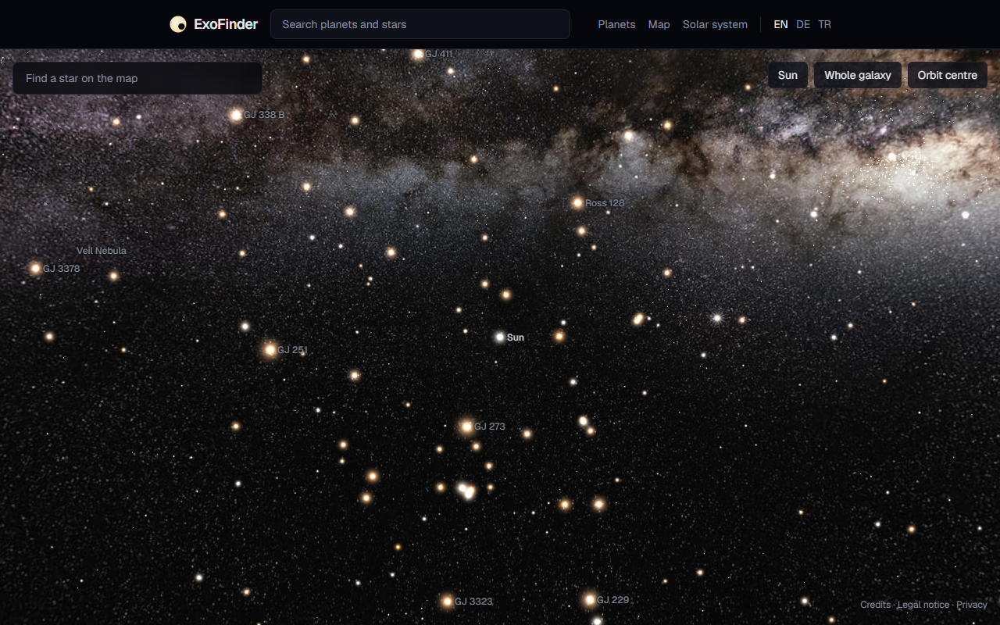
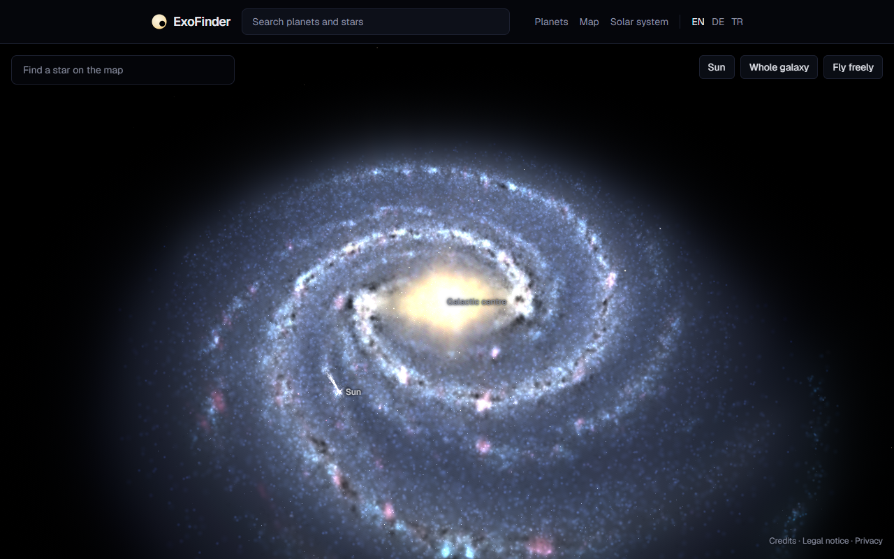
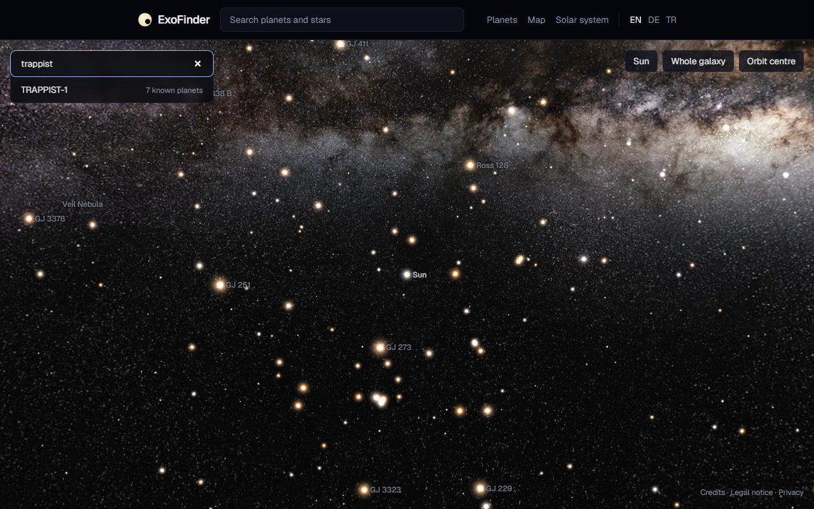
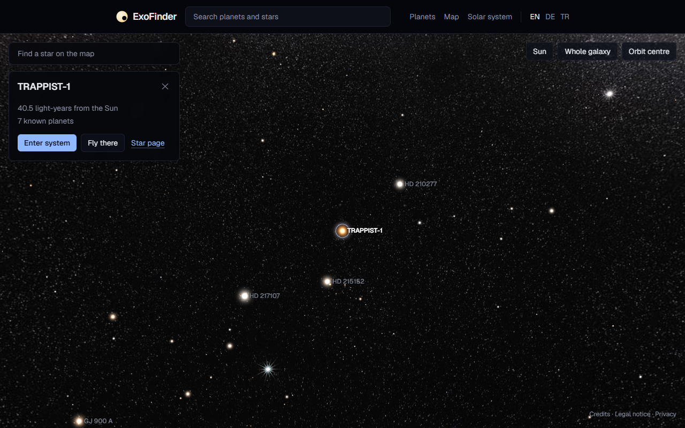
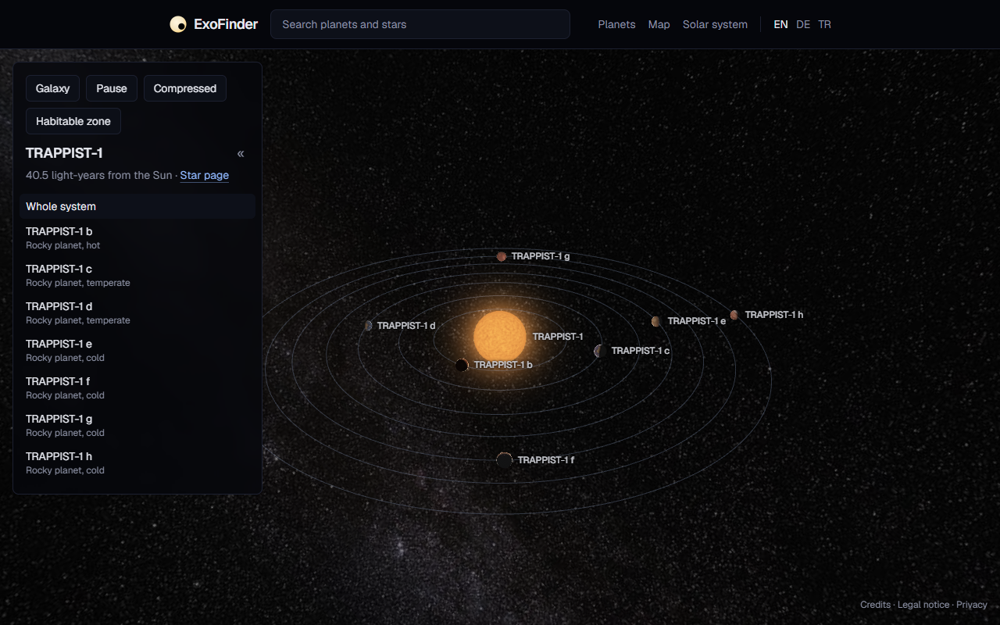

# The map

The map is a 3D model of the Milky Way. Every star with known planets sits at its real position. You can fly from star to star and enter a system to see its planets on their orbits.

The map needs a browser with WebGL 2. All current versions of Chrome, Edge, Firefox and Safari have it.

## Open the map

1. Click **Map** in the bar at the top.
2. The map opens near our Sun. The stars around you are stars with planets. The band of light in the background is the Milky Way, seen from Earth.

## Look around and move

**With a mouse and keyboard**

| To … | do this |
| --- | --- |
| look around | hold the mouse button and drag |
| fly forwards or backwards | turn the mouse wheel |
| fly in any direction | press **W** (forwards), **A** (left), **S** (back), **D** (right) |
| fly up or down | press **E** (up) or **Q** (down) |
| fly faster | hold **Shift** while you fly |

**On a phone or tablet:** drag with one finger to look around, pinch with two fingers to fly.

The buttons in the top right corner bring you to two fixed places:

- **Sun** flies back to our Sun.
- **Whole galaxy** flies far out, so you see the whole Milky Way from above. From there the centre of the galaxy stays in the middle of the view: drag to turn the galaxy round it, scroll to come nearer or go further away, as in a star system.
- **Orbit centre** makes the centre of the Milky Way that fixed point from wherever you are. Click **Fly freely** to fly on your own again; flying to a star or to the Sun does that too.

Nobody can look at the Milky Way from outside, so its shape comes from an artist's impression that Robert Hurt drew for NASA from what the surveys of its stars and gas show. From afar the map does not show that picture itself: it builds the galaxy after it from clouds of stars, glowing gas, star clusters and dust, with a thin layer of arms, a thick glowing disc and a bulge in the middle. Its height is drawn larger than it is, so that you can see it as a body. The positions of the stars with planets are measured.

When you fly away from the Sun, more stars appear around you: red dwarfs close by, stars like the Sun a little further, bright giants far away. They are not real stars from a catalogue. The map computes them from how crowded the Milky Way is at that place, so the arms are full of stars and the space between them is emptier. Only the stars with planets are real.

Some famous sights are marked when you come near them: glowing clouds of gas such as the Orion Nebula, the shells of dying stars such as the Ring Nebula, young star clusters such as the Pleiades, old globular clusters such as Omega Centauri, and far outside the Milky Way the two Magellanic Clouds, small galaxies that circle ours.

## Find a star

1. Click into the field **Find a star on the map** in the top left corner.
2. Type a part of the star's name, for example `trappist`.
3. Click the star in the list, or press **Enter** for the first one.
4. The camera flies to the star and selects it.

You can also click a star directly on the map to select it. Double-click it to fly there.

## A selected star

When a star is selected, a box appears in the top left corner. It shows the star's name, its distance from the Sun and how many planets it has.

| Button | What it does |
| --- | --- |
| **Enter system** | Goes inside the system and shows the star with its planets. |
| **Fly there** | Flies to the star, without going inside. |
| **Star page** | Opens the [page of the star](Star-Pages). |
| **✕** | Clears the selection. **Esc** does the same. |

## Inside a system

After **Enter system** you see the star in the middle and its planets on their orbits. The planets move around the star.

1. **Turn the view:** hold the mouse button and drag.
2. **Zoom:** turn the mouse wheel. On a phone, pinch with two fingers.
3. **Follow a planet:** click it on the map or in the list on the left. The camera flies to the planet and stays with it.
4. **Open its page:** click **Page** next to the planet in the list.
5. **Follow a moon:** in the solar system the moons of the planet you follow appear around it and below its name in the list, the large ones first, then every smaller one. The other planets make way meanwhile. Click any moon to follow it. **Hide moons** in the row of the planet switches them off. Most small moons were never seen up close: when you follow one, its shape and surface are an illustration, and the list says so. To enjoy the view without the panel, **«** next to the star's name folds it away and **» Show panel** brings it back.
6. **See everything again:** click **Whole system** at the top of the list.
7. **Stop the movement:** click **Pause**. Click **Play** to go on.
8. **Change the scale:** the button next to **Pause** names the scale you see, **Compressed** or **True scale**. Click it to switch. In the true scale the planets shrink to dots far apart, and every body stays at least a few pixels wide so that you can still find it.
9. **Show the habitable zone:** click **Habitable zone**. A faint green band appears around the star, and the panel names its distances. In the list, a green dot marks every planet that circles in the zone, and a green ring every planet at its edge. Click the button again to hide the band.
10. **Leave the system:** click **Galaxy** or press **Esc**.

On a phone the list of planets is folded away so that it does not cover the view. Tap the button with the planet's name to open it.

> **Two scales.** At first the planets are drawn much bigger than they really are, and the orbits are pushed closer together, so that you can see all of them at once. **True scale** shows the real proportions instead, for the planets and for the moons of the planet you follow alike.

> **The habitable zone.** This is the range of distances at which a rocky planet with an atmosphere could keep liquid water on its surface: closer to the star the water boils away, farther out it freezes. The two thin lines are the cautious limits, and the band fades beyond them to the most generous ones. Nobody knows whether a planet in the zone really has water, or life; the zone only says that the starlight would allow it. For some stars the temperature or the size is not known, and then the button cannot be used.

## Jump into the map from other pages

You do not have to search the map yourself. These links take you straight to the right place:

- On a **planet page**: **See it on its orbit in 3D**
- On a **star page**: **View the system in 3D** or **Find it on the map**
